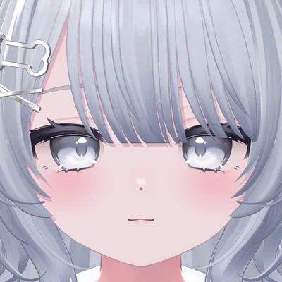
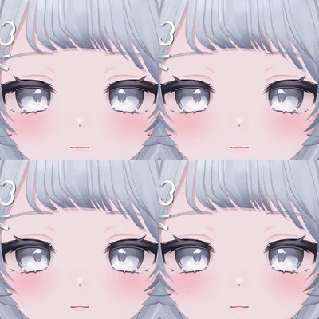
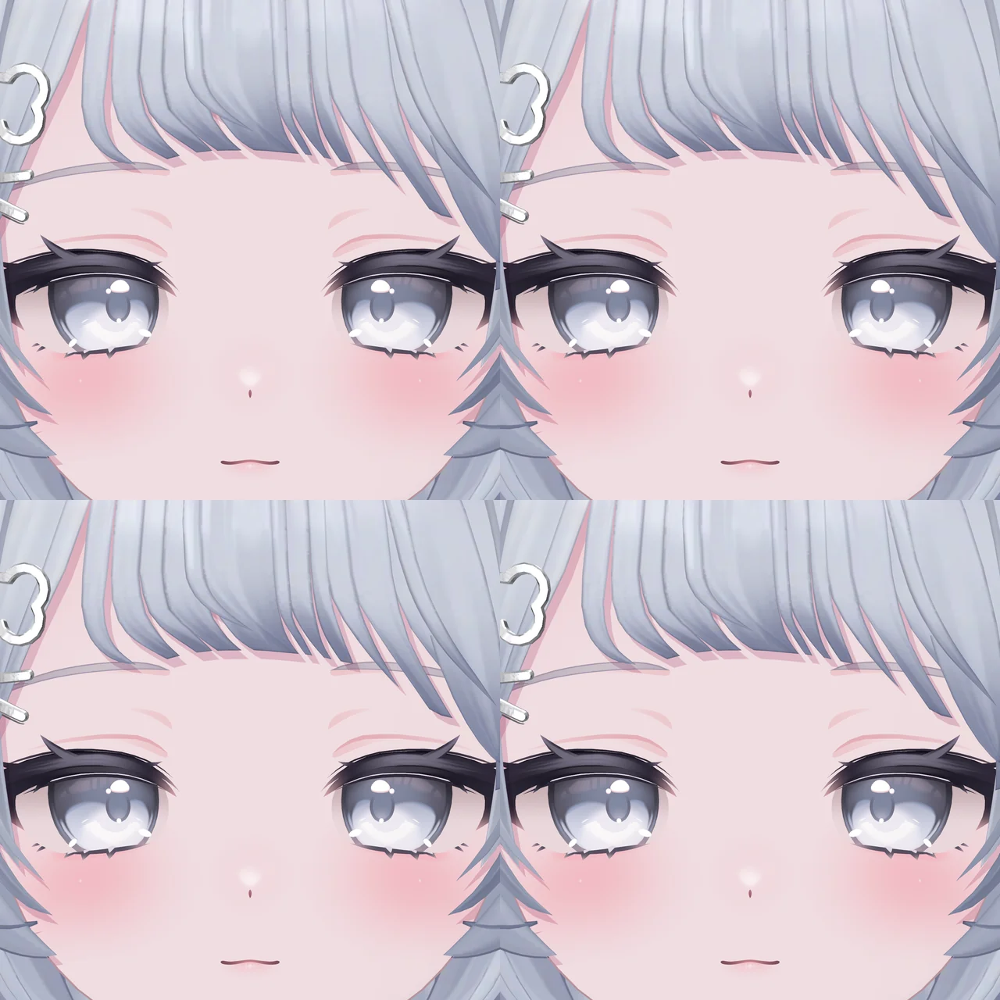
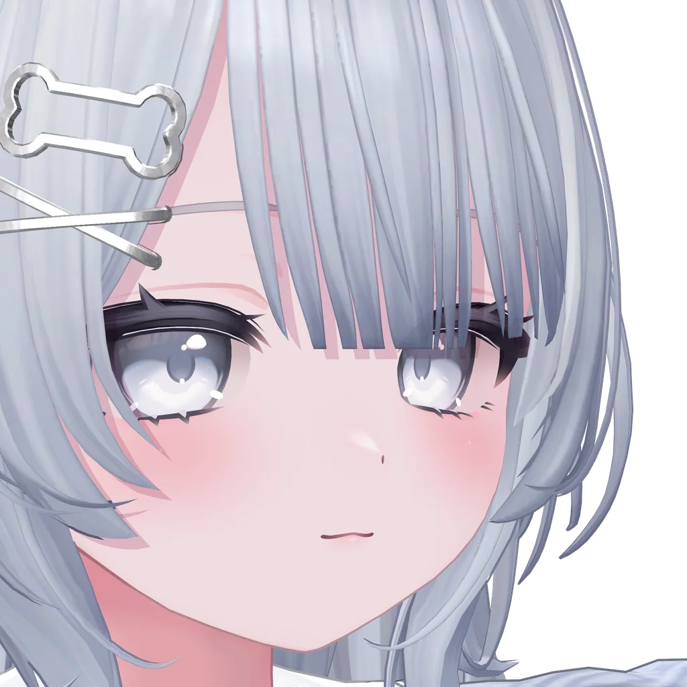
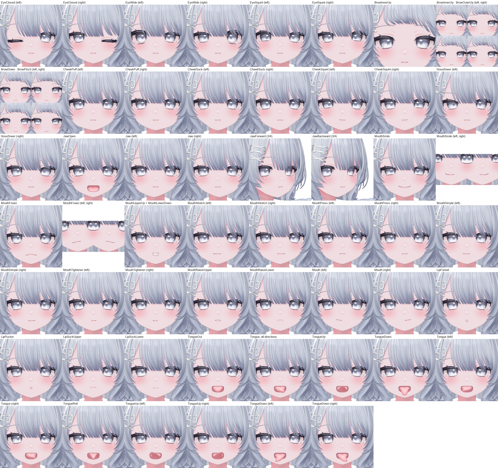
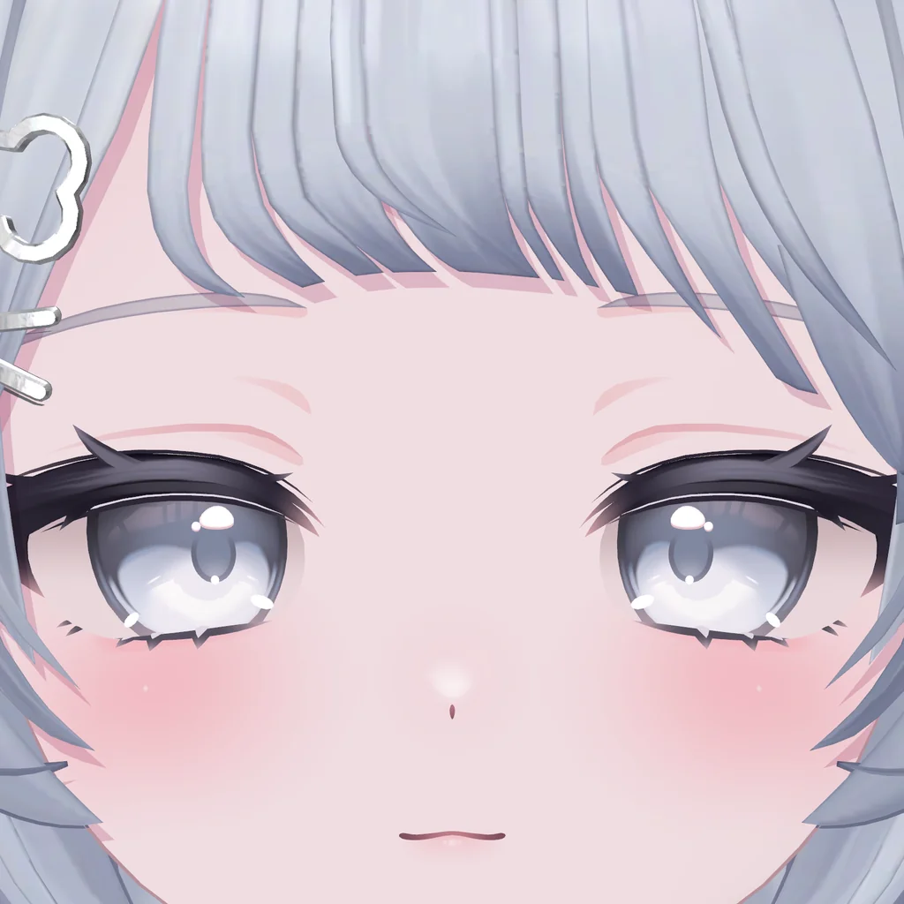
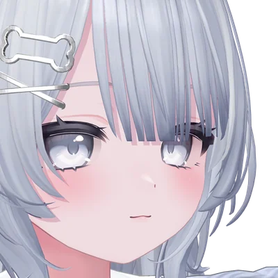
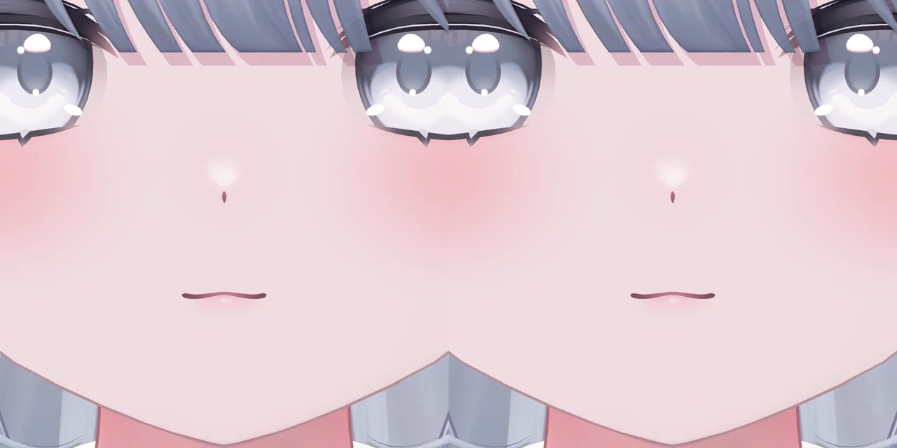
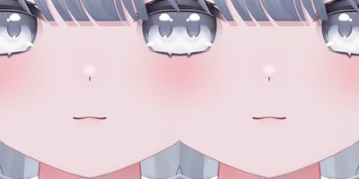
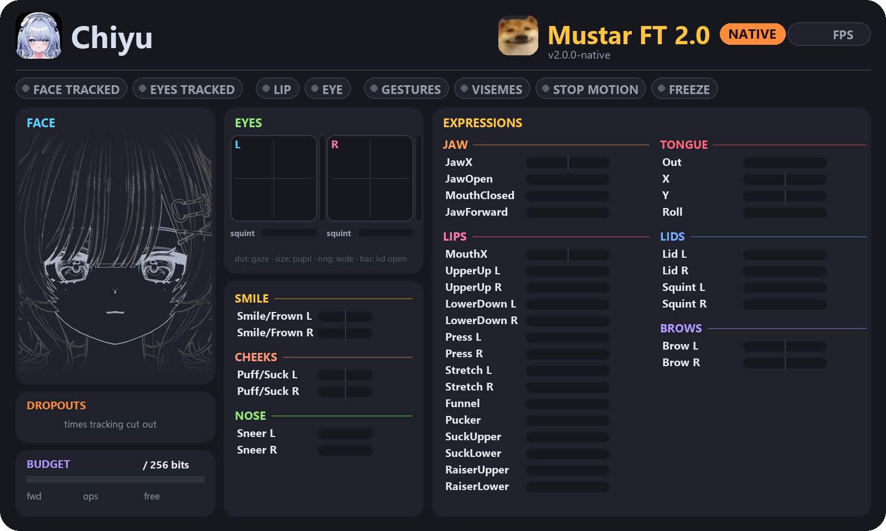

<a href="README.md">English</a> · <b>日本語</b> · <a href="README.zh.md">中文</a>

<h1 align="center">Chiyu Face Tracking</h1>

mFT v2.0.0-native for <b>ちゆ - Chiyu by plium</b>

<a href="https://mustarlabs.booth.pm/items/9078058">mFT on BOOTH</a> · <a href="https://booth.pm/en/items/8942824">ちゆ - Chiyu by plium</a> · <a href="https://youtu.be/25gfjd5u3mI">Demo video</a>

## Expressions

FT shapes, each looping 0 → 1 → 0. Left and right are as you look at the avatar (its own left shows on your right).  
FT シェイプ (0 → 1 → 0)。左右は見ている人から見た向き。

<table>
<tr><td align="center"> EyeClosed (left)</td><td align="center"> EyeWide (left)</td><td align="center"> EyeSquint (left)</td><td align="center"> BrowInnerUp · BrowOuterUp (left, right)</td></tr>
<tr><td align="center"> BrowDown · BrowPinch (left, right)</td><td align="center"> CheekPuff (left)</td><td align="center"> JawOpen</td><td align="center"> JawForward (3/4)</td></tr>
<tr><td align="center"> MouthSmile</td><td align="center"> MouthFrown</td><td align="center"> MouthUpperUp + MouthLowerDown</td><td align="center"> Mouth (right)</td></tr>
<tr><td align="center"> LipPucker</td><td align="center"> LipFunnel</td><td align="center"> TongueOut</td><td align="center"> Tongue, all directions</td></tr>
</table>

### All shapes / 全シェイプ

Eyes (6)

<table>
<tr><td align="center"> EyeClosed (left)</td><td align="center"> EyeClosed (right)</td><td align="center"> EyeWide (left)</td><td align="center"> EyeWide (right)</td></tr>
<tr><td align="center"> EyeSquint (left)</td><td align="center"> EyeSquint (right)</td></tr>
</table>

Brows (3)

<table>
<tr><td align="center"> BrowInnerUp</td><td align="center"> BrowInnerUp · BrowOuterUp (left, right)</td><td align="center"> BrowDown · BrowPinch (left, right)</td></tr>
</table>

Cheeks and nose (8)

<table>
<tr><td align="center"> CheekPuff (left)</td><td align="center"> CheekPuff (right)</td><td align="center"> CheekSuck (left)</td><td align="center"> CheekSuck (right)</td></tr>
<tr><td align="center"> CheekSquint (left)</td><td align="center"> CheekSquint (right)</td><td align="center"> NoseSneer (left)</td><td align="center"> NoseSneer (right)</td></tr>
</table>

Jaw (5)

<table>
<tr><td align="center"> JawOpen</td><td align="center"> Jaw (left)</td><td align="center"> Jaw (right)</td><td align="center"> JawForward (3/4)</td></tr>
<tr><td align="center"> JawBackward (3/4)</td></tr>
</table>

Mouth (17)

<table>
<tr><td align="center"> MouthSmile</td><td align="center"> MouthSmile (left, right)</td><td align="center"> MouthFrown</td><td align="center"> MouthFrown (left, right)</td></tr>
<tr><td align="center"> MouthUpperUp + MouthLowerDown</td><td align="center"> MouthStretch (left)</td><td align="center"> MouthStretch (right)</td><td align="center"> MouthPress (left)</td></tr>
<tr><td align="center"> MouthPress (right)</td><td align="center"> MouthDimple (left)</td><td align="center"> MouthDimple (right)</td><td align="center"> MouthTightener (left)</td></tr>
<tr><td align="center"> MouthTightener (right)</td><td align="center"> MouthRaiserUpper</td><td align="center"> MouthRaiserLower</td><td align="center"> Mouth (left)</td></tr>
<tr><td align="center"> Mouth (right)</td></tr>
</table>

Lips (4)

<table>
<tr><td align="center"> LipFunnel</td><td align="center"> LipPucker</td><td align="center"> LipSuckUpper</td><td align="center"> LipSuckLower</td></tr>
</table>

Tongue (11)

<table>
<tr><td align="center"> TongueOut</td><td align="center"> Tongue, all directions</td><td align="center"> TongueUp</td><td align="center"> TongueDown</td></tr>
<tr><td align="center"> Tongue (left)</td><td align="center"> Tongue (right)</td><td align="center"> TongueRoll</td><td align="center"> TongueUp (left)</td></tr>
<tr><td align="center"> TongueUp (right)</td><td align="center"> TongueDown (left)</td><td align="center"> TongueDown (right)</td></tr>
</table>

## 日本語

### 概要

- ちゆの口、目、舌、頬、眉があなたの顔に合わせて動きます。彼女のために作ったシェイプ 67 個。
- 本物のアイボーンで視線が動き、外側 28°、内側 22°、上下 14°。
- アニメモード: 顔がポーズを保ち 1 秒に 8 回切り替わり、口は声に合わせてパキッと動きます。
- ボタンひとつで導入。元のファイルには触りません。
- ちゆ本体とフェイストラッキング機器は含まれません。

ちゆには plium さんのフェイストラッキングも付属しています。mFT は、より幅広いツールと豊かな表現力を求める人のための選択肢です。

### 数字とその意味

| 数字 | 意味 |
|---|---|
| 自分 +0.28 ms、他の人 +0.27 ms (ネイティブ) | 1 フレームあたりの追加負荷。従来版は自分 +0.33 ms、他の人 +0.33 ms。彼女自身の FX は約 0.22 ms。 |
| 220 / 256 (ネイティブ)、253 / 256 (従来版) | 同期パラメーター。ネイティブ: 彼女自身の 181 + 追加機能 39 (Full) または 10 (Light、合計 191)。顔の動き自体は 0 bit。 |
| シェイプ 84 個 + 彼女の 1,133 個 | 67 個は FT 用、15 個はビゼーム 35%、2 個は瞳。彼女のシェイプは 1 つも消しません。 |
| 舌 10 ポーズ | 上下左右、斜め、丸め。舌出しは 4 段階で伸びます。 |
| パッケージ 2.4 MB | 差分データのみ。アバター本体のデータは入っていません。 |

### 中身

- ワールド内キャリブレーションと微調整ダイヤル 7 種。
- デバッグパネル: 顔、目、全表情の値をその場で表示。左手首のボタンで開閉。
- スムージング Off / 5〜30 ms、または Stop Motion。設定は見ている人にも同じに映ります。
- FT anime visemes: 声で口がパキッと切り替わり、トラッキングの口に重なります。
- 表情キープ (Freeze)、瞳 (エミュレート / トラッカー)、目が表情に反応 (笑顔、にらみ、下を見る)。
- エモート 11 種 (ネイティブ): 猫目、うるうる、キラキラ、涙、青ざめ、白目、ショック、ほっぺ、照れ、ぐるぐる、ハート。
- PaperTrackerMode: Paper Tracker でファンネルとパッカーが同時に出るとき、強い方だけを使います。

### アバターで変わること

- Gimmick > Face は外れ、もぐもぐ 2 種とナデナデは Extras > Emotes_Vendors に移ります。
- 彼女の自動まばたきは視線トラッキング中は止まり、切ると戻ります。頭なで顔と AFK はそのままです。
- ハンドジェスチャーの表情は初期 OFF (メニューで ON)。
- リップシンクはコピー側で私のレイヤーが動かします。アンインストールで元に戻ります。
- 衣装、髪、小物のメニューはそのまま使えます。

### 弱点

- ちゆ専用。PC で確認、Quest は未検証。
- 従来版は枠に収めるため、Standing / Crouching / Prone / Floating のポーズ切替とエモートが入りません。Breast_Size と Mogumogu_Type は 5 段階になります。ネイティブは全部入ります。
- キャリブレーションと Tune は保存されますが、アバターのリセットでは初期値に戻ります。
- ちゆの更新で顔のメッシュが変わると、対応版が必要です。

### 必要なもの

ちゆ、VRChat SDK (3.10.6 以降)、VRCFT、VRCFT (Unified Expressions) で動くフェイストラッカー。ちゆ本体の導入は plium さんの説明書に従ってください (Modular Avatar、lilToon)。

### 技術的な詳細

- 負荷の測り方: Unity 上で彼女の FX と完成した FX を比較、10 フレームの実行を繰り返した最速値 (2026-11-03)。誤差は約 15%。
- 顔メッシュ 12,915 頂点。ちゆ 1.0.0 で確認。
- デルタ法線はゼロ: 彼女のフラットな顔の陰影を崩しません。
- 舌のシェイプは舌だけを動かし、顎と舌が両方上がったときだけ補正が入ります (0 bit)。
- ネイティブの式の命令 325 / 2048。

---

> **Mustard Awards**  
> **Chiyu: 8.5 / 10 mustard cans.**  
> How well the model behaved on the way to face tracking. Higher is better.  
> Plus: near seamless. 1,133 shapes with clean left/right splits, real eye bones, and a tidy, well-built face mesh that stayed identical from pre-release to launch.  
> Minus: her tongue could have more verts.

## デバッグパネル

