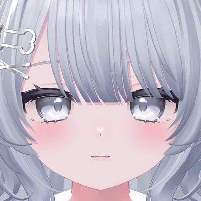
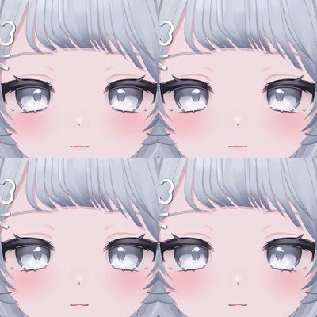
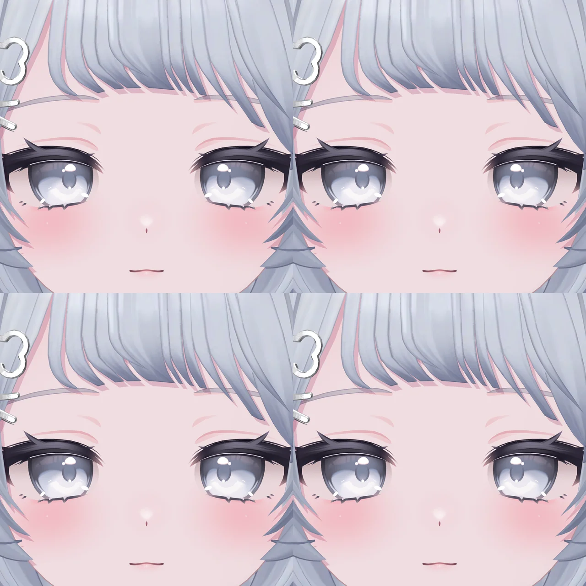
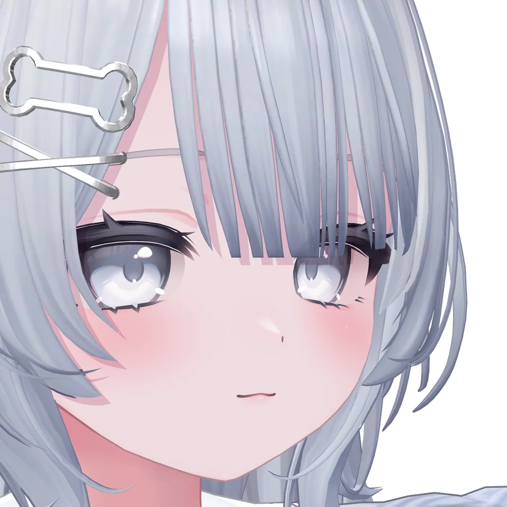
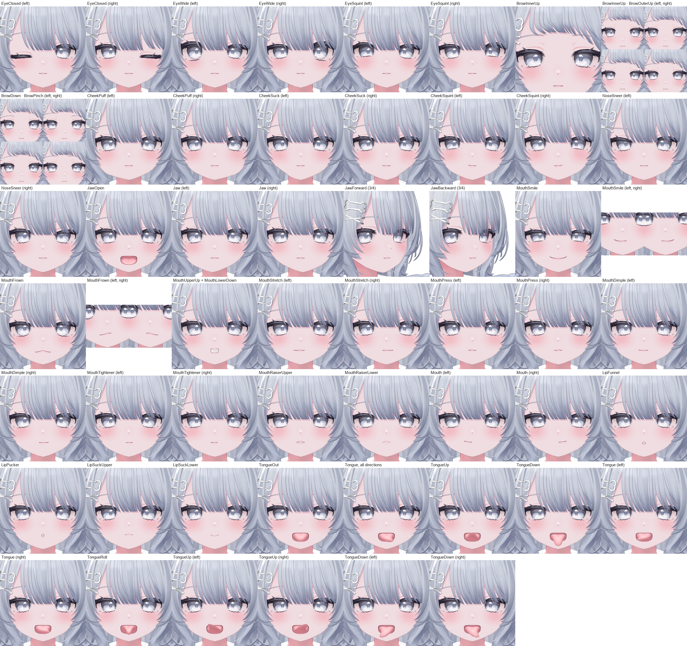
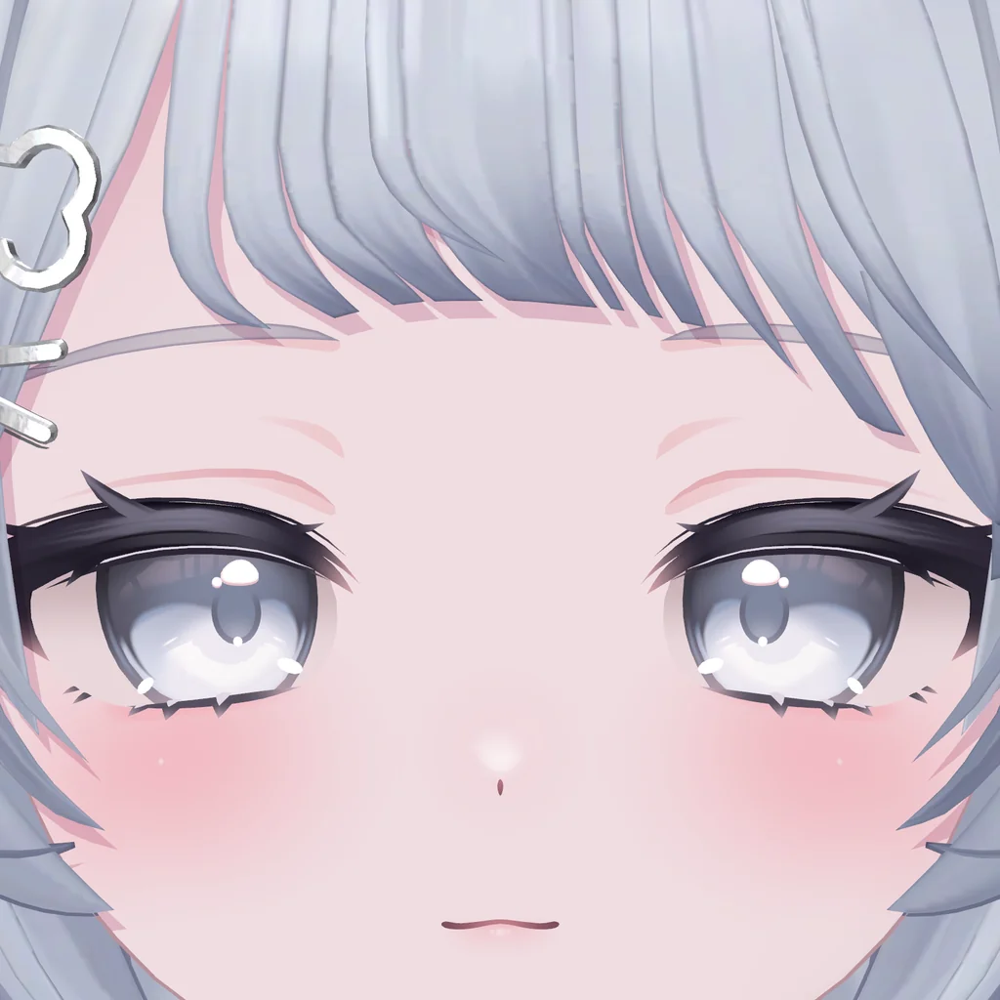
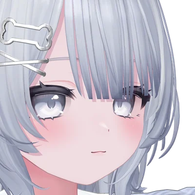
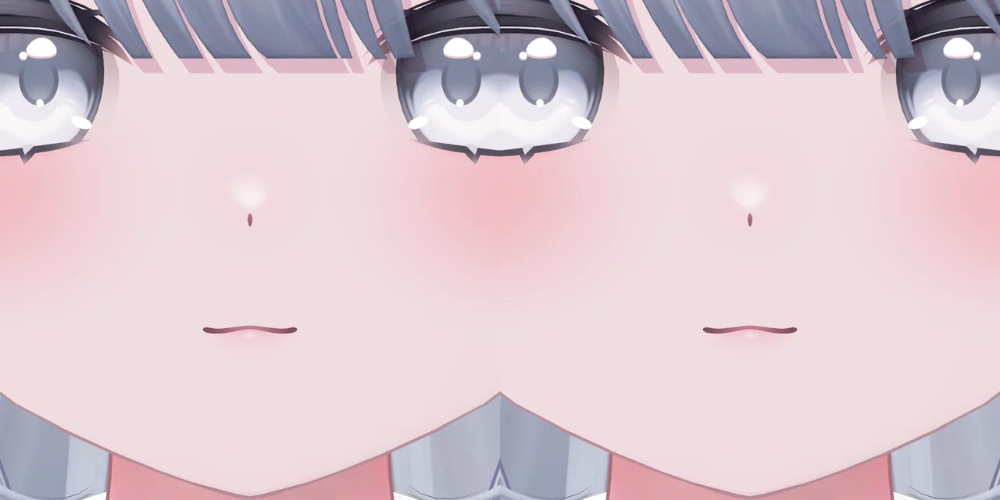
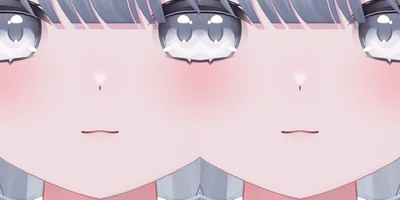
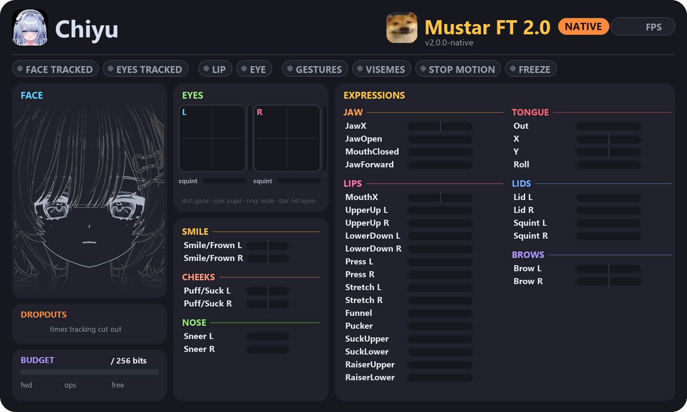

<a href="README.md">English</a> · <a href="README.ja.md">日本語</a> · <b>中文</b>

<h1 align="center">Chiyu Face Tracking</h1>

mFT v2.0.0-native for <b>ちゆ - Chiyu by plium</b>

<a href="https://mustarlabs.booth.pm/items/9078058">mFT on BOOTH</a> · <a href="https://booth.pm/en/items/8942824">ちゆ - Chiyu by plium</a> · <a href="https://youtu.be/25gfjd5u3mI">Demo video</a>

## Expressions

FT shapes, each looping 0 → 1 → 0. Left and right are as you look at the avatar (its own left shows on your right).  
FT シェイプ (0 → 1 → 0)。左右は見ている人から見た向き。

<table>
<tr><td align="center"> EyeClosed (left)</td><td align="center"> EyeWide (left)</td><td align="center"> EyeSquint (left)</td><td align="center"> BrowInnerUp · BrowOuterUp (left, right)</td></tr>
<tr><td align="center"> BrowDown · BrowPinch (left, right)</td><td align="center"> CheekPuff (left)</td><td align="center"> JawOpen</td><td align="center"> JawForward (3/4)</td></tr>
<tr><td align="center"> MouthSmile</td><td align="center"> MouthFrown</td><td align="center"> MouthUpperUp + MouthLowerDown</td><td align="center"> Mouth (right)</td></tr>
<tr><td align="center"> LipPucker</td><td align="center"> LipFunnel</td><td align="center"> TongueOut</td><td align="center"> Tongue, all directions</td></tr>
</table>

### All shapes / 全シェイプ

Eyes (6)

<table>
<tr><td align="center"> EyeClosed (left)</td><td align="center"> EyeClosed (right)</td><td align="center"> EyeWide (left)</td><td align="center"> EyeWide (right)</td></tr>
<tr><td align="center"> EyeSquint (left)</td><td align="center"> EyeSquint (right)</td></tr>
</table>

Brows (3)

<table>
<tr><td align="center"> BrowInnerUp</td><td align="center"> BrowInnerUp · BrowOuterUp (left, right)</td><td align="center"> BrowDown · BrowPinch (left, right)</td></tr>
</table>

Cheeks and nose (8)

<table>
<tr><td align="center"> CheekPuff (left)</td><td align="center"> CheekPuff (right)</td><td align="center"> CheekSuck (left)</td><td align="center"> CheekSuck (right)</td></tr>
<tr><td align="center"> CheekSquint (left)</td><td align="center"> CheekSquint (right)</td><td align="center"> NoseSneer (left)</td><td align="center"> NoseSneer (right)</td></tr>
</table>

Jaw (5)

<table>
<tr><td align="center"> JawOpen</td><td align="center"> Jaw (left)</td><td align="center"> Jaw (right)</td><td align="center"> JawForward (3/4)</td></tr>
<tr><td align="center"> JawBackward (3/4)</td></tr>
</table>

Mouth (17)

<table>
<tr><td align="center"> MouthSmile</td><td align="center"> MouthSmile (left, right)</td><td align="center"> MouthFrown</td><td align="center"> MouthFrown (left, right)</td></tr>
<tr><td align="center"> MouthUpperUp + MouthLowerDown</td><td align="center"> MouthStretch (left)</td><td align="center"> MouthStretch (right)</td><td align="center"> MouthPress (left)</td></tr>
<tr><td align="center"> MouthPress (right)</td><td align="center"> MouthDimple (left)</td><td align="center"> MouthDimple (right)</td><td align="center"> MouthTightener (left)</td></tr>
<tr><td align="center"> MouthTightener (right)</td><td align="center"> MouthRaiserUpper</td><td align="center"> MouthRaiserLower</td><td align="center"> Mouth (left)</td></tr>
<tr><td align="center"> Mouth (right)</td></tr>
</table>

Lips (4)

<table>
<tr><td align="center"> LipFunnel</td><td align="center"> LipPucker</td><td align="center"> LipSuckUpper</td><td align="center"> LipSuckLower</td></tr>
</table>

Tongue (11)

<table>
<tr><td align="center"> TongueOut</td><td align="center"> Tongue, all directions</td><td align="center"> TongueUp</td><td align="center"> TongueDown</td></tr>
<tr><td align="center"> Tongue (left)</td><td align="center"> Tongue (right)</td><td align="center"> TongueRoll</td><td align="center"> TongueUp (left)</td></tr>
<tr><td align="center"> TongueUp (right)</td><td align="center"> TongueDown (left)</td><td align="center"> TongueDown (right)</td></tr>
</table>

## 中文

### 简介

- ちゆ的嘴、眼睛、舌头、脸颊和眉毛随你的脸而动。为她制作了 67 个形态键。
- 视线使用她真实的眼骨：向外 28°，向内 22°，上下 14°。
- 动画模式：脸保持姿势，每秒跳变 8 次，嘴随声音利落切换。
- 一键安装。绝不改动原始文件。
- 不含 ちゆ 本体和面捕设备。

ちゆ 也自带 plium 制作的面捕。mFT 是给想要更丰富工具和更强表现力的人的选择。

### 数字及其含义

| 数字 | 含义 |
|---|---|
| 自己 +0.28 ms，他人 +0.27 ms (原生) | 每帧增加的开销。经典版：自己 +0.33 ms，他人 +0.33 ms。她自身的 FX 约 0.22 ms。 |
| 220 / 256 (原生)，253 / 256 (经典) | 同步参数。原生：她自身的 181 + 附加功能 39 (Full) 或 10 (Light，合计 191)。面部本身 0 bit。 |
| 84 个形态键 + 她的 1,133 个 | 67 个面捕，15 个 35% 视位，2 个瞳孔。她的形态键一个都不删。 |
| 舌头 10 个姿势 | 上下左右、斜向、卷舌。伸舌分 4 段伸出。 |
| 安装包 2.4 MB | 只有差异数据，不含模型数据。 |

### 内容

- 游戏内校准和 7 个微调旋钮。
- 调试面板：实时显示脸、眼睛和所有表情数值。左手腕的按钮可开关。
- 平滑 关闭 / 5 到 30 ms，或 Stop Motion。他人看到的与你的设置相同。
- FT anime visemes：嘴随声音利落切换，叠加在追踪之上。
- 冻结、瞳孔 (模拟 / 追踪器)，眼睛随表情反应 (微笑、瞪眼、向下看)。
- 11 个表情 (原生)：猫眼、泪眼、闪亮、眼泪、脸色发青、白眼、震惊、脸颊、害羞、晕眩、爱心。
- PaperTrackerMode：Paper Tracker 同时触发 funnel 和 pucker 时，只用较强的一个。

### 模型上的变化

- Gimmick > Face 移除，Mogumogu (两项) 和 NadeNade 移到 Extras > Emotes_Vendors。
- 视线追踪开启时她的自动眨眼暂停，关闭后恢复。摸头表情和 AFK 保留。
- 手势表情默认关闭 (菜单开关)。
- 副本上的口型同步由我的层驱动，卸载后恢复。
- 服装、头发和道具菜单照常使用。

### 缺点

- 仅限 ちゆ。已在 PC 测试，Quest 未测试。
- 为了放得下，经典版没有 Standing / Crouching / Prone / Floating 姿势切换和表情，Breast_Size 和 Mogumogu_Type 变为 5 档。原生版全都有。
- 校准和 Tune 会保存，但重置模型会恢复默认。
- 如果 ちゆ 更新改变了脸部网格，需要更新版本。

### 需要

ちゆ、VRChat SDK (3.10.6 或更新)、VRCFT，以及支持 VRCFT (Unified Expressions) 的面捕设备。ちゆ 本体请按 plium 的说明书操作 (Modular Avatar、lilToon)。

### 技术细节

- 开销测量：在 Unity 中比较她的 FX 与构建后的 FX，取重复 10 帧运行的最快值 (2026-11-03)。误差约 15%。
- 脸部网格 12,915 顶点。已在 ちゆ 1.0.0 上确认。
- 法线增量为零，她扁平的脸部阴影保持干净。
- 舌头形态键只移动舌头；只有下巴和舌头都抬起时才触发小修正 (0 bit)。
- 原生：表达式指令 325 / 2048。

---

> **Mustard Awards**  
> **Chiyu: 8.5 / 10 mustard cans.**  
> How well the model behaved on the way to face tracking. Higher is better.  
> Plus: near seamless. 1,133 shapes with clean left/right splits, real eye bones, and a tidy, well-built face mesh that stayed identical from pre-release to launch.  
> Minus: her tongue could have more verts.

## 调试面板

