
<b>English</b> · <a href="README.ja.md">日本語</a> · <a href="README.zh.md">中文</a>

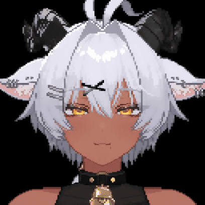

<h1 align="center">Diana Face Tracking</h1>

mFT v2.0.0-native for <b>Diana by 雑司</b>

<a href="https://mustarlabs.booth.pm/items/9194443">mFT on BOOTH</a> · <a href="https://ozoniya.booth.pm/items/9108761">Diana by 雑司</a> · <a href="https://youtu.be/eJ7l7llmK-4">Demo video</a>

## Expressions

FT shapes, each looping 0 → 1 → 0. Left and right are as you look at the avatar (its own left shows on your right).  
FT シェイプ (0 → 1 → 0)。左右は見ている人から見た向き。

<table>
<tr><td align="center">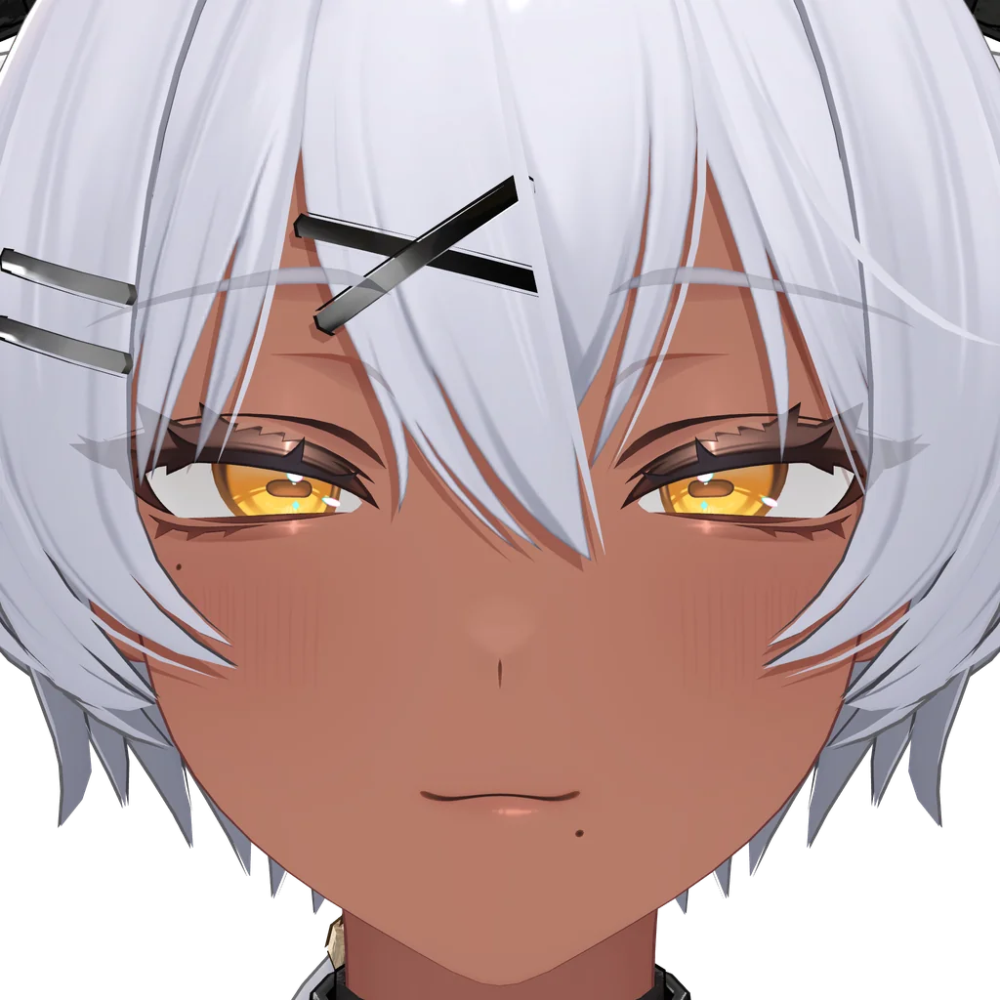 Eyes, all directions (lids follow)</td><td align="center">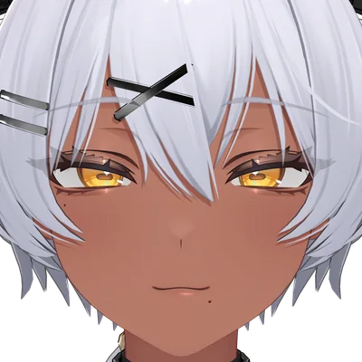 EyeClosed (left)</td><td align="center"> EyeWide (left)</td><td align="center"> EyeSquint (left)</td></tr>
<tr><td align="center">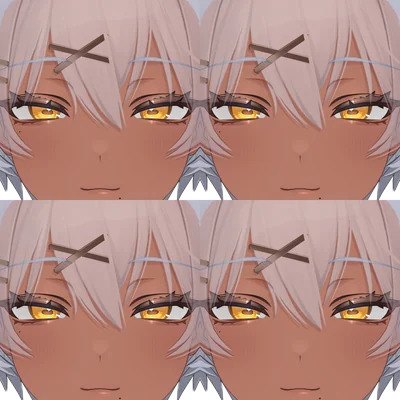 BrowInnerUp · BrowOuterUp (left, right)</td><td align="center">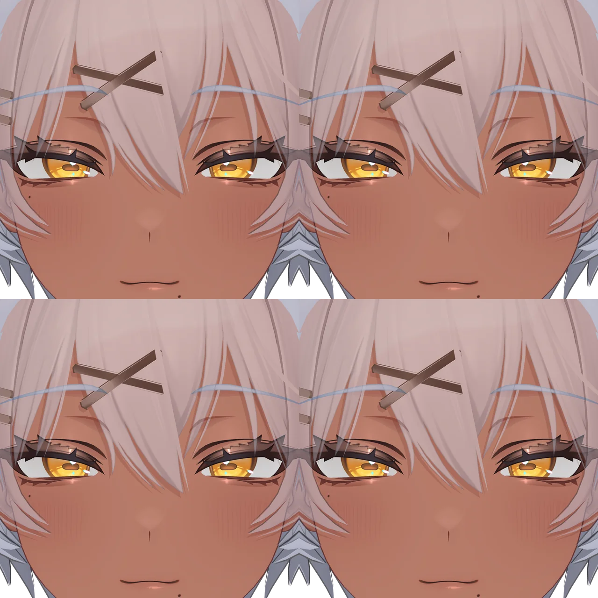 BrowDown · BrowPinch (left, right)</td><td align="center"> CheekPuff (left)</td><td align="center"> JawOpen</td></tr>
<tr><td align="center">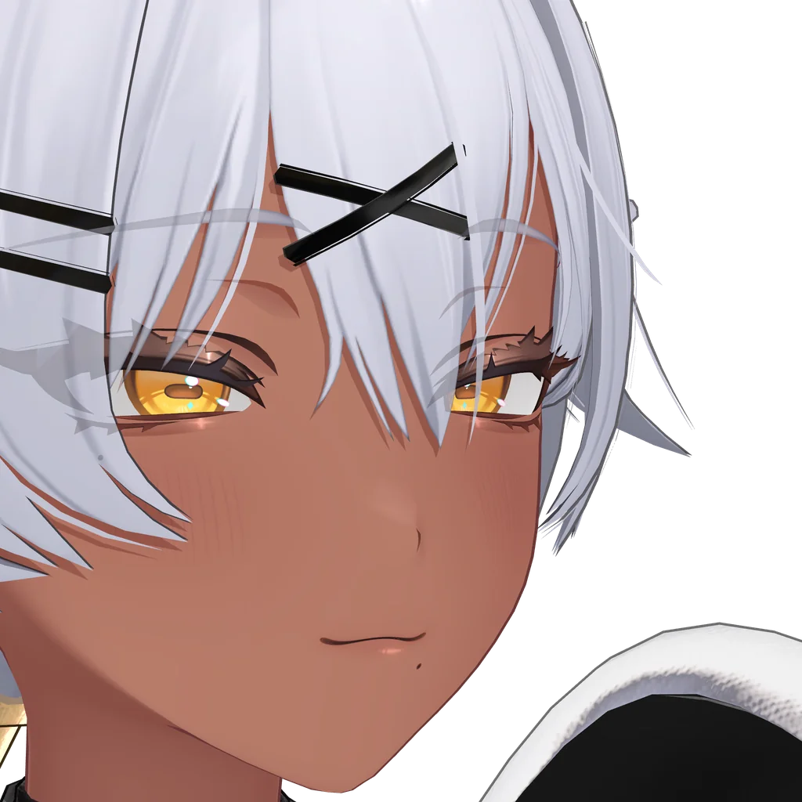 JawForward (3/4)</td><td align="center"> MouthSmile</td><td align="center"> Toothy smile</td><td align="center"> MouthFrown</td></tr>
<tr><td align="center"> MouthUpperUp + MouthLowerDown</td><td align="center"> Mouth (right)</td><td align="center"> LipPucker</td><td align="center"> LipFunnel</td></tr>
<tr><td align="center"> TongueOut</td><td align="center"> Tongue, all directions</td></tr>
</table>

### All shapes / 全シェイプ

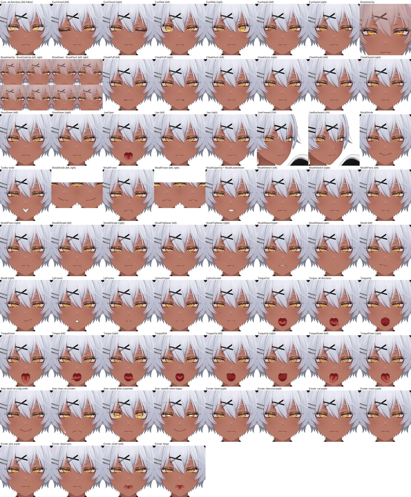

Eyes (7)

<table>
<tr><td align="center"> Eyes, all directions (lids follow)</td><td align="center"> EyeClosed (left)</td><td align="center"> EyeClosed (right)</td><td align="center"> EyeWide (left)</td></tr>
<tr><td align="center"> EyeWide (right)</td><td align="center"> EyeSquint (left)</td><td align="center"> EyeSquint (right)</td></tr>
</table>

Brows (3)

<table>
<tr><td align="center">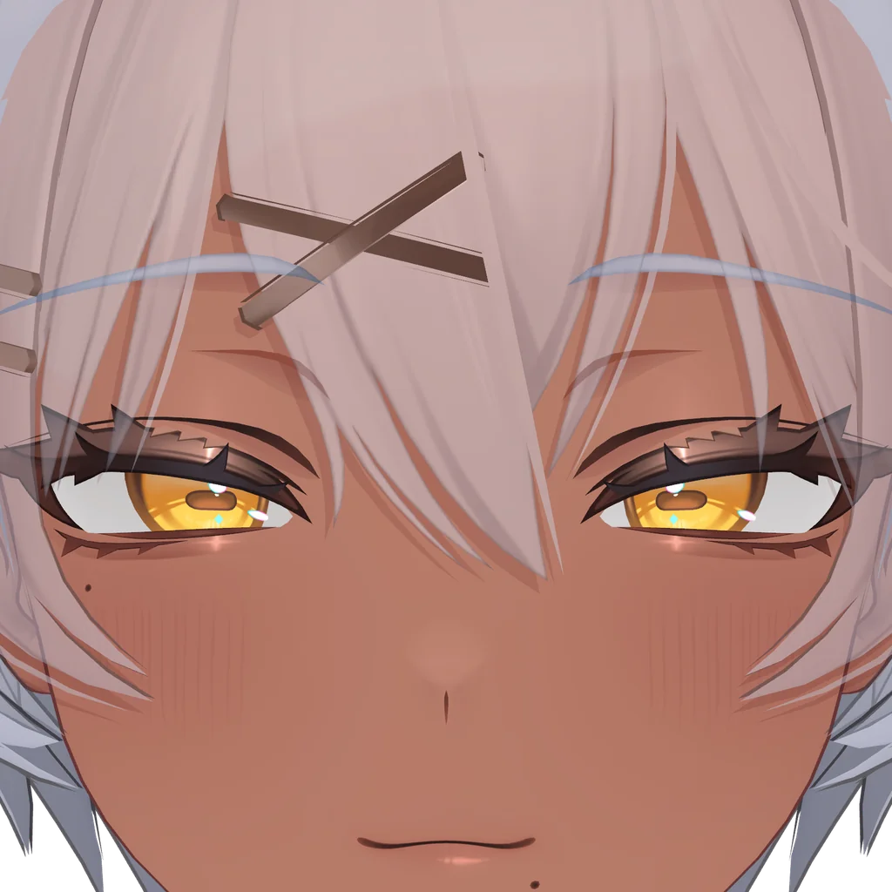 BrowInnerUp</td><td align="center"> BrowInnerUp · BrowOuterUp (left, right)</td><td align="center"> BrowDown · BrowPinch (left, right)</td></tr>
</table>

Cheeks and nose (8)

<table>
<tr><td align="center"> CheekPuff (left)</td><td align="center"> CheekPuff (right)</td><td align="center"> CheekSuck (left)</td><td align="center"> CheekSuck (right)</td></tr>
<tr><td align="center"> CheekSquint (left)</td><td align="center"> CheekSquint (right)</td><td align="center"> NoseSneer (left)</td><td align="center"> NoseSneer (right)</td></tr>
</table>

Jaw (5)

<table>
<tr><td align="center"> JawOpen</td><td align="center"> Jaw (left)</td><td align="center"> Jaw (right)</td><td align="center"> JawForward (3/4)</td></tr>
<tr><td align="center">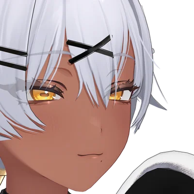 JawBackward (3/4)</td></tr>
</table>

Mouth (18)

<table>
<tr><td align="center"> MouthSmile</td><td align="center"> Toothy smile</td><td align="center">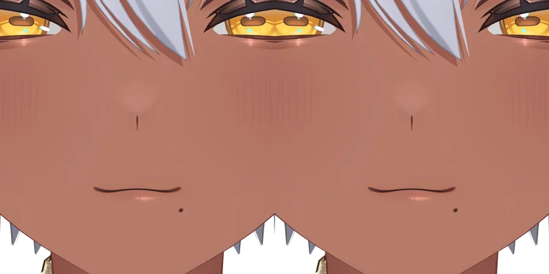 MouthSmile (left, right)</td><td align="center"> MouthFrown</td></tr>
<tr><td align="center">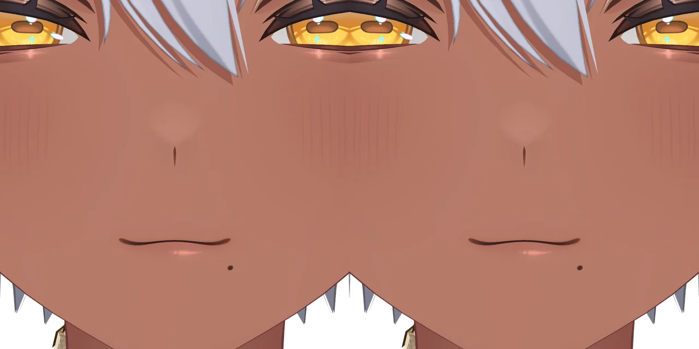 MouthFrown (left, right)</td><td align="center"> MouthUpperUp + MouthLowerDown</td><td align="center"> MouthStretch (left)</td><td align="center"> MouthStretch (right)</td></tr>
<tr><td align="center"> MouthPress (left)</td><td align="center"> MouthPress (right)</td><td align="center"> MouthDimple (left)</td><td align="center"> MouthDimple (right)</td></tr>
<tr><td align="center"> MouthTightener (left)</td><td align="center"> MouthTightener (right)</td><td align="center"> MouthRaiserUpper</td><td align="center"> MouthRaiserLower</td></tr>
<tr><td align="center"> Mouth (left)</td><td align="center"> Mouth (right)</td></tr>
</table>

Lips (4)

<table>
<tr><td align="center"> LipFunnel</td><td align="center"> LipPucker</td><td align="center"> LipSuckUpper</td><td align="center"> LipSuckLower</td></tr>
</table>

Tongue (11)

<table>
<tr><td align="center"> TongueOut</td><td align="center"> Tongue, all directions</td><td align="center"> TongueUp</td><td align="center"> TongueDown</td></tr>
<tr><td align="center"> Tongue (left)</td><td align="center"> Tongue (right)</td><td align="center"> TongueRoll</td><td align="center"> TongueUp (left)</td></tr>
<tr><td align="center"> TongueUp (right)</td><td align="center"> TongueDown (left)</td><td align="center"> TongueDown (right)</td></tr>
</table>

Emotes and auto effects (12)

<table>
<tr><td align="center"> Auto: blush on a big smile</td><td align="center"> Auto: tears on a frown</td><td align="center"> Auto: sweat when surprised</td><td align="center"> Auto: sparkle when happy</td></tr>
<tr><td align="center"> Emote: heart pupils</td><td align="center"> Emote: diamond pupils</td><td align="center"> Emote: cat pupils</td><td align="center"> Emote: cross pupils</td></tr>
<tr><td align="center"> Emote: plus pupils</td><td align="center"> Emote: dead eyes</td><td align="center"> Emote: shark teeth</td><td align="center"> Emote: fangs</td></tr>
</table>

## English

### In short

- Diana's mouth, eyes, tongue, cheeks and brows follow your face. 67 shapes made for her.
- Her lids follow your gaze: the upper lid lifts when you look up, the lower lid drops when you look down. On by default, toggle in Extras.
- A 10-pose tongue posed by hand. It rides her lower jaw and only comes out once the mouth is open.
- One button to install. Your original files are never touched.
- Diana and a face tracking device are not included.

mFT runs on my own template, written from scratch, for people who want a wider toolkit and more expressiveness.

Full report

### The numbers, and what they mean

| number | what it means |
|---|---|
| You +0.62 ms, viewers +0.58 ms | Extra cost per frame. Her own FX is about 0.10 ms. |
| Her own 94 / 256, FT 30 | Synced parameters, counted apart. The face itself is 0 bits (VRChat's built-in FT carries it). |
| 87 shapes + her 536 | 67 for FT, 5 copies of her own parts, 15 visemes at 35%. None of her shapes are removed. |
| Tongue: 10 poses | Out, up, down, left, right, 4 diagonals, roll. Out grows in 4 stages and waits for the jaw: in below 20%, fully out by 45%. |
| Package 2.0 MB | Difference data only. No avatar data inside. |

### What you get

- In-world calibration and 7 fine-tune dials.
- Debug panel: face, eyes and every expression value, live. Open it from the menu, or add a button on your left wrist in the installer.
- Smoothing Off / 5 to 30 ms, or Stop Motion. Viewers see you as you set it.
- FT anime visemes: the mouth snaps with your voice, on top of tracking.
- Freeze, pupils (emulated or tracker), PaperTrackerMode.
- Eyes that react: lids follow your gaze, raised brows lift the lids a little.
- Gaze range set on her own eyes: out 40.7, in 27.3, up 17.2, down 28.7.
- Emotes, effects only (the face stays on tracking). In the patcher only Auto effects comes ticked, the manual emotes are yours to add (1 bit each). In game every emote starts OFF. Auto effects (blush on a big smile, tears on a frown, sweat when surprised, sparkle when happy). The 8 manual emotes: (heart, diamond, cat, cross and plus pupils, dead eyes, shark teeth, fangs).

### What changes on your avatar

- Her blink layer pauses while eye tracking is on, and comes back when it's off.
- Hand gesture expressions start off (Face Tracking > Hand Gestures turns them back on).
- Her own face toggles (Face, Face Option) keep working on top of tracking.
- Lip sync on the copy runs through my layer. Uninstall puts it back.
- Her outfit, hair, horn, ear, tail and color menus keep working.
- Her Face menu moves to Face Tracking > Extras (her faces override tracking while on).

### Cons

- Diana only. Tested on PC, Quest is untested.
- Native only: with her own 94 bits, the classic install doesn't fit (about 270 / 256).
- Calibration and Tune are saved, but Reset Avatar puts them back to default.
- If a Diana update changes her face mesh, an updated version is needed.

### You need

Diana (1.0.0 / 1.0.3), VRChat SDK (3.10.6 or newer), VRCFT (Steam version, main or beta branch), and a face tracker that works with VRCFT (Unified Expressions). Set Diana up first with 雑司's own instructions.

### Technical details

- How cost was measured: her FX against the built one in Unity, fastest of repeated 10-frame runs (2026-11-21). Noise is about 15%.
- Face mesh 10,443 verts. Checked on Diana 1.0.0 / 1.0.3.
- Zero delta normals, so her face shading stays clean.
- Eyes: bone eyes, with the gaze range set on her face in Unity.
- Tongue: posed by hand in my Tongue Poser. It rides the lower jaw and stays in until the jaw opens (0 bits).

---

> **Mustard Awards**  
> **Diana: 7.2 / 10 mustard cans.**  
> How well the model behaved on the way to face tracking. Higher is better.  
> Plus: very decent shapes of her own, a real mouth box inside (respect to the author for that), and a mouth that is comfortable for FT.  
> Minus: narrow eyes, not ideal for FT. The tongue is low-poly: 522 triangles over the biggest tongue of the set (29 x 42 mm), about 0.4 triangles per mm², while the other mFT avatars sit at 1.0 to 3.4. So 2.5 to 8 times coarser, and it shows on curls and rolls.

## 日本語

日本語で読む

### 概要

- ディアナの口、目、舌、頬、眉があなたの顔に合わせて動きます。彼女のために作ったシェイプ 67 個。
- まぶたが視線についてきます: 上を見ると上まぶたが上がり、下を見ると下まぶたが下がります。最初からオン、Extras で切り替えできます。
- 手でポーズを付けた 10 ポーズの舌。下あごと一緒に動き、口が開いてから出てきます。
- ボタンひとつで導入。元のファイルには触りません。
- ディアナ本体とフェイストラッキング機器は含まれません。

mFT はゼロから作った独自テンプレートで、より幅広いツールと豊かな表現力を求める人のための選択肢です。

### 数字とその意味

| 数字 | 意味 |
|---|---|
| 自分 +0.62 ms、他の人 +0.58 ms | 1 フレームあたりの追加負荷。彼女自身の FX は約 0.10 ms。 |
| 彼女自身 94 / 256、FT 30 | 同期パラメーターは別々に数えます。顔の動き自体は 0 bit (VRChat 本体の FT が運びます)。 |
| シェイプ 87 個 + 彼女の 536 個 | 67 個は FT 用、5 個は彼女のパーツの複製、15 個はビゼーム 35%。彼女のシェイプは 1 つも消しません。 |
| 舌 10 ポーズ | 出す、上下左右、斜め 4 つ、丸め。舌出しは 4 段階で伸び、あごを待ちます: 20% まではしまったまま、45% で全部出ます。 |
| パッケージ 2.0 MB | 差分データのみ。アバター本体のデータは入っていません。 |

### 中身

- ワールド内キャリブレーションと微調整ダイヤル 7 種。
- デバッグパネル: 顔、目、全表情の値をその場で表示。メニューで開閉、左手首のボタンは導入時に選べます。
- スムージング Off / 5〜30 ms、または Stop Motion。設定は見ている人にも同じに映ります。
- FT anime visemes: 声で口がパキッと切り替わり、トラッキングの口に重なります。
- フリーズ、瞳 (エミュレートまたはトラッカー)、PaperTrackerMode。
- 顔に反応する目: まぶたが視線に合わせて動き、眉を上げるとまぶたも少し上がります。
- 彼女の目に合わせて決めた視線の範囲: 外 40.7、内 27.3、上 17.2、下 28.7。
- エモート (効果だけ、顔はトラッキングのまま)。パッチャーでは自動エフェクトだけ最初からチェック済み、手動のエモートはお好みで追加 (1 個 1 bit)。ゲーム内ではすべて最初オフです。自動エフェクト (大きな笑顔で頬染め、への字口で涙、驚くと汗、嬉しい顔でキラキラ)。手動のエモート 8 個: (ハート・ダイヤ・猫・バツ・プラスの瞳、ハイライトなしの目、ギザ歯、八重歯)。

### アバターで変わること

- 彼女のまばたきレイヤーは視線トラッキング中は止まり、切ると戻ります。
- ハンドジェスチャーの表情は最初オフです (Face Tracking > Hand Gestures で戻せます)。
- 彼女の表情トグル (Face、Face Option) はトラッキングの上でそのまま使えます。
- リップシンクはコピー側で私のレイヤーが動かします。アンインストールで元に戻ります。
- 彼女の衣装、髪、角、耳、しっぽ、カラーのメニューはそのまま使えます。
- 彼女の Face メニューは Face Tracking > Extras に移ります (表情はトラッキングより優先されます)。

### 弱点

- ディアナ専用。PC で確認、Quest は未検証。
- ネイティブ専用: 彼女自身のパラメーターが 94 bit あるため、従来版は入りません (合計 約 270 / 256)。
- キャリブレーションと Tune は保存されますが、アバターのリセットでは初期値に戻ります。
- ディアナの更新で顔のメッシュが変わると、対応版が必要です。

### 必要なもの

ディアナ (1.0.0 / 1.0.3)、VRChat SDK (3.10.6 以降)、VRCFT (Steam 版、メインでもベータブランチでも可)、VRCFT (Unified Expressions) で動くフェイストラッカー。ディアナ本体の導入は雑司さんの説明書に従ってください。

### 技術的な詳細

- 負荷の測り方: Unity 上で彼女の FX と完成した FX を比較、10 フレームの実行を繰り返した最速値 (2026-11-21)。誤差は約 15%。
- 顔のメッシュ 10,443 頂点。ディアナ 1.0.0 / 1.0.3 で確認。
- デルタ法線はゼロ: 彼女の顔の陰影がきれいに保たれます。
- 目: ボーンの目。視線の範囲は Unity で彼女の顔に合わせて決めました。
- 舌: 自作の Tongue Poser で手で付けたポーズ。下あごに乗って動き、あごが開くまで出ません (0 bit)。

---

## Debug panel

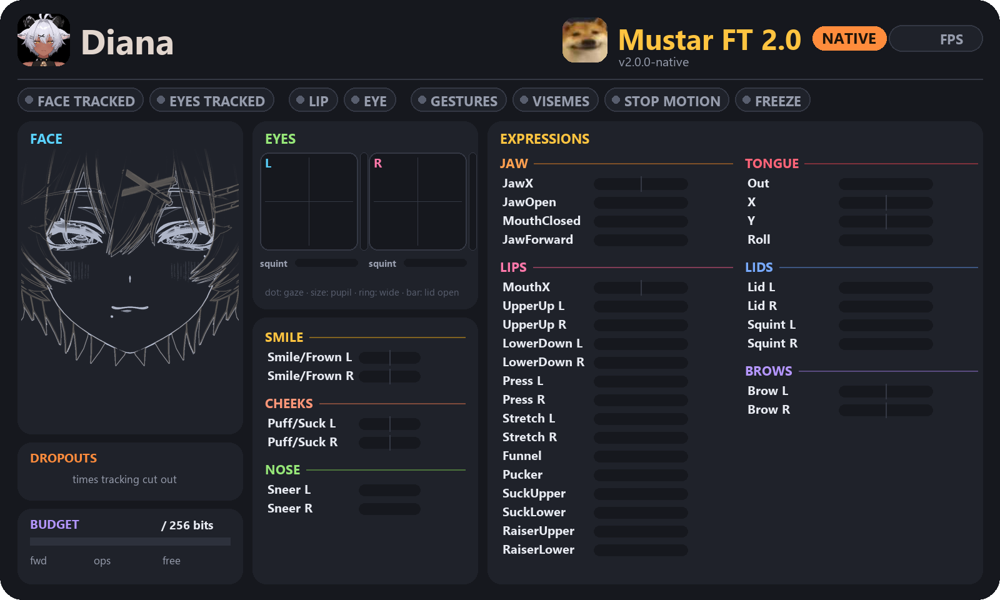
