
<a href="README.md">English</a> · <a href="README.ja.md">日本語</a> · <b>中文</b>

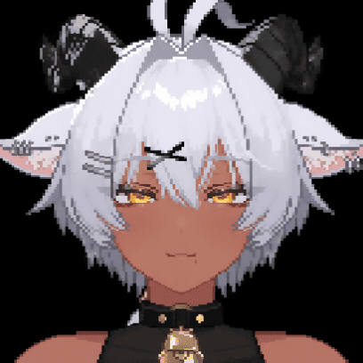

<h1 align="center">Diana Face Tracking</h1>

mFT v2.0.0-native for <b>Diana by 雑司</b>

<a href="https://mustarlabs.booth.pm/items/9194443">mFT on BOOTH</a> · <a href="https://ozoniya.booth.pm/items/9108761">Diana by 雑司</a> · <a href="https://youtu.be/eJ7l7llmK-4">Demo video</a>

## Expressions

FT shapes, each looping 0 → 1 → 0. Left and right are as you look at the avatar (its own left shows on your right).  
FT シェイプ (0 → 1 → 0)。左右は見ている人から見た向き。

<table>
<tr><td align="center">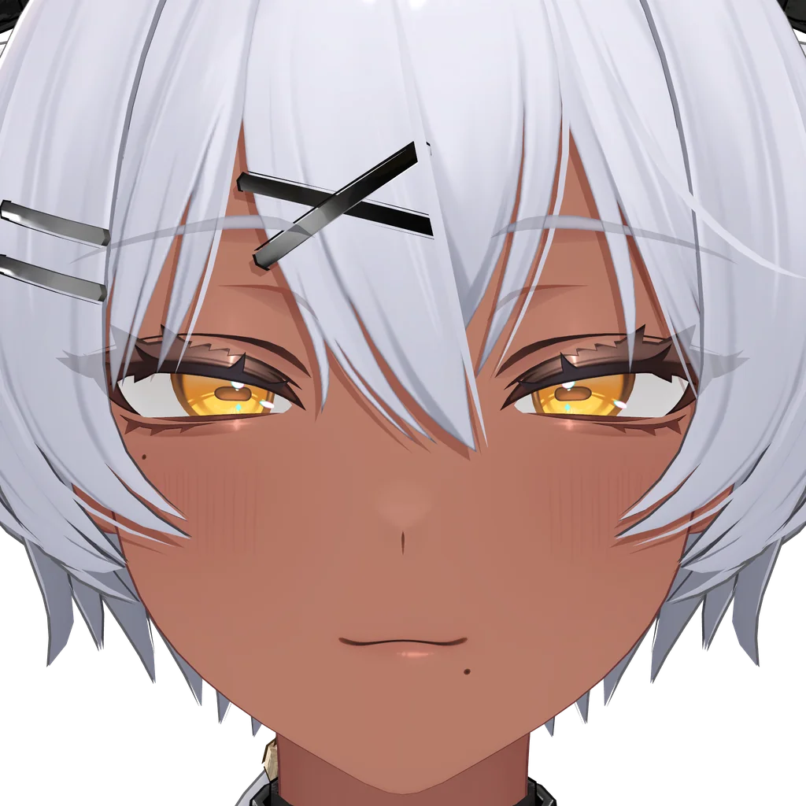 Eyes, all directions (lids follow)</td><td align="center">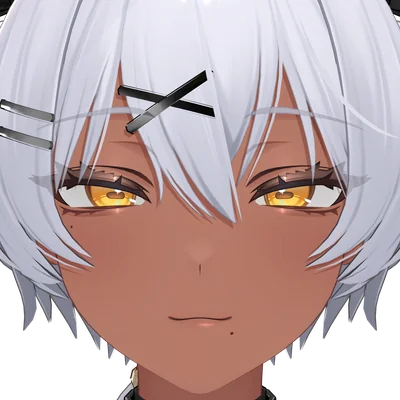 EyeClosed (left)</td><td align="center"> EyeWide (left)</td><td align="center"> EyeSquint (left)</td></tr>
<tr><td align="center">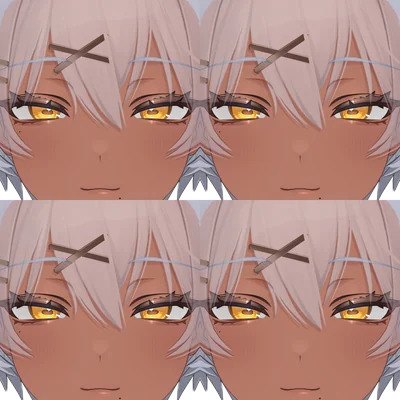 BrowInnerUp · BrowOuterUp (left, right)</td><td align="center">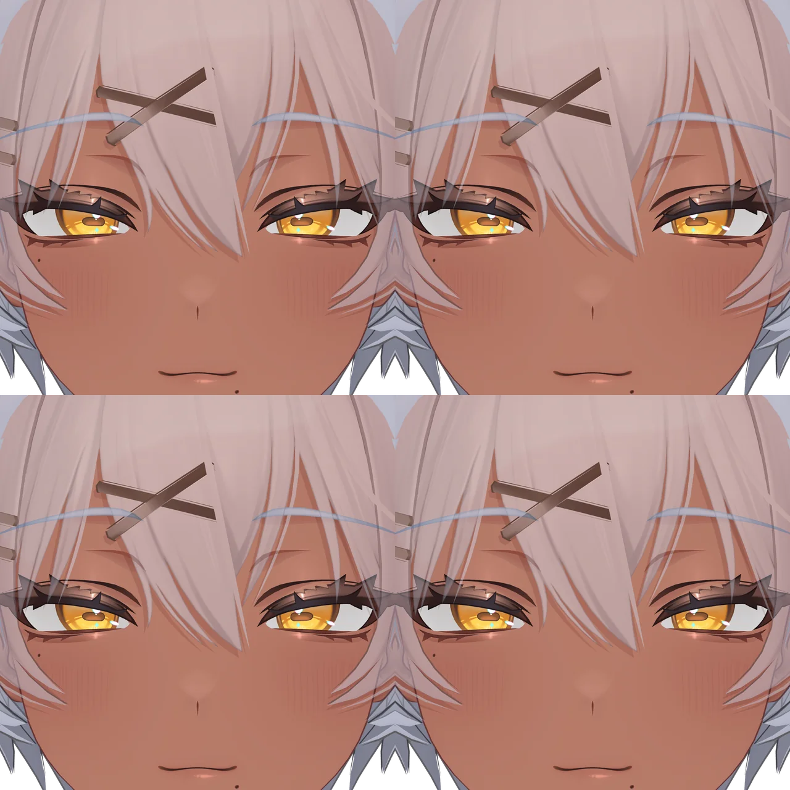 BrowDown · BrowPinch (left, right)</td><td align="center"> CheekPuff (left)</td><td align="center"> JawOpen</td></tr>
<tr><td align="center">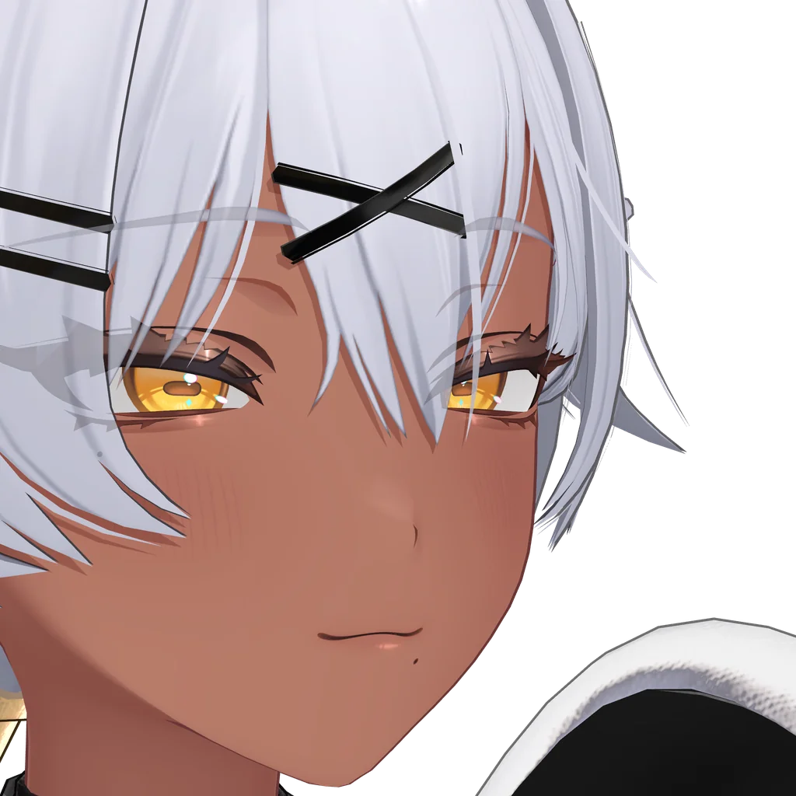 JawForward (3/4)</td><td align="center"> MouthSmile</td><td align="center"> Toothy smile</td><td align="center"> MouthFrown</td></tr>
<tr><td align="center"> MouthUpperUp + MouthLowerDown</td><td align="center"> Mouth (right)</td><td align="center"> LipPucker</td><td align="center"> LipFunnel</td></tr>
<tr><td align="center"> TongueOut</td><td align="center"> Tongue, all directions</td></tr>
</table>

### All shapes / 全シェイプ

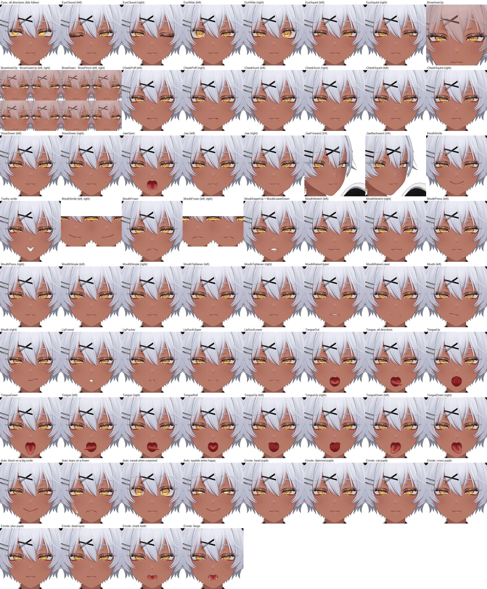

Eyes (7)

<table>
<tr><td align="center"> Eyes, all directions (lids follow)</td><td align="center"> EyeClosed (left)</td><td align="center"> EyeClosed (right)</td><td align="center"> EyeWide (left)</td></tr>
<tr><td align="center"> EyeWide (right)</td><td align="center"> EyeSquint (left)</td><td align="center"> EyeSquint (right)</td></tr>
</table>

Brows (3)

<table>
<tr><td align="center">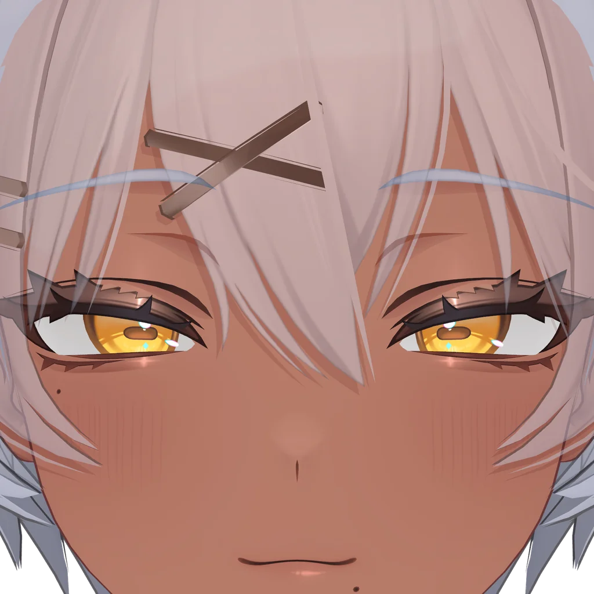 BrowInnerUp</td><td align="center"> BrowInnerUp · BrowOuterUp (left, right)</td><td align="center"> BrowDown · BrowPinch (left, right)</td></tr>
</table>

Cheeks and nose (8)

<table>
<tr><td align="center"> CheekPuff (left)</td><td align="center"> CheekPuff (right)</td><td align="center"> CheekSuck (left)</td><td align="center"> CheekSuck (right)</td></tr>
<tr><td align="center"> CheekSquint (left)</td><td align="center"> CheekSquint (right)</td><td align="center"> NoseSneer (left)</td><td align="center"> NoseSneer (right)</td></tr>
</table>

Jaw (5)

<table>
<tr><td align="center"> JawOpen</td><td align="center"> Jaw (left)</td><td align="center"> Jaw (right)</td><td align="center"> JawForward (3/4)</td></tr>
<tr><td align="center">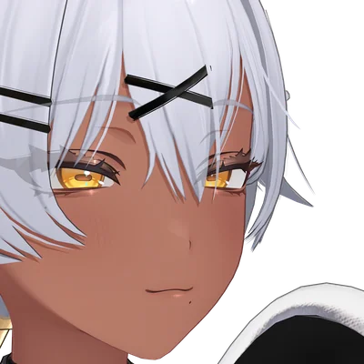 JawBackward (3/4)</td></tr>
</table>

Mouth (18)

<table>
<tr><td align="center"> MouthSmile</td><td align="center"> Toothy smile</td><td align="center">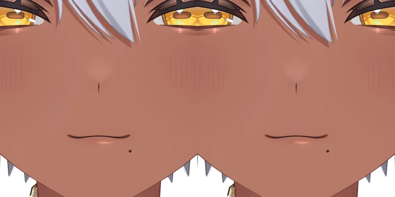 MouthSmile (left, right)</td><td align="center"> MouthFrown</td></tr>
<tr><td align="center">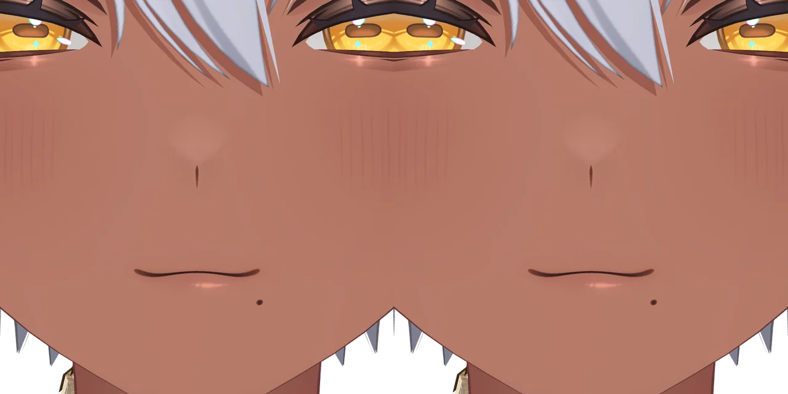 MouthFrown (left, right)</td><td align="center"> MouthUpperUp + MouthLowerDown</td><td align="center"> MouthStretch (left)</td><td align="center"> MouthStretch (right)</td></tr>
<tr><td align="center"> MouthPress (left)</td><td align="center"> MouthPress (right)</td><td align="center"> MouthDimple (left)</td><td align="center"> MouthDimple (right)</td></tr>
<tr><td align="center"> MouthTightener (left)</td><td align="center"> MouthTightener (right)</td><td align="center"> MouthRaiserUpper</td><td align="center"> MouthRaiserLower</td></tr>
<tr><td align="center"> Mouth (left)</td><td align="center"> Mouth (right)</td></tr>
</table>

Lips (4)

<table>
<tr><td align="center"> LipFunnel</td><td align="center"> LipPucker</td><td align="center"> LipSuckUpper</td><td align="center"> LipSuckLower</td></tr>
</table>

Tongue (11)

<table>
<tr><td align="center"> TongueOut</td><td align="center"> Tongue, all directions</td><td align="center"> TongueUp</td><td align="center"> TongueDown</td></tr>
<tr><td align="center"> Tongue (left)</td><td align="center"> Tongue (right)</td><td align="center"> TongueRoll</td><td align="center"> TongueUp (left)</td></tr>
<tr><td align="center"> TongueUp (right)</td><td align="center"> TongueDown (left)</td><td align="center"> TongueDown (right)</td></tr>
</table>

Emotes and auto effects (12)

<table>
<tr><td align="center"> Auto: blush on a big smile</td><td align="center"> Auto: tears on a frown</td><td align="center"> Auto: sweat when surprised</td><td align="center"> Auto: sparkle when happy</td></tr>
<tr><td align="center"> Emote: heart pupils</td><td align="center"> Emote: diamond pupils</td><td align="center"> Emote: cat pupils</td><td align="center"> Emote: cross pupils</td></tr>
<tr><td align="center"> Emote: plus pupils</td><td align="center"> Emote: dead eyes</td><td align="center"> Emote: shark teeth</td><td align="center"> Emote: fangs</td></tr>
</table>

## 中文

### 简介

- Diana 的嘴、眼睛、舌头、脸颊和眉毛会跟随你的脸。为她制作了 67 个形态键。
- 眼睑跟随视线：向上看时上眼睑抬起，向下看时下眼睑下降。默认开启，可在 Extras 中切换。
- 手工摆出的 10 个舌头姿势。舌头跟着下颌移动，嘴张开后才会伸出。
- 一键安装。绝不改动原始文件。
- 不含 ディアナ 本体和面捕设备。

mFT 使用我从零编写的模板，是给想要更丰富工具和更强表现力的人的选择。

### 数字及其含义

| 数字 | 含义 |
|---|---|
| 自己 +0.62 ms，其他人 +0.58 ms | 每帧的额外开销。她自己的 FX 约 0.10 ms。 |
| 她自己 94 / 256，FT 30 | 同步参数分开计算。脸部动作本身 0 bit (由 VRChat 内置 FT 传输)。 |
| 87 个形态键 + 她的 536 个 | 67 个用于 FT，5 个是她自身部件的副本，15 个是 35% 的口型。不删除她的任何形态键。 |
| 舌头 10 个姿势 | 伸出、上下左右、4 个斜向、卷起。伸出分 4 段，并等待下颌：20% 以下收着，45% 时完全伸出。 |
| 安装包 2.0 MB | 仅差分数据，不含模型数据。 |

### 内容

- 游戏内校准和 7 个微调旋钮。
- 调试面板：实时显示脸、眼睛和所有表情数值。从菜单打开，也可在安装器中添加左手腕按钮。
- 平滑 关闭 / 5 到 30 ms，或 Stop Motion。他人看到的与你的设置相同。
- FT anime visemes：嘴随声音利落切换，叠加在追踪之上。
- 冻结、瞳孔 (模拟或追踪器)、PaperTrackerMode。
- 会反应的眼睛：眼睑跟随视线，抬眉时眼睑也会略微抬起。
- 按她的眼睛设定的视线范围：外 40.7、内 27.3、上 17.2、下 28.7。
- 表情特效 (只有特效，脸部仍由追踪控制)。安装器中只默认勾选自动特效，手动表情可自行添加 (每个 1 bit)。游戏中所有表情默认关闭。自动特效 (大笑时脸红、撇嘴时流泪、惊讶时出汗、开心时闪光)。8 个手动表情：(爱心、钻石、猫、叉、加号瞳孔，无高光的眼睛，鲨鱼齿，虎牙)。

### 模型上的变化

- 开启眼动追踪时她的眨眼层暂停，关闭后恢复。
- 手势表情默认关闭 (Face Tracking > Hand Gestures 可重新开启)。
- 她自己的表情开关 (Face、Face Option) 在追踪之上仍可使用。
- 副本上的口型同步由我的层驱动，卸载后恢复。
- 她的服装、头发、角、耳朵、尾巴和颜色菜单照常可用。
- 她的 Face 菜单移到 Face Tracking > Extras (开启时她的表情优先于追踪)。

### 缺点

- 仅限 ディアナ。已在 PC 测试，Quest 未测试。
- 仅原生：她自己有 94 bit 参数，经典版装不下 (合计约 270 / 256)。
- 校准和 Tune 会保存，但重置模型会恢复默认。
- 如果 ディアナ 更新改变了脸部网格，需要更新版本。

### 需要

Diana、VRChat SDK (3.10.6 或更新)、VRCFT (Steam 版，主线或测试分支均可)，以及支持 VRCFT (Unified Expressions) 的面部追踪设备。请先按雑司的说明设置好 Diana。

### 技术细节

- 开销测量：在 Unity 中比较她的 FX 与构建后的 FX，取重复 10 帧运行的最快值 (2026-11-21)。误差约 15%。
- 脸部网格 10,443 顶点。已在 Diana 1.0.0 上确认。
- 增量法线为零，她的脸部阴影保持干净。
- 眼睛：骨骼眼睛，视线范围在 Unity 中按她的脸设定。
- 舌头：在我的 Tongue Poser 中手工摆姿势。跟随下颌移动，下颌张开前不会伸出 (0 bit)。

---

> **Mustard Awards**  
> **Diana: 7.2 / 10 mustard cans.**  
> How well the model behaved on the way to face tracking. Higher is better.  
> Plus: very decent shapes of her own, a real mouth box inside (respect to the author for that), and a mouth that is comfortable for FT.  
> Minus: narrow eyes, not ideal for FT. The tongue is low-poly: 522 triangles over the biggest tongue of the set (29 x 42 mm), about 0.4 triangles per mm², while the other mFT avatars sit at 1.0 to 3.4. So 2.5 to 8 times coarser, and it shows on curls and rolls.

## 调试面板

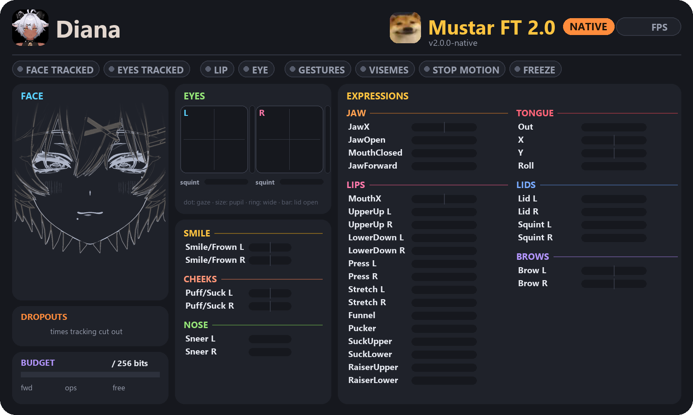
