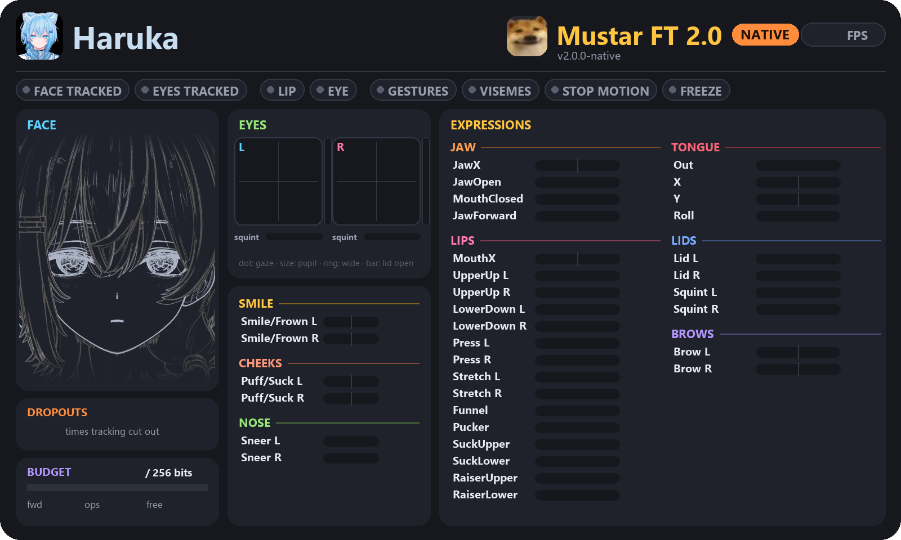
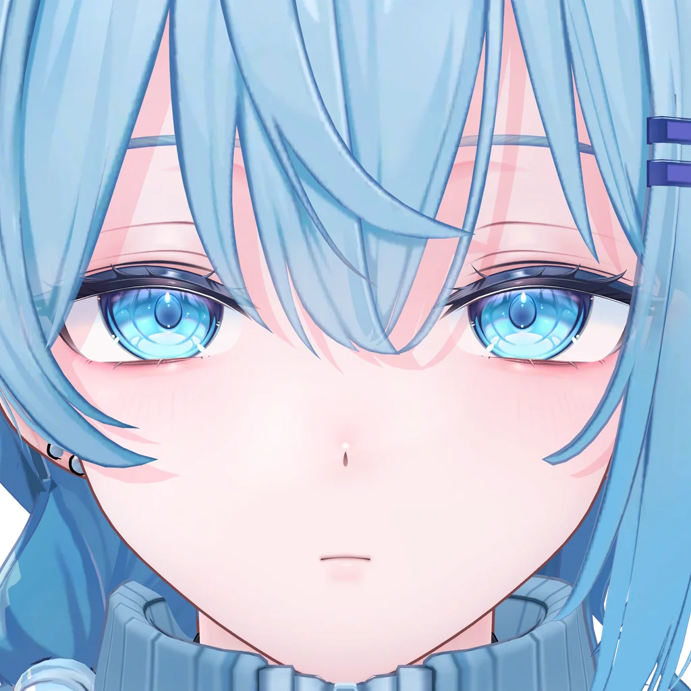
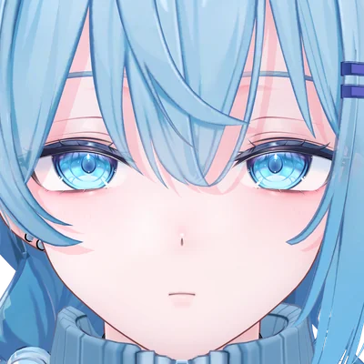
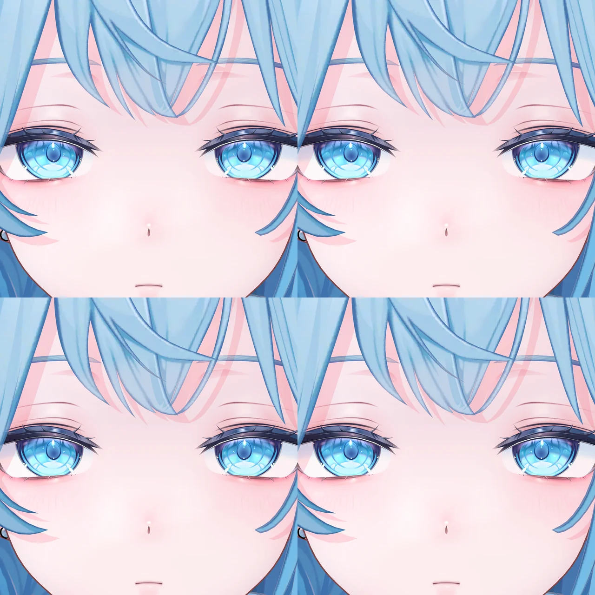
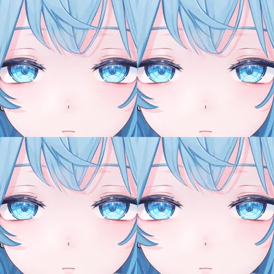
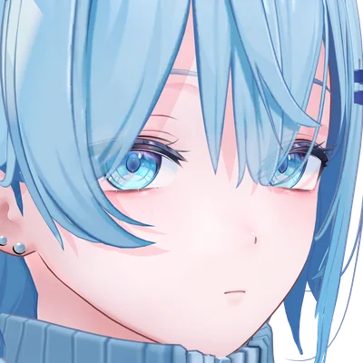
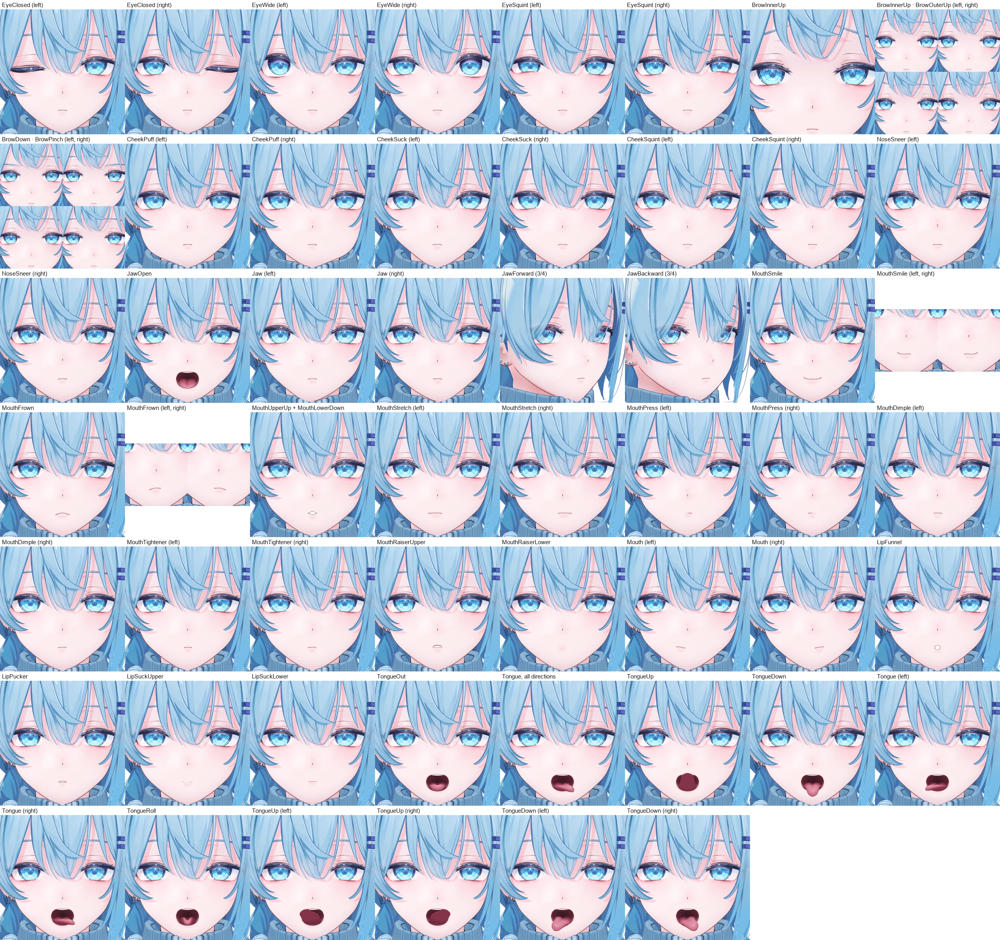
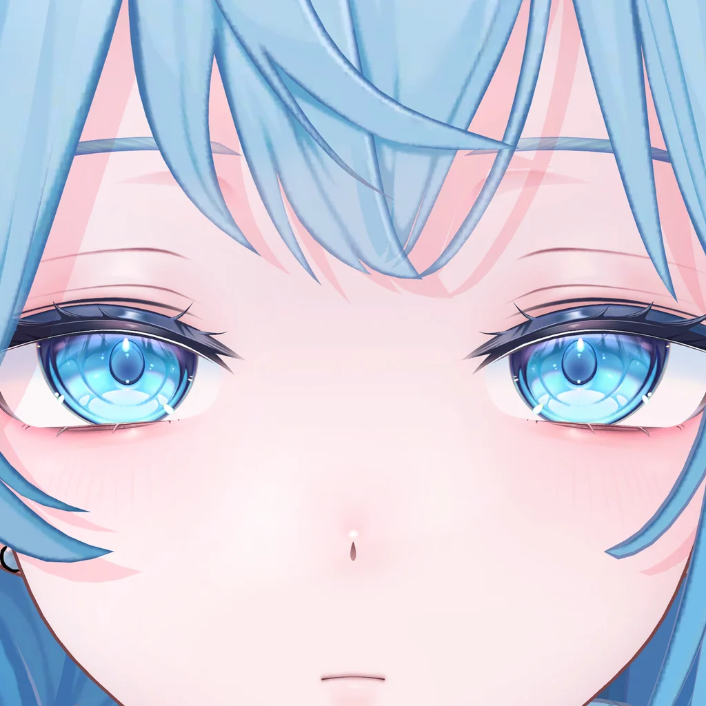
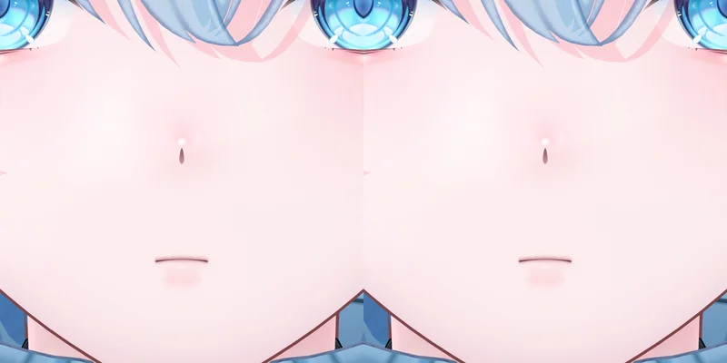
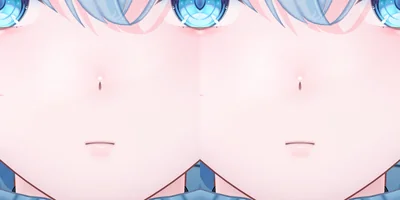

# Haruka Face Tracking v2.0.0-native_V1

**▶▶▶ FT シェイプを動くプレビューでチェック! / Preview the FT shapes here: [github.com/mustar22/mFT/tree/main/Haruka#expressions](https://github.com/mustar22/mFT/tree/main/Haruka#expressions) ◀◀◀**

**Hotpatch landed (fits Haruka v1.00). Delete Haruka_FT in the scene, turn Haruka back on, delete Assets/_Haruka_FT, import the new package, press Patch again.**

**ホットパッチ配信 (はるか v1.00 対応)。シーンの Haruka_FT を削除して元の Haruka を表示に戻し、Assets/_Haruka_FT フォルダーを削除、新しいパッケージをインポートして、もう一度パッチを当ててください。**

Free report. Read this before you buy: what you get, what changes on your avatar, and the numbers, explained.
Face tracking for **はるか -Haruka-** by BLUESTELLA. Built by mustar.

Haruka: [はるか -Haruka- by BLUESTELLA](https://booth.pm/en/items/8591283)

Demo video: [https://youtu.be/BaPW5rd_xLo](https://youtu.be/BaPW5rd_xLo)

> **Mustard Awards**
> **Haruka: 8 / 10 mustard cans.**
> How well the model behaved on the way to face tracking. Higher is better.
> Plus: 728 shapes with clean left/right splits, real eye bones, and rich mouth, teeth and tongue parts.
> Minus: a small mouth, and eyes that glide on a big sphere: for a cartoonish eye glide, a flatter, planar movement would read better.

---

[日本語](#日本語) · [English](#english)

## 日本語

### 概要

- Haruka の口、目、舌、頬、眉があなたの顔に合わせて動きます。FT 用シェイプ 70 個。
- 本物のアイボーンで視線が動き、外側 49°、内側 49°、上下 27° / 47°。
- Stop Motion モード (アニメモード): 顔がポーズを保ち 1 秒に 8 回切り替わり、口は声に合わせてパキッと動きます。
- ボタンひとつで導入。元のファイルには触りません。
- はるか本体とフェイストラッキング機器は含まれません。

mFT はゼロから作った独自テンプレートで、より幅広いツールと豊かな表現力を求める人のための選択肢です。

### 数字とその意味

| 数字 | 意味 |
|---|---|
| 自分 +0.29 ms、他の人 +0.28 ms (ネイティブ) | 1 フレームあたりの追加負荷。従来版は自分 +0.40 ms、他の人 +0.39 ms。彼自身の FX は約 0.02 ms。 |
| 76 / 256 (ネイティブ)、222 / 256 (従来版) | 同期パラメーター。ネイティブ: 彼自身の 38 + 追加機能 38 (Full) または 9 (Light、合計 47)。顔の動き自体は 0 bit。 |
| シェイプ 124 個 + 彼の 728 個 | 70 個は FT 用、39 個は彼の表情パーツの複製、15 個はビゼーム 35%。彼のシェイプは 1 つも消しません。 |
| 舌 10 ポーズ | 上下左右、斜め、丸め。舌出しは 4 段階で伸びます。 |
| パッケージ 2.6 MB | 差分データのみ。アバター本体のデータは入っていません。 |

### 中身

- ワールド内キャリブレーションと微調整ダイヤル 7 種。
- デバッグパネル: 顔、目、全表情の値をその場で表示。メニューで開閉、左手首のボタンは導入時に選べます。
- スムージング Off / 5〜30 ms、または Stop Motion。設定は見ている人にも同じに映ります。
- FT anime visemes: 声で口がパキッと切り替わり、トラッキングの口に重なります。
- 表情キープ (Freeze)、瞳 (エミュレート / トラッカー)、目が表情に反応 (笑顔、にらみ、下を見る)。
- エモート 11 種: 猫目、キラキラ、涙、青ざめ、白目、汗、ほっぺの線、照れ、ぐるぐる、ハート、死んだ目。
- 歯の統一: 口を閉じたときの歯を 1 つのきれいな噛み合わせに揃えました。
- 歯メニュー (導入時に選択): Long Fangs、No Fangs、Shark Teeth。
- なでなでと耳引っぱりはフェイストラッキング中もそのまま動きます。
- PaperTrackerMode: Paper Tracker でファンネルとパッカーが同時に出るとき、強い方だけを使います。
- 舌ガード: 口がほとんど閉じているときは舌が出ません。上と斜め上のポーズは、口が十分に開いてから出ます。
- まぶたが視線についてきます (上を見る、下を見る)。
- なでなでと耳引っぱりの最中は、まばたきと目の笑顔が止まり、彼自身の表情と重なりません。

### アバターで変わること

- 彼のまばたきレイヤーは視線トラッキング中は止まり、切ると戻ります。
- ハンドジェスチャーの表情は視線トラッキング中は止まり、切ると戻ります。なでなでは止まりません。
- 歯は常に統一した噛み合わせになります (コピーのみ)。アンインストールで元に戻ります。
- リップシンクはコピー側で私のレイヤーが動かします。アンインストールで元に戻ります。
- 衣装、ケモ耳、尻尾、髪のメニューはそのまま使えます。

### 弱点

- はるか専用。PC で確認、Quest は未検証。
- キャリブレーションと Tune は保存されますが、アバターのリセットでは初期値に戻ります。
- はるかの更新で顔のメッシュが変わると、対応版が必要です。

### 必要なもの

はるか、VRChat SDK (3.10.6 以降)、VRCFT、VRCFT (Unified Expressions) で動くフェイストラッカー。VRCFT は Steam 版 (メインでもベータブランチでも可)。はるか本体の導入は BLUESTELLA さんの説明書に従ってください (lilToon、Modular Avatar は最新版)。

### 技術的な詳細

- 負荷の測り方: Unity 上で彼の FX と完成した FX を比較、10 フレームの実行を繰り返した最速値 (2026-11-06)。誤差は約 15%。
- メッシュ 15,130 頂点。はるかの Haruka プレハブで確認。
- デルタ法線はゼロ: 彼の顔の陰影がきれいに保たれます。
- 舌のシェイプは舌だけを動かし、顎と舌が同時に動くときだけ小さな補正が入ります (0 bit)。
- 新規インポートで導入した結果と開発環境の結果が一致することを確認済み。

---

## English

### In short

- Haruka's mouth, eyes, tongue, cheeks and brows move with your face. 70 face tracking shapes.
- Gaze on his real eye bones: 49° outward, 49° inward, 27° / 47° up and down.
- Stop Motion mode (anime mode): the face holds a pose and jumps 8 times a second, and the mouth snaps with your voice.
- One button to install. Your original files are never touched.
- Haruka and a face tracking device are not included.

mFT runs on my own template, written from scratch, for people who want a wider toolkit and more expressiveness.

### The numbers, and what they mean

| number | what it means |
|---|---|
| You +0.29 ms, viewers +0.28 ms (native) | Added per frame. Classic: you +0.40 ms, viewers +0.39 ms. His own FX is about 0.02 ms. |
| 76 / 256 (native), 222 / 256 (classic) | Synced parameters. Native: his own 38 + extras 38 (Full) or 9 (Light, total 47). The face itself is 0 bits. |
| 124 shapes + his 728 | 70 for face tracking, 39 copies of his face parts, 15 visemes at 35%. None of his removed. |
| 10 tongue poses | Up, down, sideways, diagonals, roll. Tongue out extends in 4 stages. |
| Package 2.6 MB | Shape differences only, no avatar data. |

### What you get

- In-world calibration and 7 fine-tune dials.
- Debug panel: face, eyes and every expression value, live. Open it from the menu, or add a button on your left wrist in the installer.
- Smoothing Off / 5 to 30 ms, or Stop Motion. Viewers see you as you set it.
- FT anime visemes: the mouth snaps with your voice, on top of tracking.
- Freeze, pupils (emulated or tracker), and eyes that react to your face (smile, glare, looking down).
- 11 emotes: cat eyes, sparkle, tears, blue face, white eyes, sweat, cheek lines, blush, dizzy, hearts, dead eyes.
- One clean bite: his teeth meet in a single set position when the mouth is closed.
- Teeth menu (pick it in the installer): Long Fangs, No Fangs, Shark Teeth.
- Headpat and ear pulling keep working while face tracking is on.
- PaperTrackerMode: when Paper Tracker fires funnel and pucker together, the stronger one wins.
- Tongue guard: the tongue stays in while the mouth is barely open, and the up and up-diagonal poses wait for a wider jaw.
- His lids follow his gaze, looking up and looking down.
- During headpat and ear pull, blink and eye smile pause, so they never stack on his own face.

### What changes on your avatar

- His blink layer pauses while Eye Tracking is on, and comes back when it's off.
- His hand-gesture faces pause while Eye Tracking is on, and come back when it's off. Headpat never pauses.
- His teeth stay in the one bite on the copy. Uninstall puts them back.
- Lip sync on the copy runs through my layer. Uninstall puts it back.
- His outfit, ears, tail and hair menus keep working.

### Cons

- Haruka only. Tested on PC, Quest is untested.
- Calibration and Tune are saved, but Reset Avatar puts them back to default.
- If a Haruka update changes his face mesh, an updated version is needed.

### You need

Haruka, the VRChat SDK (3.10.6 or newer), VRCFT, and a face tracker that works with VRCFT (Unified Expressions). VRCFT from Steam, main or beta branch. For Haruka himself, follow BLUESTELLA's manual (latest lilToon and Modular Avatar).

### Technical details

- How cost was measured: his FX against the built one in Unity, fastest of repeated 10-frame runs (2026-11-06). Noise is about 15%.
- Mesh 15,130 verts. Checked on the Haruka prefab.
- Zero delta normals, so his face shading stays clean.
- Tongue shapes move only the tongue; a small correction fires only when jaw and tongue are both up (0 bits).
- A fresh import matched the development build exactly.

---

## Debug panel

## Expressions

FT シェイプ (0 → 1 → 0)。左右は見ている人から見た向き。 FT shapes, each looping 0 → 1 → 0. Left and right are as you look at the avatar (its own left shows on your right).

<table>
<tr><td align="center"> EyeClosed (left)</td><td align="center"> EyeWide (left)</td><td align="center"> EyeSquint (left)</td><td align="center"> BrowInnerUp · BrowOuterUp (left, right)</td></tr>
<tr><td align="center"> BrowDown · BrowPinch (left, right)</td><td align="center"> CheekPuff (left)</td><td align="center"> JawOpen</td><td align="center"> JawForward (3/4)</td></tr>
<tr><td align="center"> MouthSmile</td><td align="center"> MouthFrown</td><td align="center"> MouthUpperUp + MouthLowerDown</td><td align="center"> Mouth (right)</td></tr>
<tr><td align="center"> LipPucker</td><td align="center"> LipFunnel</td><td align="center"> TongueOut</td><td align="center"> Tongue, all directions</td></tr>
</table>

### All shapes / 全シェイプ

Eyes (6)

<table>
<tr><td align="center"> EyeClosed (left)</td><td align="center"> EyeClosed (right)</td><td align="center"> EyeWide (left)</td><td align="center"> EyeWide (right)</td></tr>
<tr><td align="center"> EyeSquint (left)</td><td align="center"> EyeSquint (right)</td></tr>
</table>

Brows (3)

<table>
<tr><td align="center"> BrowInnerUp</td><td align="center"> BrowInnerUp · BrowOuterUp (left, right)</td><td align="center"> BrowDown · BrowPinch (left, right)</td></tr>
</table>

Cheeks and nose (8)

<table>
<tr><td align="center"> CheekPuff (left)</td><td align="center"> CheekPuff (right)</td><td align="center"> CheekSuck (left)</td><td align="center"> CheekSuck (right)</td></tr>
<tr><td align="center"> CheekSquint (left)</td><td align="center"> CheekSquint (right)</td><td align="center"> NoseSneer (left)</td><td align="center"> NoseSneer (right)</td></tr>
</table>

Jaw (5)

<table>
<tr><td align="center"> JawOpen</td><td align="center"> Jaw (left)</td><td align="center"> Jaw (right)</td><td align="center"> JawForward (3/4)</td></tr>
<tr><td align="center"> JawBackward (3/4)</td></tr>
</table>

Mouth (17)

<table>
<tr><td align="center"> MouthSmile</td><td align="center"> MouthSmile (left, right)</td><td align="center"> MouthFrown</td><td align="center"> MouthFrown (left, right)</td></tr>
<tr><td align="center"> MouthUpperUp + MouthLowerDown</td><td align="center"> MouthStretch (left)</td><td align="center"> MouthStretch (right)</td><td align="center"> MouthPress (left)</td></tr>
<tr><td align="center"> MouthPress (right)</td><td align="center"> MouthDimple (left)</td><td align="center"> MouthDimple (right)</td><td align="center"> MouthTightener (left)</td></tr>
<tr><td align="center"> MouthTightener (right)</td><td align="center"> MouthRaiserUpper</td><td align="center"> MouthRaiserLower</td><td align="center"> Mouth (left)</td></tr>
<tr><td align="center"> Mouth (right)</td></tr>
</table>

Lips (4)

<table>
<tr><td align="center"> LipFunnel</td><td align="center"> LipPucker</td><td align="center"> LipSuckUpper</td><td align="center"> LipSuckLower</td></tr>
</table>

Tongue (11)

<table>
<tr><td align="center"> TongueOut</td><td align="center"> Tongue, all directions</td><td align="center"> TongueUp</td><td align="center"> TongueDown</td></tr>
<tr><td align="center"> Tongue (left)</td><td align="center"> Tongue (right)</td><td align="center"> TongueRoll</td><td align="center"> TongueUp (left)</td></tr>
<tr><td align="center"> TongueUp (right)</td><td align="center"> TongueDown (left)</td><td align="center"> TongueDown (right)</td></tr>
</table>

