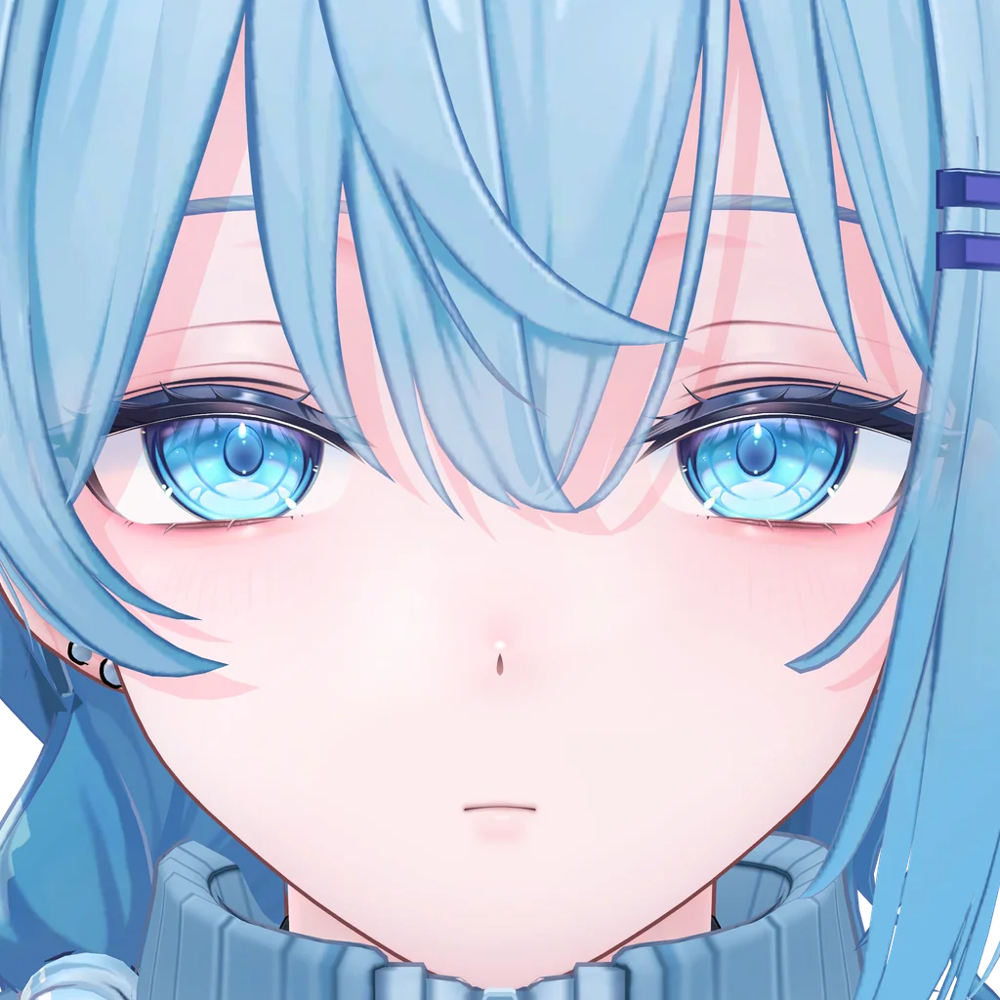
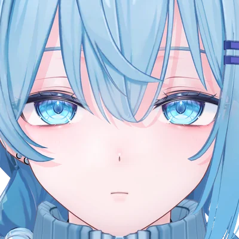
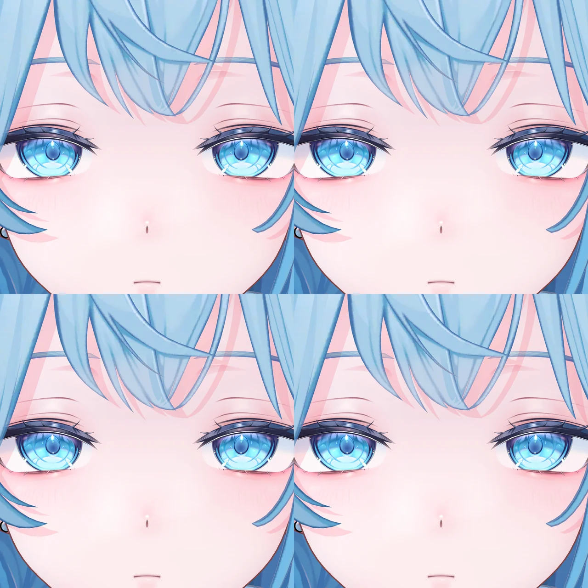
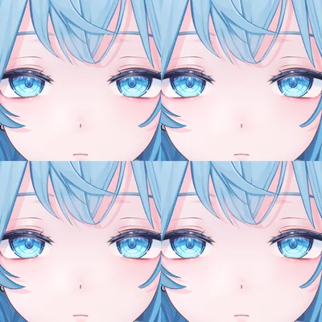
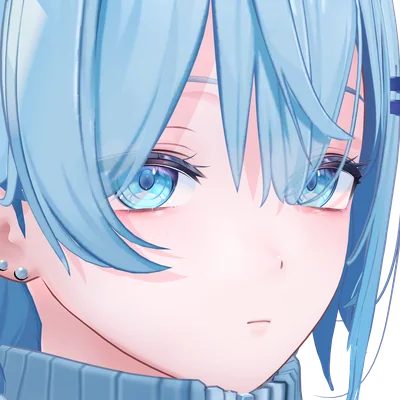
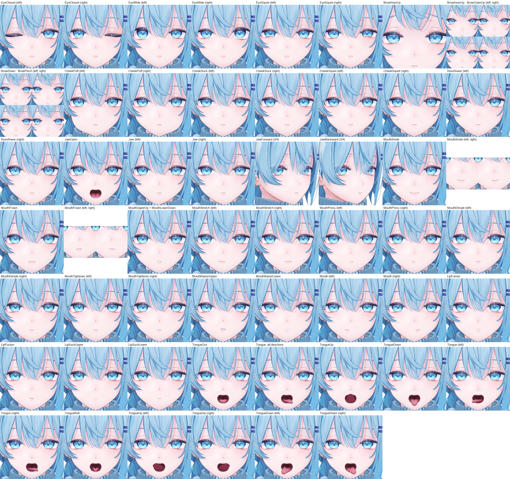
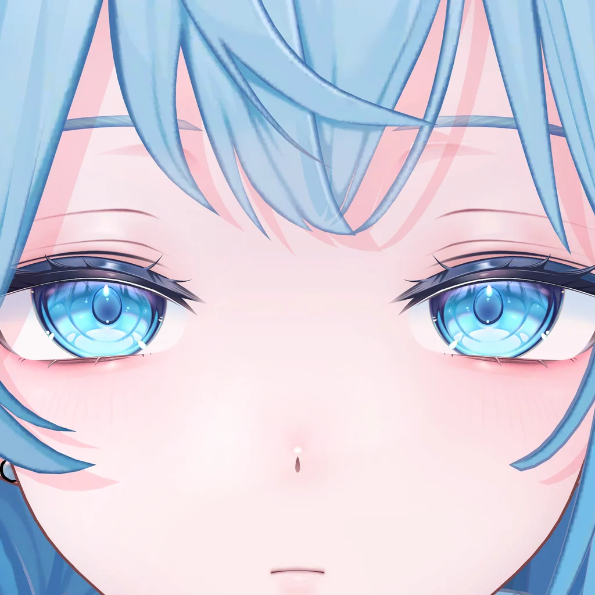
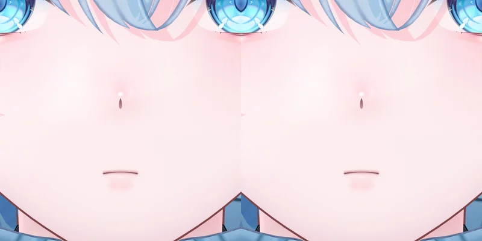
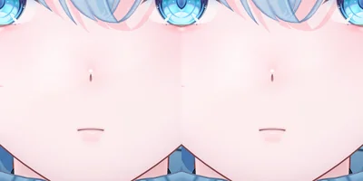
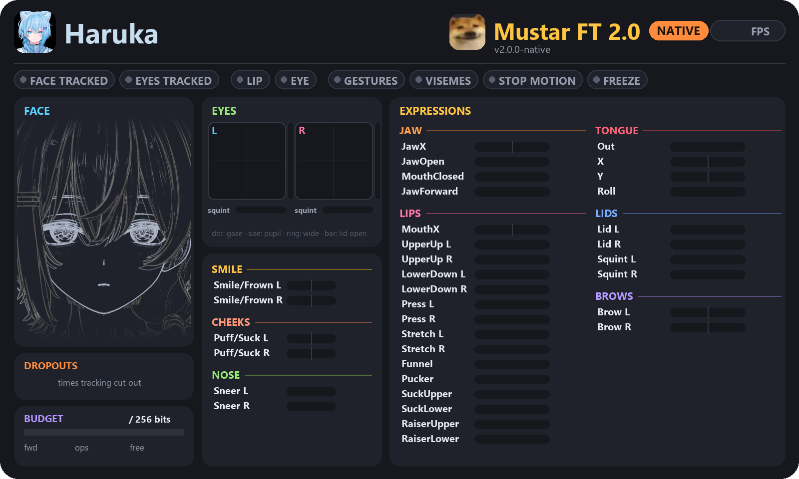

<a href="README.md">English</a> · <a href="README.ja.md">日本語</a> · <b>中文</b>

<h1 align="center">Haruka Face Tracking</h1>

mFT v2.0.0-native_V1 for <b>はるか -Haruka- by BLUESTELLA</b>

<a href="https://mustarlabs.booth.pm/items/9103429">mFT on BOOTH</a> · <a href="https://booth.pm/en/items/8591283">はるか -Haruka- by BLUESTELLA</a> · <a href="https://youtu.be/BaPW5rd_xLo">Demo video</a>

## Expressions

FT shapes, each looping 0 → 1 → 0. Left and right are as you look at the avatar (its own left shows on your right).  
FT シェイプ (0 → 1 → 0)。左右は見ている人から見た向き。

<table>
<tr><td align="center"> EyeClosed (left)</td><td align="center"> EyeWide (left)</td><td align="center"> EyeSquint (left)</td><td align="center"> BrowInnerUp · BrowOuterUp (left, right)</td></tr>
<tr><td align="center"> BrowDown · BrowPinch (left, right)</td><td align="center"> CheekPuff (left)</td><td align="center"> JawOpen</td><td align="center"> JawForward (3/4)</td></tr>
<tr><td align="center"> MouthSmile</td><td align="center"> MouthFrown</td><td align="center"> MouthUpperUp + MouthLowerDown</td><td align="center"> Mouth (right)</td></tr>
<tr><td align="center"> LipPucker</td><td align="center"> LipFunnel</td><td align="center"> TongueOut</td><td align="center"> Tongue, all directions</td></tr>
</table>

### All shapes / 全シェイプ

Eyes (6)

<table>
<tr><td align="center"> EyeClosed (left)</td><td align="center"> EyeClosed (right)</td><td align="center"> EyeWide (left)</td><td align="center"> EyeWide (right)</td></tr>
<tr><td align="center"> EyeSquint (left)</td><td align="center"> EyeSquint (right)</td></tr>
</table>

Brows (3)

<table>
<tr><td align="center"> BrowInnerUp</td><td align="center"> BrowInnerUp · BrowOuterUp (left, right)</td><td align="center"> BrowDown · BrowPinch (left, right)</td></tr>
</table>

Cheeks and nose (8)

<table>
<tr><td align="center"> CheekPuff (left)</td><td align="center"> CheekPuff (right)</td><td align="center"> CheekSuck (left)</td><td align="center"> CheekSuck (right)</td></tr>
<tr><td align="center"> CheekSquint (left)</td><td align="center"> CheekSquint (right)</td><td align="center"> NoseSneer (left)</td><td align="center"> NoseSneer (right)</td></tr>
</table>

Jaw (5)

<table>
<tr><td align="center"> JawOpen</td><td align="center"> Jaw (left)</td><td align="center"> Jaw (right)</td><td align="center"> JawForward (3/4)</td></tr>
<tr><td align="center"> JawBackward (3/4)</td></tr>
</table>

Mouth (17)

<table>
<tr><td align="center"> MouthSmile</td><td align="center"> MouthSmile (left, right)</td><td align="center"> MouthFrown</td><td align="center"> MouthFrown (left, right)</td></tr>
<tr><td align="center"> MouthUpperUp + MouthLowerDown</td><td align="center"> MouthStretch (left)</td><td align="center"> MouthStretch (right)</td><td align="center"> MouthPress (left)</td></tr>
<tr><td align="center"> MouthPress (right)</td><td align="center"> MouthDimple (left)</td><td align="center"> MouthDimple (right)</td><td align="center"> MouthTightener (left)</td></tr>
<tr><td align="center"> MouthTightener (right)</td><td align="center"> MouthRaiserUpper</td><td align="center"> MouthRaiserLower</td><td align="center"> Mouth (left)</td></tr>
<tr><td align="center"> Mouth (right)</td></tr>
</table>

Lips (4)

<table>
<tr><td align="center"> LipFunnel</td><td align="center"> LipPucker</td><td align="center"> LipSuckUpper</td><td align="center"> LipSuckLower</td></tr>
</table>

Tongue (11)

<table>
<tr><td align="center"> TongueOut</td><td align="center"> Tongue, all directions</td><td align="center"> TongueUp</td><td align="center"> TongueDown</td></tr>
<tr><td align="center"> Tongue (left)</td><td align="center"> Tongue (right)</td><td align="center"> TongueRoll</td><td align="center"> TongueUp (left)</td></tr>
<tr><td align="center"> TongueUp (right)</td><td align="center"> TongueDown (left)</td><td align="center"> TongueDown (right)</td></tr>
</table>

## 中文

### 简介

- Haruka 的嘴、眼睛、舌头、脸颊和眉毛随你的脸而动。70 个面捕形态键。
- 视线使用他真实的眼骨：向外 49°，向内 49°，上下 27° / 47°。
- Stop Motion 模式 (动画模式)：脸保持姿势，每秒跳变 8 次，嘴随声音利落切换。
- 一键安装。绝不改动原始文件。
- 不含 はるか 本体和面捕设备。

mFT 使用我从零编写的模板，是给想要更丰富工具和更强表现力的人的选择。

### 数字及其含义

| 数字 | 含义 |
|---|---|
| 自己 +0.29 ms，他人 +0.28 ms (原生) | 每帧增加的开销。经典版：自己 +0.40 ms，他人 +0.39 ms。他自身的 FX 约 0.02 ms。 |
| 76 / 256 (原生)，222 / 256 (经典) | 同步参数。原生：他自身的 38 + 附加功能 38 (Full) 或 9 (Light，合计 47)。面部本身 0 bit。 |
| 124 个形态键 + 他的 728 个 | 70 个用于面捕，39 个是他表情部件的副本，15 个口型 35%。他的形态键一个都不删。 |
| 舌头 10 个姿势 | 上下左右、斜向、卷舌。伸舌分 4 段。 |
| 包 2.6 MB | 只有形态差异，不含模型数据。 |

### 内容

- 游戏内校准和 7 个微调旋钮。
- 调试面板：实时显示脸、眼睛和所有表情数值。从菜单打开，也可在安装器中添加左手腕按钮。
- 平滑 关闭 / 5 到 30 ms，或 Stop Motion。他人看到的与你的设置相同。
- FT anime visemes：嘴随声音利落切换，叠加在追踪之上。
- 冻结、瞳孔 (模拟 / 追踪器)，眼睛随表情反应 (微笑、瞪眼、向下看)。
- 11 个表情：猫眼、闪亮、眼泪、脸色发青、白眼、流汗、脸颊线、害羞、晕眩、爱心、死鱼眼。
- 统一咬合：闭嘴时他的牙齿保持同一个干净的位置。
- 牙齿菜单 (在安装器中选择)：Long Fangs、No Fangs、Shark Teeth。
- 面捕开启时，摸头和拉耳朵照常使用。
- PaperTrackerMode：Paper Tracker 同时触发 funnel 和 pucker 时，只用较强的一个。
- 舌头保护：嘴几乎闭着时舌头不会伸出，向上和斜上的姿势要等嘴张得够大才出现。
- 眼睑跟随视线（向上看、向下看）。
- 摸头和拉耳朵时，眨眼和眼睛笑会暂停，不会和他自己的表情叠在一起。

### 模型上的变化

- 视线追踪开启时他的眨眼层暂停，关闭后恢复。
- 视线追踪开启时他的手势表情暂停，关闭后恢复。摸头不会暂停。
- 副本上牙齿保持统一咬合。卸载后恢复。
- 副本上的口型同步走我的层。卸载后恢复。
- 服装、兽耳、尾巴和头发菜单照常使用。

### 缺点

- 仅限 Haruka。已在 PC 测试，Quest 未测试。
- 校准和 Tune 会保存，但重置模型会恢复默认。
- 如果 Haruka 更新改变了脸部网格，需要更新版本。

### 需要

Haruka、VRChat SDK (3.10.6 或更新)、VRCFT，以及支持 VRCFT (Unified Expressions) 的面捕设备。VRCFT 使用 Steam 版 (main 或 beta 分支均可)。Haruka 本体请按 BLUESTELLA 的说明书操作 (lilToon 和 Modular Avatar 用最新版)。

### 技术细节

- 开销测量：在 Unity 中比较他的 FX 与构建后的 FX，取重复 10 帧运行的最快值 (2026-11-06)。误差约 15%。
- 网格 15,130 顶点。已在 Haruka 预制体上确认。
- 法线增量为零，他的脸部阴影保持干净。
- 舌头形态键只动舌头；只有下巴和舌头同时动作时才触发小修正 (0 bit)。
- 全新导入的结果与开发版本完全一致。

---

> **Mustard Awards**  
> **Haruka: 8 / 10 mustard cans.**  
> How well the model behaved on the way to face tracking. Higher is better.  
> Plus: 728 shapes with clean left/right splits, real eye bones, and rich mouth, teeth and tongue parts.  
> Minus: a small mouth, and eyes that glide on a big sphere: for a cartoonish eye glide, a flatter, planar movement would read better.

## 调试面板

