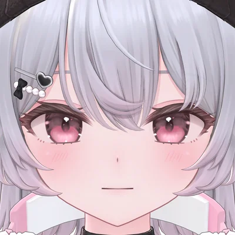
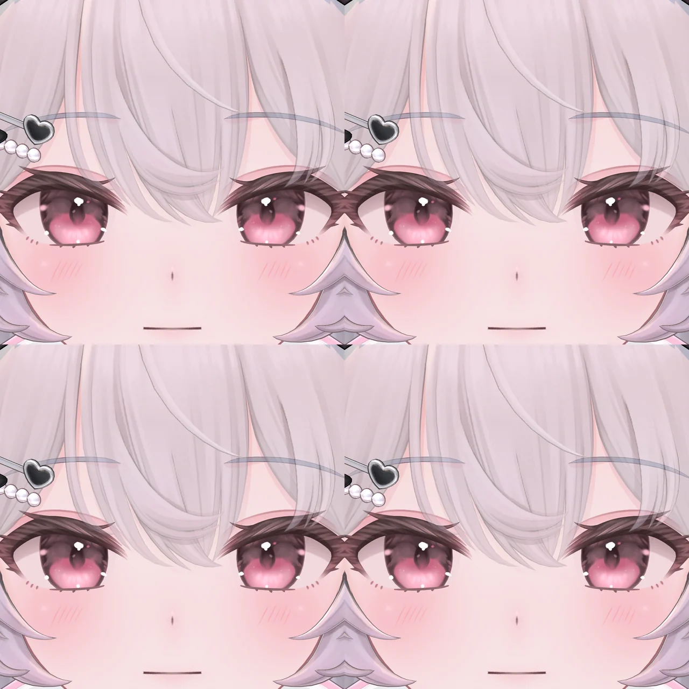
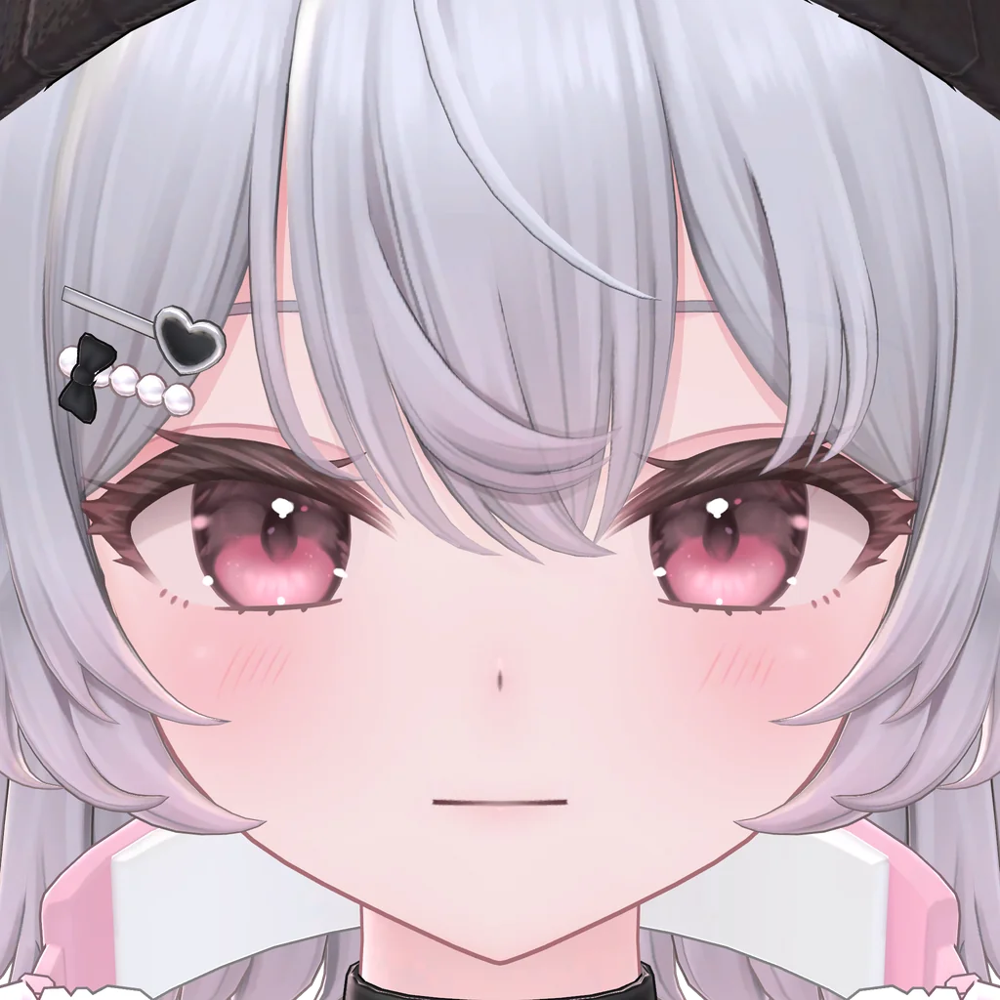
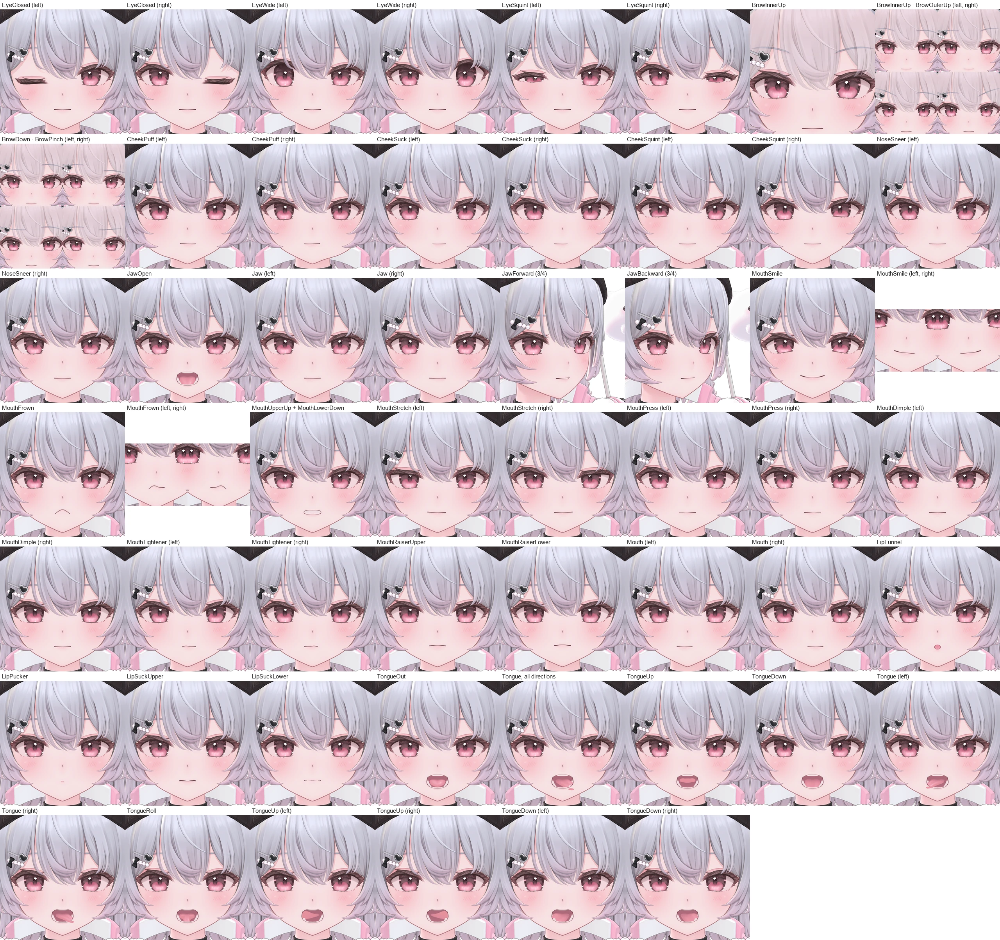
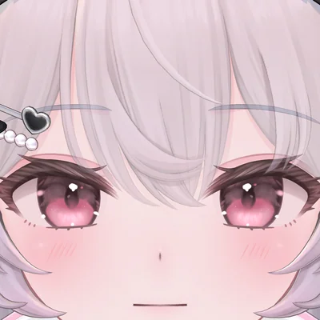
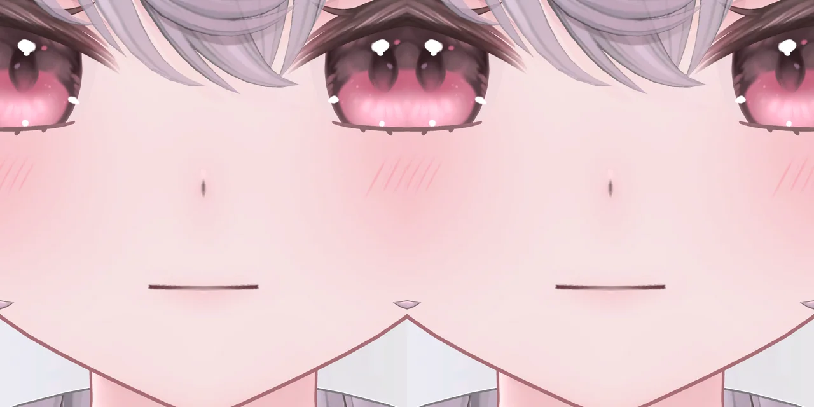

# Lunary Face Tracking v2.0.0-native

**▶▶▶ FT シェイプを動くプレビューでチェック! / Preview the FT shapes here: [github.com/mustar22/mFT/tree/main/Lunary#expressions](https://github.com/mustar22/mFT/tree/main/Lunary#expressions) ◀◀◀**

Free report. Read this before you buy: what you get, what changes on your avatar, and the numbers, explained.
Face tracking for **Lunary** and **Lunary Kisekae** by あまのえむ (mellowpink). Built by mustar. Native (VRChat's built-in FT) and classic install in one package.

**Special thanks to the testers: あまのえむ (mellowpink), タケオ**

Demo video: [https://youtu.be/cTbftDgtHQg](https://youtu.be/cTbftDgtHQg)

> **Mustard Awards**
> **Lunary: 9 / 10 mustard cans.**
> How well the model behaved on the way to face tracking. Higher is better.

---

[日本語](#日本語) · [English](#english)

## 日本語

### 概要

- ルナリィの口、目、舌、頬、眉があなたの顔に合わせて動きます。彼女の顔のために造形したシェイプ 72 個。
- 本物のアイボーンで視線が動きます: 外 16°、内 18°、上 9°、下 12°。まぶたも視線についてきます。
- 導入はボタンひとつ。元のファイルには一切触れません。
- ルナリィ本体とフェイストラッキング機器は含まれません。

mFT はゼロから作った独自テンプレートで、より幅広いツールと豊かな表現力を求める人のための選択肢です。

### 数字とその意味

| 数字 | 意味 |
|---|---|
| 自分 +0.56 ms、他の人 +0.60 ms (ネイティブ) | 1 フレームあたりの追加負荷。2026-11-20 にきれいなシーンで計測、上限と考えてください。従来版 (v1.4 で計測): 自分 +0.80 ms、他の人 +0.74 ms。ライトは約 0.2 ms 軽くなります。 |
| 89 / 256 (ネイティブ)、222 / 256 (従来版フル)、200 / 256 (従来版ライト) | 同期パラメーター。ネイティブは別々に数えます: 彼女自身 63 + FT 26 (フル) または 8 (ライト)。顔の動き自体は 0 bit。Kisekae の従来版: 203 / 181。彼女のメニューは詰め直し、スライダーは段階ボタンになります。 |
| シェイプ 72 個 + 彼女の 1,056 個 | 彼女の顔のために造形。彼女のシェイプはひとつも消しません。 |
| 舌 10 ポーズ、最大 13.9 mm | 上、下、左右、斜め、ロール。 |
| パッケージ 3.3 MB | 差分データのみ。アバター本体のデータは入っていません。 |

### 中身

- ワールド内キャリブレーションと微調整ダイヤル 7 種。
- デバッグパネル: 顔、目、全表情の値をその場で表示。左手首のボタンで開閉。
- スムージング Off / 5〜30 ms、または Stop Motion。見ている人にも設定どおりに映ります。
- フリーズと瞳 (エミュレートまたはトラッカー)。
- アニメ風の効果線とエモート 7 種。
- すぼめ口では歯と舌が奥に引っ込み、唇から何も飛び出しません。
- 見ている人には目に小さな自然な揺れが見えます。0 bit。

### アバターで変わること

- 顔と目はフェイストラッキングが担当するので、表情パペット、フェイスセット、手動の目の操作は外れます。
- ハンドジェスチャーの表情は初期オフ (メニューで ON)。
- スライダー (髪の長さ、リムライトなど) は段階ボタンになります。
- エモートは Face Tracking メニュー (Extras) に移ります。
- それ以外はそのままです。

### 弱点

- ルナリィとルナリィ Kisekae 専用。 PC で確認、Quest は未検証。
- キャリブレーションと Tune は保存されますが、アバターのリセットでは初期値に戻ります。
- ヒンディー語とアラビア語はキャリブレーションパネルのみ。メニューとパッチャーは英語表示です。
- ルナリィの更新で顔のメッシュが変わると、対応版が必要です。

### 必要なもの

ルナリィまたはルナリィ Kisekae、VRChat SDK (3.10.6 以降)、VRCFT (Steam 版、メインでもベータブランチでも可)、VRCFT (Unified Expressions) で動くフェイストラッカー。

### 技術的な詳細

- 負荷の測り方: Unity 上でアバター自身の FX と完成した FX を比較、10 フレームの実行を繰り返した中央値。ネイティブは 2026-11-20 にきれいなシーンで計測、その日の誤差は約 30%。
- 顔メッシュ 14,199 頂点 / 23,546 三角形。
- デバッグパネルは 1 つのメッシュ (以前は約 150 個のオブジェクト)。
- スムージングはフレームレートに左右されず、設定は 3 bit で同期。Stop Motion はその設定値のひとつなので追加コストなし。
- ネイティブ: 式の命令 140、フェイストラッキング演算 325。

---

## English

### In short

- Lunary's mouth, eyes, tongue, cheeks and brows move with your face. 72 shapes sculpted for her face.
- Gaze on her real eye bones: 16° out, 18° in, 9° up, 12° down, and the lids follow where you look.
- One button to install. Your original files are never touched.
- Lunary and a face tracking device are not included.

mFT runs on my own template, written from scratch, for people who want a wider toolkit and more expressiveness.

### The numbers, and what they mean

| number | what it means |
|---|---|
| You +0.56 ms, viewers +0.60 ms (native) | Added per frame. Measured 2026-11-20 in a clean scene, treat it as an upper bound. Classic (measured on v1.4): you +0.80 ms, viewers +0.74 ms. Light is about 0.2 ms lighter. |
| 89 / 256 (native), 222 / 256 (classic Full), 200 / 256 (classic Light) | Synced parameters. Native counts them apart: her own 63 + FT 26 (Full) or 8 (Light). The face itself is 0 bits. Kisekae classic: 203 / 181. Her menu is repacked: sliders become step buttons. |
| 72 shapes + her 1,056 | Sculpted for her face. None of hers removed. |
| 10 tongue poses, up to 13.9 mm | Up, down, sideways, diagonals, roll. |
| Package 3.3 MB | Shape differences only, no avatar data. |

### What you get

- In-world calibration and 7 fine-tune dials.
- Debug panel: face, eyes and every expression value, live. A button on your left wrist opens it.
- Smoothing Off / 5 to 30 ms, or Stop Motion. Viewers see you as you set it.
- Freeze and pupils (emulated or tracker).
- Anime FX lines and 7 emotes.
- On a pucker the teeth and tongue tuck back, nothing pokes through the lips.
- Living eyes: viewers see tiny natural eye flicks. 0 bits.

### What changes on your avatar

- Face tracking takes over the face and eyes, so her expression puppet, face sets and manual eye control are removed.
- Hand gesture expressions start off (menu toggle).
- Sliders (hair length, rim light and so on) become step buttons.
- Emotes move into the Face Tracking menu (Extras).
- Everything else stays as it was.

### Cons

- Lunary and Lunary Kisekae only. Tested on PC, Quest is untested.
- Calibration and Tune are saved, but Reset Avatar puts them back to default.
- Hindi and Arabic: calibration panel only, the menu and patcher show English.
- If a Lunary update changes the face mesh, an updated version is needed.

### You need

Lunary or Lunary Kisekae, the VRChat SDK (3.10.6 or newer), VRCFT (Steam, main or beta branch), and a face tracker that works with VRCFT (Unified Expressions).

### Technical details

- How cost was measured: the avatar's own FX against the built one in Unity, the median of repeated 10-frame runs. Native measured 2026-11-20 in a clean scene; editor noise that day was about 30%.
- Face mesh 14,199 verts / 23,546 tris.
- The debug panel is one mesh (it used to be about 150 objects).
- Smoothing is frame-rate exact and your preset syncs in 3 bits. Stop Motion is one of the preset's values, so it costs nothing extra.
- Native: 140 expression instructions, 325 face-tracking operations.

---

## Debug panel

## Expressions

FT シェイプ (0 → 1 → 0)。左右は見ている人から見た向き。 FT shapes, each looping 0 → 1 → 0. Left and right are as you look at the avatar (its own left shows on your right).

<table>
<tr><td align="center"> EyeClosed (left)</td><td align="center"> EyeWide (left)</td><td align="center"> EyeSquint (left)</td><td align="center"> BrowInnerUp · BrowOuterUp (left, right)</td></tr>
<tr><td align="center"> BrowDown · BrowPinch (left, right)</td><td align="center"> CheekPuff (left)</td><td align="center"> JawOpen</td><td align="center"> JawForward (3/4)</td></tr>
<tr><td align="center"> MouthSmile</td><td align="center"> MouthFrown</td><td align="center"> MouthUpperUp + MouthLowerDown</td><td align="center"> Mouth (right)</td></tr>
<tr><td align="center"> LipPucker</td><td align="center"> LipFunnel</td><td align="center"> TongueOut</td><td align="center"> Tongue, all directions</td></tr>
</table>

### All shapes / 全シェイプ

Eyes (6)

<table>
<tr><td align="center"> EyeClosed (left)</td><td align="center"> EyeClosed (right)</td><td align="center"> EyeWide (left)</td><td align="center"> EyeWide (right)</td></tr>
<tr><td align="center"> EyeSquint (left)</td><td align="center"> EyeSquint (right)</td></tr>
</table>

Brows (3)

<table>
<tr><td align="center"> BrowInnerUp</td><td align="center"> BrowInnerUp · BrowOuterUp (left, right)</td><td align="center"> BrowDown · BrowPinch (left, right)</td></tr>
</table>

Cheeks and nose (8)

<table>
<tr><td align="center"> CheekPuff (left)</td><td align="center"> CheekPuff (right)</td><td align="center"> CheekSuck (left)</td><td align="center"> CheekSuck (right)</td></tr>
<tr><td align="center"> CheekSquint (left)</td><td align="center"> CheekSquint (right)</td><td align="center"> NoseSneer (left)</td><td align="center"> NoseSneer (right)</td></tr>
</table>

Jaw (5)

<table>
<tr><td align="center"> JawOpen</td><td align="center"> Jaw (left)</td><td align="center"> Jaw (right)</td><td align="center"> JawForward (3/4)</td></tr>
<tr><td align="center"> JawBackward (3/4)</td></tr>
</table>

Mouth (17)

<table>
<tr><td align="center"> MouthSmile</td><td align="center"> MouthSmile (left, right)</td><td align="center"> MouthFrown</td><td align="center"> MouthFrown (left, right)</td></tr>
<tr><td align="center"> MouthUpperUp + MouthLowerDown</td><td align="center"> MouthStretch (left)</td><td align="center"> MouthStretch (right)</td><td align="center"> MouthPress (left)</td></tr>
<tr><td align="center"> MouthPress (right)</td><td align="center"> MouthDimple (left)</td><td align="center"> MouthDimple (right)</td><td align="center"> MouthTightener (left)</td></tr>
<tr><td align="center"> MouthTightener (right)</td><td align="center"> MouthRaiserUpper</td><td align="center"> MouthRaiserLower</td><td align="center"> Mouth (left)</td></tr>
<tr><td align="center"> Mouth (right)</td></tr>
</table>

Lips (4)

<table>
<tr><td align="center"> LipFunnel</td><td align="center"> LipPucker</td><td align="center"> LipSuckUpper</td><td align="center"> LipSuckLower</td></tr>
</table>

Tongue (11)

<table>
<tr><td align="center"> TongueOut</td><td align="center"> Tongue, all directions</td><td align="center"> TongueUp</td><td align="center"> TongueDown</td></tr>
<tr><td align="center"> Tongue (left)</td><td align="center"> Tongue (right)</td><td align="center"> TongueRoll</td><td align="center"> TongueUp (left)</td></tr>
<tr><td align="center"> TongueUp (right)</td><td align="center"> TongueDown (left)</td><td align="center"> TongueDown (right)</td></tr>
</table>

