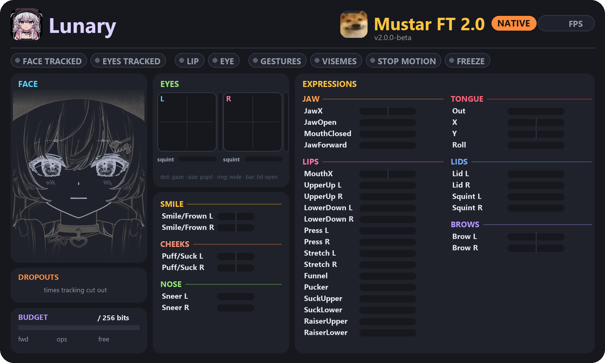

# Lunary Face Tracking v1.4.1 + mFT 2.0 native v2.0.0-beta

Free report. Read this before you buy: what you get, what changes on your avatar, and the numbers, explained.
Face tracking for **Lunary** and **Lunary Kisekae** by あまのえむ (mellowpink). Built by mustar.

**Special thanks to the testers: あまのえむ (mellowpink), タケオ**

> **Mustard Awards**
> **Lunary: 9 / 10 mustard cans.**
> How well the model behaved on the way to face tracking. Higher is better.

---

[日本語](#日本語) · [English](#english)

## 日本語

### mFT 2.0 ネイティブ (ベータ)

- VRChat 本体のフェイストラッキングで動く導入方法を追加。パッチャーで **mFT 2.0: VRChat native face tracking (beta)** にチェック。チェックなしは従来どおりの導入です。
- 顔の同期パラメーターは 0 bit (VRChat が自分で同期)。彼女のメニュー込みで合計 89 / 256。
- キャリブレーション、スムージングとストップモーション、フリーズ、瞳 (エミュレート / トラッカー)、ハンドジェスチャー切替はそのまま使えます。
- 新しいデバッグパネル: 顔、目、全表情の値、途切れ回数、予算をその場で表示。目の前に出て、傾きません。
- キャリブレーションと Tune は保存され、再入室・アバター切替・更新後も残ります。アバターのリセットでは初期値に戻ります。対策を開発中 (試したもの: アップロード時に値を焼き込む、VRChat から値をライブで読む)。
- 必要なもの: VRChat オープンベータ、VRChat SDK 3.10.6-beta.3 以降、VRCFT。PC で確認、Quest は未検証。
- 負荷: 式の命令 140 / 512、フェイストラッキング演算 325。

### ひとことで

- ルナリィの口、目、舌、頬、眉があなたの顔と一緒に動きます。彼女の顔のために造形したシェイプ72個。
- 導入はボタン1回。必要なのは VRChat SDK だけで、他のツールは不要。
- 元のファイルには一切手を加えません。
- ルナリィ本体と、フェイストラッキング機器は別途必要です。

### 数値とその意味

| 数値 | 意味 |
|---|---|
| 負荷 +0.80 ms / フレーム | 軽いです。定番の Adjerry テンプレートは +0.55 ms。v1.4 の最初の版は +4.5 ms だったので、リリース前に約1/5まで削りました。 |
| パラメータ 222 / 256 (フル) | VRChat のアバターは256まで。フェイストラッキングと彼女のメニュー全部を入れて34空き、他のギミック用に使えます。ライトなら56空き。着せ替え版は53 / 75空き。 |
| 彼女のメニュー 183 → 61 | 衣装、髪、アクセのメニューはそのまま使えます。スライダーは段階ボタンに (髪は5段階)。 |
| シェイプ 72個 + 彼女の1056個 | 彼女の顔専用に造形。元のシェイプは1つも消していません。 |
| スムージング 5 ms (初期) 〜 30 ms | トラッカーの細かい揺れを抑える強さ。数字が小さいほど反応が速く、大きいほどなめらか。見ている人にもあなたの設定のまま映ります。 |
| 視線 外16° / 内18° / 上9° / 下12° | 本物の目のボーンが動くので、瞳が滑らずちゃんと動きます。まぶたも視線についてきます。 |
| 舌 10ポーズ、最大13.9 mm | 上下左右、斜め、舌巻き。 |
| パッケージ 1.9 MB | 軽いです。 |

### できること

- ワールド内キャリブレーション: 点を目で追って表情を作るだけ。控えめな笑顔でもしっかり笑顔に。
- 表情キープ: 今の顔を固定、全員に見えます。
- デバッグパネル: トラッカーが今送っている値をその場で確認。
- アニメ線、エモート7種、感度ダイヤル7種、左手首のボタン。
- すぼめたときに歯と舌が下がり、唇を突き抜けません。
- キャリブパネルは10言語、パッチャーとメニューは8言語。

### アバターに加わる変更

- 顔と目はフェイストラッキングが担当するので、表情パペット、フェイスセット、手動の目操作はなくなります。
- ハンドジェスチャーの表情は初期OFF。トラッキング中の顔に重なりません。FT / フェイトラ > ハンドジェスチャー でいつでもON。
- スライダー (髪の長さ、リムライトなど) は段階ボタンに。
- エモートはフェイストラッキングのメニュー (おまけ) に移動。
- それ以外はすべてそのまま。

### 弱点

- ルナリィ / 着せ替え版専用。
- Adjerry テンプレートより少し重い (+0.25 ms)。ライト導入で約0.2 ms戻ります。
- 感度ダイヤルの値はアバターのリセットで戻ります。
- ヒンディー語とアラビア語はキャリブパネルのみ、メニューとパッチャーは英語。

### 必要なもの

ルナリィ または ルナリィ着せ替え版、VRChat SDK、VRCFT (Unified Expressions) で動くフェイストラッキング機器。

### 技術的な詳細

- 規格: VRCFT Unified Expressions v2、同期パラメータ39個。顔メッシュ 14,199頂点 / 23,546三角形。
- 負荷の測り方: Unity で彼女のコピーを動かし、10フレーム×30回の最速値。彼女自身の FX に上乗せされる分だけ。Adjerry テンプレートも同じ方法。他の人から見た時は +0.74 ms。
- 削ったもの: デバッグパネルを約150個のオブジェクトから1枚のメッシュに (約-1 ms)、「賢い」スムージングを廃止 (-0.8 ms)、スムージングを1値1クリップに (-0.3 ms)。
- スムージングはフレームレートに依存せず、選んだ設定は3 bitで同期。他の人側は届くパケットの間隔を実測して補間します。

---

## English

### mFT 2.0 native (beta)

- New install option on VRChat's own built-in face tracking: tick **mFT 2.0: VRChat native face tracking (beta)** in the patcher. Unticked = the classic install, unchanged.
- The face costs 0 synced bits (VRChat syncs it itself). Total with her menu: 89 / 256.
- Still there: calibration, smoothing + Stop Motion, Freeze, pupils (emulated or from the tracker), hand-gesture toggle.
- New debug panel: face, eyes, every expression value, dropouts and the budget, live. Spawns in front of you and stays level.
- Calibration and Tune are saved: they survive rejoining, avatar switches and updates. Reset Avatar still puts them back to default; I'm working on it (tried so far: baking the values in at upload, reading them live from VRChat).
- Needs VRChat open beta, VRChat SDK 3.10.6-beta.3 or newer, VRCFT. Tested on PC; Quest not tested.
- Cost: 140 / 512 expression instructions, 325 face-tracking ops.

### In short

- Lunary's mouth, eyes, tongue, cheeks and brows move with your face. 72 shapes sculpted for her face.
- One button to install. The VRChat SDK is the only thing you need, no other tools.
- Your original files are never touched.
- Lunary and a face tracking device are not included.

### The numbers, and what they mean

| number | what it means |
|---|---|
| +0.80 ms per frame | Light. The popular Adjerry template adds 0.55 ms. My first v1.4 build added 4.5 ms, so I cut it to about a fifth before release. |
| 222 / 256 parameters (Full) | VRChat caps every avatar at 256. With face tracking and her whole menu in, 34 are left for your other gimmicks. 56 with a Light install. Kisekae: 53 / 75 left. |
| Her menu: 183 → 61 | Every outfit, hair and accessory option still works. Sliders become step buttons (hair: 5 steps). |
| 72 shapes + her 1056 | Sculpted for her face. None of her own shapes removed. |
| Smoothing 5 ms (default) to 30 ms | How much tracker jitter gets calmed. Lower reacts faster, higher looks smoother. Others see you exactly as you set it. |
| Gaze 16° out / 18° in / 9° up / 12° down | Her real eye bones turn, so the iris moves instead of sliding. The lids follow where you look. |
| Tongue: 10 poses, up to 13.9 mm | Up, down, sideways, diagonals, roll. |
| Package 1.9 MB | Small. |

### What you get

- In-world calibration: follow the dot, make the faces. A small smile still reads as a full one.
- Freeze: holds your current face, everyone sees it.
- Debug panel: see what your tracker is sending, live.
- Anime FX lines, 7 emotes, 7 fine-tune dials, a button on your left wrist.
- On a pucker the teeth and tongue tuck back, nothing pokes through the lips.
- Calibration panel in 10 languages, patcher and menu in 8.

### What changes on your avatar

- Face tracking takes over the face and eyes, so her expression puppet, face sets and manual eye control are removed.
- Hand gesture expressions start OFF, so they don't pile on top of your tracked face. Turn them on anytime: Face Tracking > Hand Gestures.
- Sliders (hair length, rim light and so on) become step buttons.
- Emotes move into the Face Tracking menu (Extras).
- Everything else stays as it was.

### Cons

- Lunary and Lunary Kisekae only.
- A bit heavier than Adjerry's template (+0.25 ms). A Light install gets about 0.2 ms back.
- Fine-tune dials reset when you reset the avatar.
- Hindi and Arabic: calibration panel only, the menu and patcher show English.

### You need

Lunary or Lunary Kisekae, the VRChat SDK, and a face tracker that works with VRCFT (Unified Expressions).

### Technical details

- Standard: VRCFT Unified Expressions v2, 39 synced parameters. Face mesh 14,199 verts / 23,546 tris.
- How cost was measured: a copy of her running in Unity, fastest of 30 runs of 10 frames, counting only what lands on top of her own FX. Adjerry's template measured the same way. Viewers: +0.74 ms.
- What I cut: the debug panel from ~150 objects to one mesh (about -1 ms), dropped "smart" smoothing (-0.8 ms), one clip per value in the smoothing (-0.3 ms).
- Smoothing is frame-rate exact and your preset syncs in 3 bits. Viewers glide on the measured packet interval.

---

## Debug panel

## Expressions

Previews coming soon.
