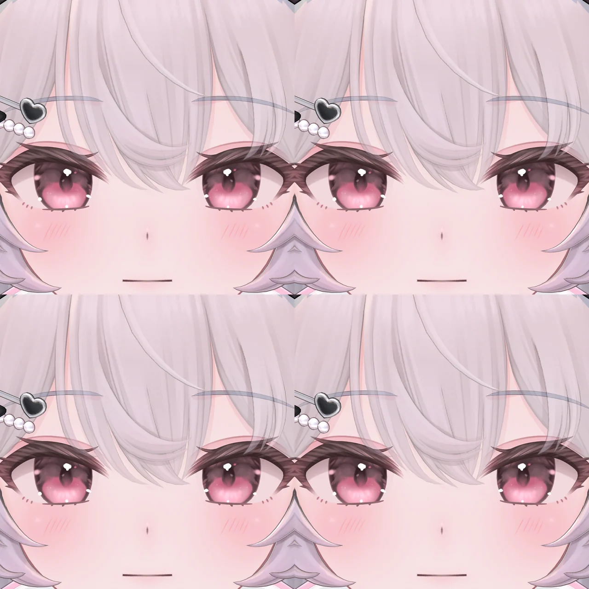
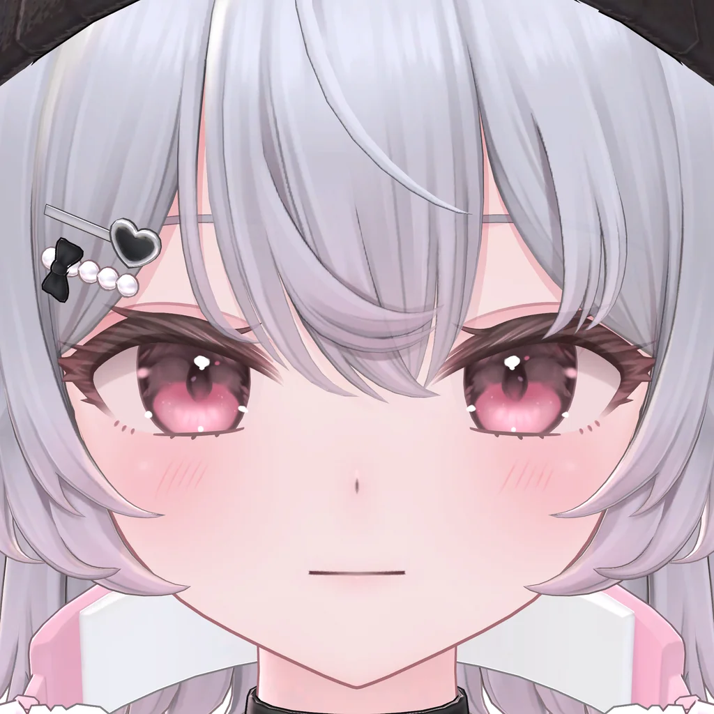
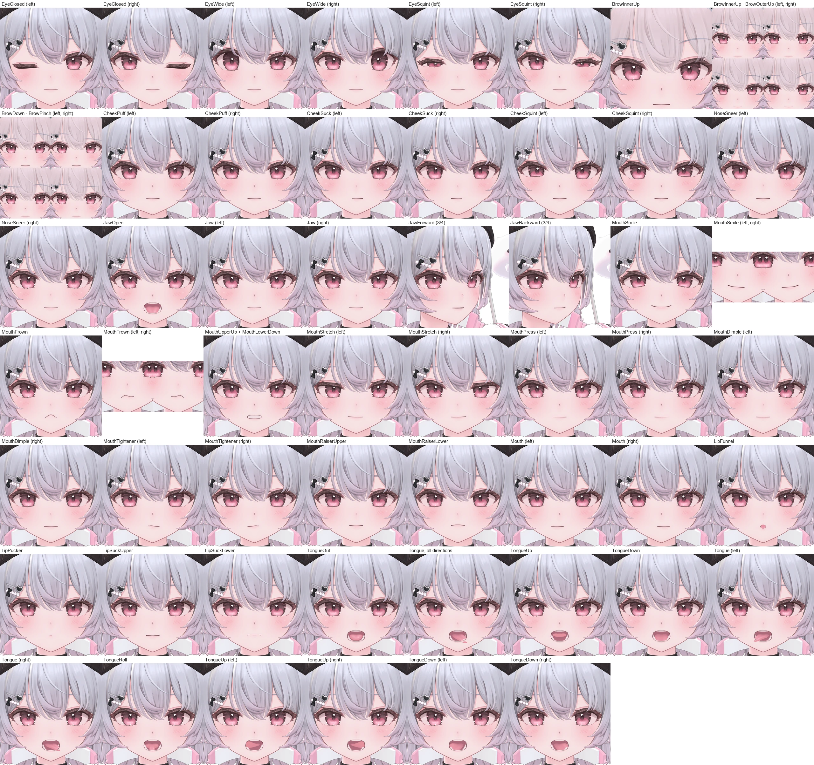
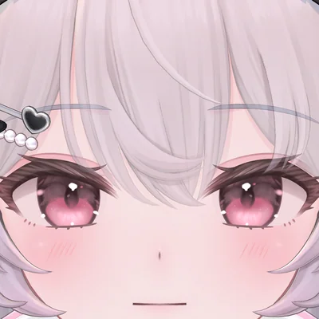
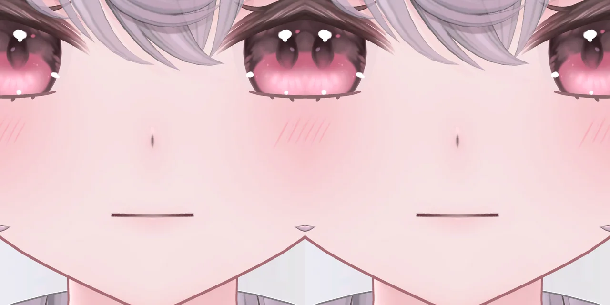
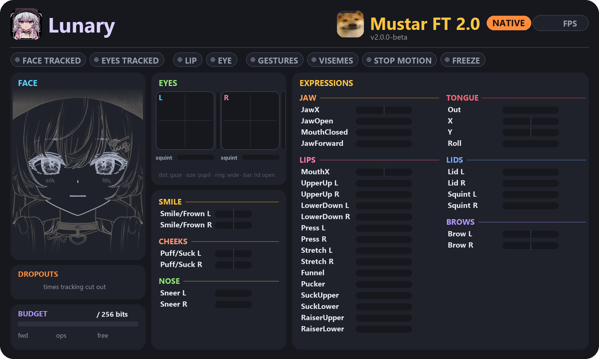

<a href="README.md">English</a> · <a href="README.ja.md">日本語</a> · <b>中文</b>

<h1 align="center">Lunary Face Tracking</h1>

mFT v2.0.0-native for <b>Lunary and Lunary Kisekae by あまのえむ (mellowpink)</b>

<a href="https://mustarlabs.booth.pm/items/8886565">mFT on BOOTH</a> · <a href="https://youtu.be/cTbftDgtHQg">Demo video</a>

<b>Special thanks to the testers: あまのえむ (mellowpink), タケオ</b>

## Expressions

FT shapes, each looping 0 → 1 → 0. Left and right are as you look at the avatar (its own left shows on your right).  
FT シェイプ (0 → 1 → 0)。左右は見ている人から見た向き。

<table>
<tr><td align="center"> EyeClosed (left)</td><td align="center"> EyeWide (left)</td><td align="center"> EyeSquint (left)</td><td align="center"> BrowInnerUp · BrowOuterUp (left, right)</td></tr>
<tr><td align="center"> BrowDown · BrowPinch (left, right)</td><td align="center"> CheekPuff (left)</td><td align="center"> JawOpen</td><td align="center"> JawForward (3/4)</td></tr>
<tr><td align="center"> MouthSmile</td><td align="center"> MouthFrown</td><td align="center"> MouthUpperUp + MouthLowerDown</td><td align="center"> Mouth (right)</td></tr>
<tr><td align="center"> LipPucker</td><td align="center"> LipFunnel</td><td align="center"> TongueOut</td><td align="center"> Tongue, all directions</td></tr>
</table>

### All shapes / 全シェイプ

Eyes (6)

<table>
<tr><td align="center"> EyeClosed (left)</td><td align="center"> EyeClosed (right)</td><td align="center"> EyeWide (left)</td><td align="center"> EyeWide (right)</td></tr>
<tr><td align="center"> EyeSquint (left)</td><td align="center"> EyeSquint (right)</td></tr>
</table>

Brows (3)

<table>
<tr><td align="center"> BrowInnerUp</td><td align="center"> BrowInnerUp · BrowOuterUp (left, right)</td><td align="center"> BrowDown · BrowPinch (left, right)</td></tr>
</table>

Cheeks and nose (8)

<table>
<tr><td align="center"> CheekPuff (left)</td><td align="center"> CheekPuff (right)</td><td align="center"> CheekSuck (left)</td><td align="center"> CheekSuck (right)</td></tr>
<tr><td align="center"> CheekSquint (left)</td><td align="center"> CheekSquint (right)</td><td align="center"> NoseSneer (left)</td><td align="center"> NoseSneer (right)</td></tr>
</table>

Jaw (5)

<table>
<tr><td align="center"> JawOpen</td><td align="center"> Jaw (left)</td><td align="center"> Jaw (right)</td><td align="center"> JawForward (3/4)</td></tr>
<tr><td align="center"> JawBackward (3/4)</td></tr>
</table>

Mouth (17)

<table>
<tr><td align="center"> MouthSmile</td><td align="center"> MouthSmile (left, right)</td><td align="center"> MouthFrown</td><td align="center"> MouthFrown (left, right)</td></tr>
<tr><td align="center"> MouthUpperUp + MouthLowerDown</td><td align="center"> MouthStretch (left)</td><td align="center"> MouthStretch (right)</td><td align="center"> MouthPress (left)</td></tr>
<tr><td align="center"> MouthPress (right)</td><td align="center"> MouthDimple (left)</td><td align="center"> MouthDimple (right)</td><td align="center"> MouthTightener (left)</td></tr>
<tr><td align="center"> MouthTightener (right)</td><td align="center"> MouthRaiserUpper</td><td align="center"> MouthRaiserLower</td><td align="center"> Mouth (left)</td></tr>
<tr><td align="center"> Mouth (right)</td></tr>
</table>

Lips (4)

<table>
<tr><td align="center"> LipFunnel</td><td align="center"> LipPucker</td><td align="center"> LipSuckUpper</td><td align="center"> LipSuckLower</td></tr>
</table>

Tongue (11)

<table>
<tr><td align="center"> TongueOut</td><td align="center"> Tongue, all directions</td><td align="center"> TongueUp</td><td align="center"> TongueDown</td></tr>
<tr><td align="center"> Tongue (left)</td><td align="center"> Tongue (right)</td><td align="center"> TongueRoll</td><td align="center"> TongueUp (left)</td></tr>
<tr><td align="center"> TongueUp (right)</td><td align="center"> TongueDown (left)</td><td align="center"> TongueDown (right)</td></tr>
</table>

## 中文

### 简介

- Lunary 的嘴、眼、舌、脸颊和眉毛随你的脸而动。为她的脸雕刻了 72 个形态键。
- 视线使用她真正的眼骨：向外 16°、向内 18°、向上 9°、向下 12°，眼睑也会跟着视线。
- 一键安装。绝不改动你的原始文件。
- 不包含 Lunary 本体和面捕设备。

mFT 使用我从零编写的模板，是给想要更丰富工具和更强表现力的人的选择。

### 数字及其含义

| 数字 | 含义 |
|---|---|
| 自己 +0.56 ms，他人 +0.60 ms (原生) | 每帧增加的开销。2026-11-20 在干净的场景中测得，请视为上限。经典版 (v1.4 测得)：自己 +0.80 ms，他人 +0.74 ms。Light 约轻 0.2 ms。 |
| 89 / 256 (原生)、222 / 256 (经典 Full)、200 / 256 (经典 Light) | 同步参数。原生分开计算：她自身 63 + FT 26 (Full) 或 8 (Light)。面部本身 0 bit。Kisekae 经典版：203 / 181。她的菜单重新打包，滑块变成分级按钮。 |
| 72 个形态键 + 她的 1,056 个 | 为她的脸雕刻。她的形态键一个都不删。 |
| 舌头 10 个姿势，最远 13.9 mm | 上、下、左右、斜向、卷舌。 |
| 包 3.3 MB | 只有形态差异，不含模型数据。 |

### 内容

- 场景内校准和 7 个微调旋钮。
- 调试面板：实时显示脸、眼睛和所有表情的数值。左手腕的按钮可开关。
- 平滑 关闭 / 5 到 30 ms，或 Stop Motion。别人看到的和你设置的一样。
- 定格和瞳孔 (模拟或追踪器)。
- 动漫效果线和 7 个表情。
- 嘟嘴时牙齿和舌头会往后收，不会从嘴唇穿出。
- 灵动的眼睛：别人能看到细微自然的眼球跳动。0 bit。

### 模型上的变化

- 面部和眼睛交给面捕，所以她的表情木偶、表情组和手动眼睛控制会被移除。
- 手势表情默认关闭 (菜单开关)。
- 滑块 (头发长度、轮廓光等) 变成分级按钮。
- 表情移到 Face Tracking 菜单 (Extras)。
- 其他一切保持原样。

### 缺点

- 仅限 Lunary 和 Lunary Kisekae。 已在 PC 上测试，Quest 未测试。
- 校准和 Tune 会保存，但重置模型会恢复默认值。
- 印地语和阿拉伯语仅有校准面板，菜单和补丁工具显示英文。
- 如果 Lunary 更新改变了脸部网格，需要对应的新版本。

### 需要

Lunary 或 Lunary Kisekae、VRChat SDK (3.10.6 或更新)、VRCFT (Steam 版，main 或 beta 分支均可)，以及支持 VRCFT (Unified Expressions) 的面捕设备。

### 技术细节

- 开销的测量方法：在 Unity 中比较模型自身的 FX 和完成后的 FX，取重复 10 帧运行的中位数。原生于 2026-11-20 在干净的场景中测得，当天编辑器误差约 30%。
- 脸部网格 14,199 顶点 / 23,546 三角形。
- 调试面板是一个网格 (以前约 150 个物体)。
- 平滑不受帧率影响，你的预设用 3 bit 同步。Stop Motion 是预设的一个值，不额外占用。
- 原生：140 条表达式指令，325 次面捕运算。

---

> **Mustard Awards**  
> **Lunary: 9 / 10 mustard cans.**  
> How well the model behaved on the way to face tracking. Higher is better.

## 调试面板

