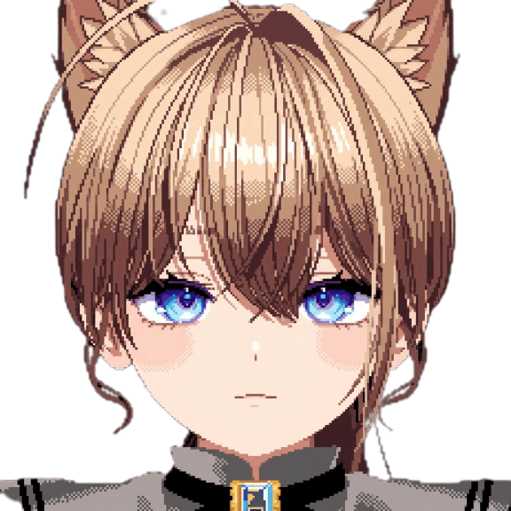
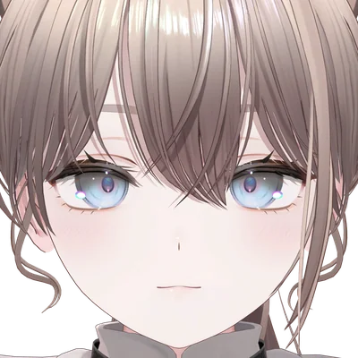
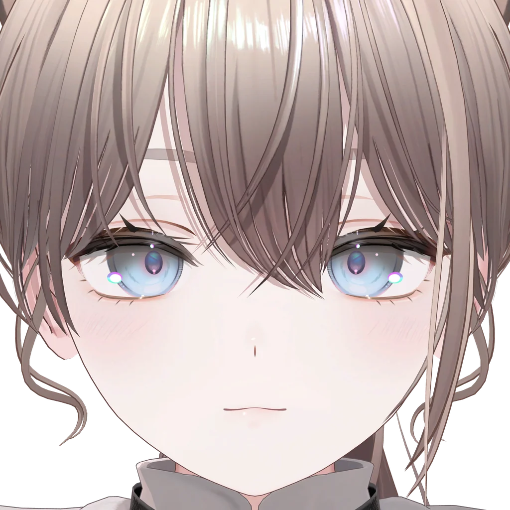
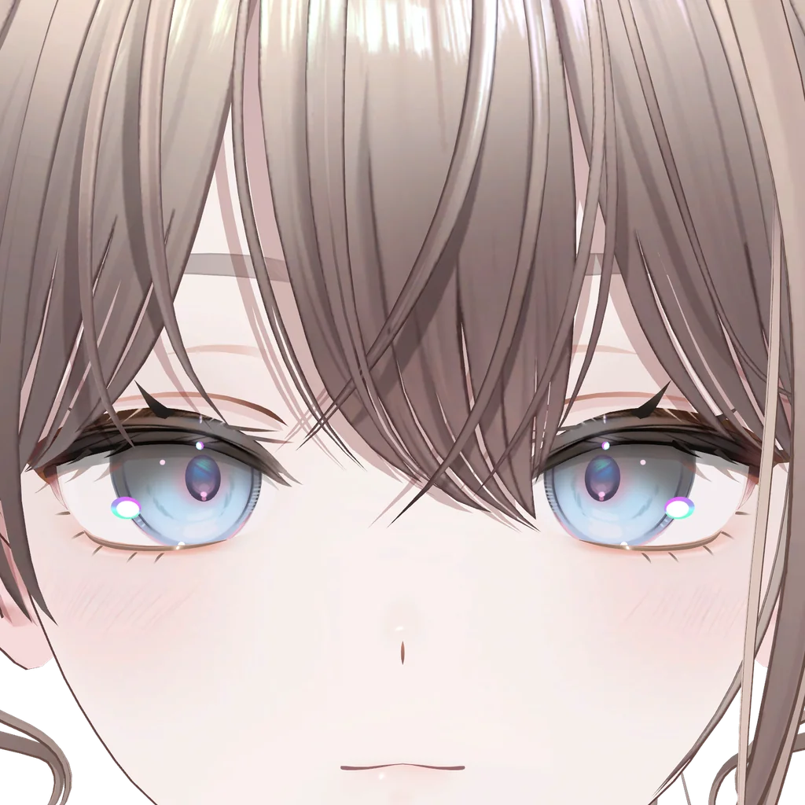
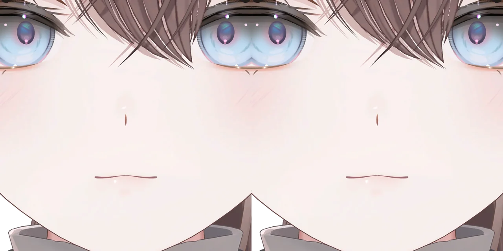
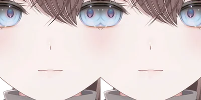

# Michella Face Tracking v1.0.1 + mFT 2.0 native v2.0.0-beta

Free report. Read this before you buy: what you get, what changes on your avatar, and the numbers, explained.
Face tracking for **Michella** by CEM DOLLS. Built by mustar.

Michella: [Michella by CEM DOLLS](https://booth.pm/en/items/8916626)

Demo video: [https://youtu.be/fPGB_iy_bqk](https://youtu.be/fPGB_iy_bqk)

> **Mustard Awards**
> **Michella: 7.5 / 10 mustard cans.**
> How well the model behaved on the way to face tracking. Higher is better.
> Plus: 536 shapes, more than enough to work with, with clean left/right splits for the eyes, lids and brows, and 11 face decals ready to become emotes.
> Minus: her mouth is small, which is nobody's fault, it is her design. The one real oddity: her eyeballs are flat discs, so the eyes needed a re-rig.

---

[日本語](#日本語) · [English](#english)

## 日本語

### mFT 2.0 ネイティブ (ベータ)

- VRChat 本体のフェイストラッキングで動く導入方法を追加。パッチャーで **mFT 2.0: VRChat native face tracking (beta)** にチェック。チェックなしは従来どおりの導入です。
- 顔の同期パラメーターは 0 bit (VRChat が自分で同期)。彼女のメニュー込みで合計 74 / 256。
- キャリブレーション、スムージングとストップモーション、フリーズ、瞳 (エミュレート / トラッカー)、ハンドジェスチャー切替はそのまま使えます。
- 新しいデバッグパネル: 顔、目、全表情の値、途切れ回数、予算をその場で表示。目の前に出て、傾きません。
- キャリブレーションと Tune は保存され、再入室・アバター切替・更新後も残ります。アバターのリセットでは初期値に戻ります。対策を開発中 (試したもの: アップロード時に値を焼き込む、VRChat から値をライブで読む)。
- 必要なもの: VRChat オープンベータ、VRChat SDK 3.10.6-beta.3 以降、VRCFT。PC で確認、Quest は未検証。
- 負荷: 式の命令 140 / 512、フェイストラッキング演算 325。

### ひとことで

- ミシェラ の口、目、舌、頬、眉があなたの顔に合わせて動きます。彼女の顔のために造形したシェイプ30個。
- アニメモード: 顔がポーズを保って1秒に8回切り替わり、口は声に合わせて動きます。
- 導入はボタンひとつ。フェイストラッキングに必要なのは VRChat SDK だけ。
- 元のファイルには一切触れません。
- ミシェラ 本体とフェイストラッキング機器は含まれません。

### 数字とその意味

| 数字 | 意味 |
|---|---|
| 1フレーム +0.80 ms (フル)、+0.33 ms (ライト) | あなたの側でフェイストラッキングが足す負荷。他の人から見て: フル +0.75 ms、ライト +0.30 ms。彼女自身の FX は約 0.10 ms。 参考: 定番の Adjerry テンプレートは +0.47 ms (他の人から見て +0.65 ms)。同じ方法で私が Lunary で計測した値で、Michella での計測ではありません (2026-10-03)。皮肉な話ですが、世の中の数字の多くと同じく、これも自己申告です :') |
| 219 / 256 パラメーター (フル)、187 / 256 (ライト) | VRChat の上限は 256。全部入れても 37 残り、他のギミックに使えます。ライトなら 187 で、69 残ります。 |
| 彼女のメニュー: 55 → 47 bit | 外れるのは Face 表情メニューだけ。Backlit や他のトグルはそのまま。 |
| シェイプ 78個 + 彼女の 536個 | 造形30、彼女のシェイプのミックス23、左右に分けた半分10、20%のビセーム15。彼女のシェイプはひとつも消しません。 |
| 瞳の移動: 左右 約12 mm、上下 約10 mm | 瞳が動ける距離。どの角度でも白目は目の中に収まります。 |
| なめらかさ 5 ms (標準) から 30 ms、または Stop Motion | トラッカーの細かい震えをどれだけ抑えるか。Stop Motion はポーズを保って1秒に8回切り替えるアニメ風。見ている人にも設定どおりに映ります。 理由: 手描きアニメは1秒に8〜12枚の絵で動きます。なめらかすぎる顔は3Dっぽく見えるので、パッと切り替わるほうがアニメに近く、私はこれがかっこいいと思っています。眼球はなめらかなまま: 8 fps だときつく見えたので変えていません。 |
| 舌: 10ポーズ | 上、下、左右、斜め、ロール。どれも彼女の小さな口に合わせて細くした完成形。 |
| 目の揺れ、0 bit | 見ている人に小さな自然な目の動きが見えます。パラメーターは使いません。 |
| パッケージ 1.6 MB | 小さいです。 |

### 入っているもの

- ワールド内キャリブレーション: 点を目で追い、表情を作るだけ。小さな笑顔もしっかり笑顔に。
- 表情キープ: 今の顔を固定、全員に見えます。
- デバッグパネル: トラッカーが送っている値をその場で確認。
- エモート11種 (猫目、うるうる、キラキラ、涙、青ざめ、白目、ショック、ほっぺ、照れ、ぐるぐる、ハート): それぞれメニューでON。多くは表情で発動します。
- 目が表情に合わせて動きます: 笑顔で目が笑い、眉を下げるとにらみ、下を見るとまぶたが下がります。
- 声で動く口: 口のポーズがパキッと切り替わり、声が大きいほど大きく。トラッキングに重なります。トグルひとつ。
- 微調整ダイヤル7種、左手首のボタン。
- キャリブレーションパネルは10言語、パッチャーとメニューは8言語。

### アバターの変わるところ

- 顔はフェイストラッキングが担当するので、コピー側では彼女の Face 表情メニューが外れます。
- 視線トラッキング中は彼女の自動まばたきが止まり、切ると戻ります。
- ハンドジェスチャーの表情は初期オフ。トラッキング中の顔に重なりません。Face Tracking > Hand Gestures でいつでもオンに。
- コピー側のリップシンクは私のレイヤーが動かします。アンインストールで彼女の設定に戻ります。
- それ以外はそのままです。

### 弱点

- ミシェラ 専用。PC で確認、Quest は未検証。
- 微調整ダイヤルはアバターをリセットすると戻ります。
- ヒンディー語とアラビア語はキャリブレーションパネルのみ。エモート名、Stop Motion、FT anime visemes はどの言語でも英語です。

### 必要なもの

ミシェラ、VRChat SDK、VRCFT (Unified Expressions) 対応のフェイストラッキング機器。ミシェラ 本体 (Modular Avatar、lilToon) の導入は CEM DOLLS さまの説明に従ってください。

### 技術的な詳細

- 規格: VRCFT Unified Expressions v2、同期パラメーター39個。顔メッシュ 9,649 頂点。
- 負荷の測り方: Unity 上で彼女を動かし、彼女自身の FX と組み込み後の FX を比較。10フレームの計測を繰り返した最速値 (2026-10-05)。
- 目: 彼女の目は平らな円盤なので、コピー側では回転軸を円盤の100 mm 後ろに置き、瞳のまわりの白い輪を切り取ります。瞳は彼女自身の動かない白目の上をすべります。コピーには専用のヒューマノイドが付き、彼女のファイルはそのままです。
- 口を閉じるシェイプは顎の開き具合が上限。法線も顎のシェイプをちょうど打ち消します。
- スムージングはフレームレートに左右されず、設定は3 bitで同期。Stop Motion はその設定値のひとつなので追加の bit はゼロ。
- 声で動く口は、VRChat がもともと全員に送っている Viseme と Voice の値を使います。

---

## English

### mFT 2.0 native (beta)

- New install option on VRChat's own built-in face tracking: tick **mFT 2.0: VRChat native face tracking (beta)** in the patcher. Unticked = the classic install, unchanged.
- The face costs 0 synced bits (VRChat syncs it itself). Total with her menu: 74 / 256.
- Still there: calibration, smoothing + Stop Motion, Freeze, pupils (emulated or from the tracker), hand-gesture toggle.
- New debug panel: face, eyes, every expression value, dropouts and the budget, live. Spawns in front of you and stays level.
- Calibration and Tune are saved: they survive rejoining, avatar switches and updates. Reset Avatar still puts them back to default; I'm working on it (tried so far: baking the values in at upload, reading them live from VRChat).
- Needs VRChat open beta, VRChat SDK 3.10.6-beta.3 or newer, VRCFT. Tested on PC; Quest not tested.
- Cost: 140 / 512 expression instructions, 325 face-tracking ops.

### In short

- Michella's mouth, eyes, tongue, cheeks and brows move with your face. 30 shapes sculpted for her face.
- An anime mode: the face holds a pose and jumps to the next 8 times a second, and the mouth follows your voice.
- One button to install. For the face tracking, the VRChat SDK is all you need.
- Your original files are never touched.
- Michella and a face tracking device are not included.

### The numbers, and what they mean

| number | what it means |
|---|---|
| +0.80 ms per frame (Full), +0.33 ms (Light) | What the face tracking adds on your side. Viewers: Full +0.75 ms, Light +0.30 ms. Her own FX costs about 0.10 ms. For reference: the popular Adjerry template adds +0.47 ms (viewers +0.65 ms), measured by me the same way on Lunary, not on Michella (2026-10-03). And yes, the irony is real: like most numbers out there, these are self-reported :') |
| 219 / 256 parameters (Full), 187 / 256 (Light) | VRChat caps every avatar at 256. With all of it in, 37 are left for your other gimmicks. A Light install is 187, so 69 are left. |
| Her menu: 55 → 47 bits | Only her Face expression menu goes. Backlit and her other toggles stay. |
| 78 shapes + her 536 | 30 sculpted, 23 mixes of her own shapes, 10 left/right halves, 15 visemes at 20%. None of her own shapes removed. |
| Eye travel: about 12 mm sideways, 10 mm up and down | How far the iris can move. The eye white stays inside the eye at any angle. |
| Smoothing 5 ms (default) to 30 ms, or Stop Motion | How much tracker jitter gets calmed. Stop Motion holds each pose and jumps 8 times a second, anime style. Others see you exactly as you set it. Why: hand-drawn anime moves at 8 to 12 drawings a second, and a face that glides too smoothly looks 3D. Snapping reads closer to a cartoon, and I just think it's cool. The eyeballs stay smooth: at 8 fps they looked too harsh, so they are unchanged. |
| Tongue: 10 poses | Up, down, sideways, diagonals, roll. Each is a complete pose, slimmed to fit her small mouth. |
| Eye flicks, 0 bits | Viewers see tiny natural eye flicks. Costs no parameters. |
| Package 1.6 MB | Small. |

### What you get

- In-world calibration: follow the dot, make the faces. A small smile still reads as a full one.
- Freeze: holds your current face, everyone sees it.
- Debug panel: see what your tracker is sending, live.
- 11 emotes (cat eyes, teary eyes, sparkle, tears, blue face, white eyes, shock, hoppe, blush, dizzy, hearts): each has its own menu toggle, and most are triggered by your face.
- The eyes act with your face: a smile smiles in the eyes, lowered brows glare, looking down lowers the lids.
- Voice-driven mouth: the mouth snaps between poses and grows with your voice, on top of tracking. One toggle.
- 7 fine-tune dials, a button on your left wrist.
- Calibration panel in 10 languages, patcher and menu in 8.

### What changes on your avatar

- Face tracking takes over the face, so her Face expression menu is removed on the copy.
- Her own auto-blink pauses while Eye Tracking is on, and comes back when you turn it off.
- Hand gesture expressions start OFF, so they don't pile on top of your tracked face. Turn them on anytime: Face Tracking > Hand Gestures.
- On the copy, lip sync runs through my layer. Uninstall puts her own setting back.
- Everything else stays as it was.

### Cons

- Michella only. Tested on PC, Quest is untested.
- Fine-tune dials reset when you reset the avatar.
- Hindi and Arabic: calibration panel only. Emote names, Stop Motion and FT anime visemes are English in every language.

### You need

Michella, the VRChat SDK, and a face tracker that works with VRCFT (Unified Expressions). For Michella herself (Modular Avatar, lilToon), follow CEM DOLLS's instructions.

### Technical details

- Standard: VRCFT Unified Expressions v2, 39 synced parameters. Face mesh 9,649 verts.
- How cost was measured: her avatar running in Unity, her own FX against the built one. The figure is the fastest of repeated 10-frame runs (2026-10-05).
- Eyes: her eye is a flat disc, so on the copy the pivot sits 100 mm behind it and the white ring around the iris is cut away. The iris slides over her own fixed eye white. The copy gets its own humanoid, her files stay as they are.
- The mouth-closed shape is capped by how far the jaw is open. Its normals cancel the jaw's exactly.
- Smoothing is frame-rate exact and your preset syncs in 3 bits. Stop Motion is one of the preset's values, so it costs nothing extra.
- The voice-driven mouth uses VRChat's built-in Viseme and Voice values, which every viewer already receives.

---

## Debug panel

## Expressions

FT シェイプ (0 → 1 → 0)。左右は見ている人から見た向き。 FT shapes, each looping 0 → 1 → 0. Left and right are as you look at the avatar (its own left shows on your right).

<table>
<tr><td align="center"> EyeClosed (left)</td><td align="center"> EyeWide (left)</td><td align="center"> EyeSquint (left)</td><td align="center"> BrowOuterUp (left, right)</td></tr>
<tr><td align="center"> BrowDown (left, right)</td><td align="center"> CheekPuff (left)</td><td align="center"> JawOpen</td><td align="center"> JawForward (3/4)</td></tr>
<tr><td align="center"> MouthSmile</td><td align="center"> MouthFrown</td><td align="center"> MouthUpperUp + MouthLowerDown</td><td align="center"> Mouth (right)</td></tr>
<tr><td align="center"> LipPucker</td><td align="center"> LipFunnel</td><td align="center"> TongueOut</td><td align="center"> Tongue, all directions</td></tr>
</table>

### All shapes / 全シェイプ

Eyes (6)

<table>
<tr><td align="center"> EyeClosed (left)</td><td align="center"> EyeClosed (right)</td><td align="center"> EyeWide (left)</td><td align="center"> EyeWide (right)</td></tr>
<tr><td align="center"> EyeSquint (left)</td><td align="center"> EyeSquint (right)</td></tr>
</table>

Brows (3)

<table>
<tr><td align="center"> BrowInnerUp</td><td align="center"> BrowOuterUp (left, right)</td><td align="center"> BrowDown (left, right)</td></tr>
</table>

Cheeks and nose (6)

<table>
<tr><td align="center"> CheekPuff (left)</td><td align="center"> CheekPuff (right)</td><td align="center"> CheekSuck (left)</td><td align="center"> CheekSuck (right)</td></tr>
<tr><td align="center"> NoseSneer (left)</td><td align="center"> NoseSneer (right)</td></tr>
</table>

Jaw (4)

<table>
<tr><td align="center"> JawOpen</td><td align="center"> Jaw (left)</td><td align="center"> Jaw (right)</td><td align="center"> JawForward (3/4)</td></tr>
</table>

Mouth (13)

<table>
<tr><td align="center"> MouthSmile</td><td align="center"> MouthSmile (left, right)</td><td align="center"> MouthFrown</td><td align="center"> MouthFrown (left, right)</td></tr>
<tr><td align="center"> MouthUpperUp + MouthLowerDown</td><td align="center"> MouthStretch (left)</td><td align="center"> MouthStretch (right)</td><td align="center"> MouthPress (left)</td></tr>
<tr><td align="center"> MouthPress (right)</td><td align="center"> MouthRaiserUpper</td><td align="center"> MouthRaiserLower</td><td align="center"> Mouth (left)</td></tr>
<tr><td align="center"> Mouth (right)</td></tr>
</table>

Lips (4)

<table>
<tr><td align="center"> LipFunnel</td><td align="center"> LipPucker</td><td align="center"> LipSuckUpper</td><td align="center"> LipSuckLower</td></tr>
</table>

Tongue (11)

<table>
<tr><td align="center"> TongueOut</td><td align="center"> Tongue, all directions</td><td align="center"> TongueUp</td><td align="center"> TongueDown</td></tr>
<tr><td align="center"> Tongue (left)</td><td align="center"> Tongue (right)</td><td align="center"> TongueRoll</td><td align="center"> TongueUp (left)</td></tr>
<tr><td align="center"> TongueUp (right)</td><td align="center"> TongueDown (left)</td><td align="center"> TongueDown (right)</td></tr>
</table>

