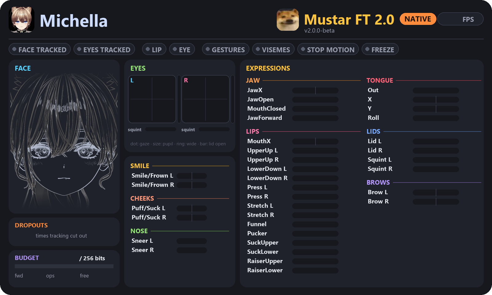
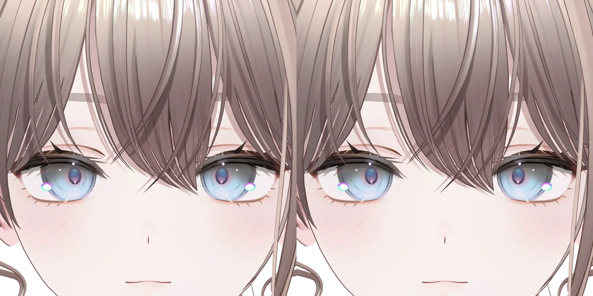
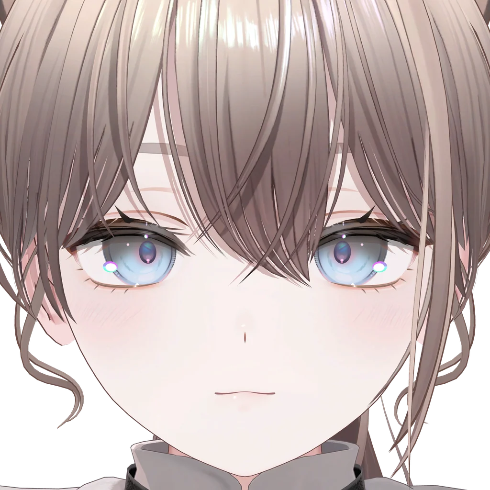
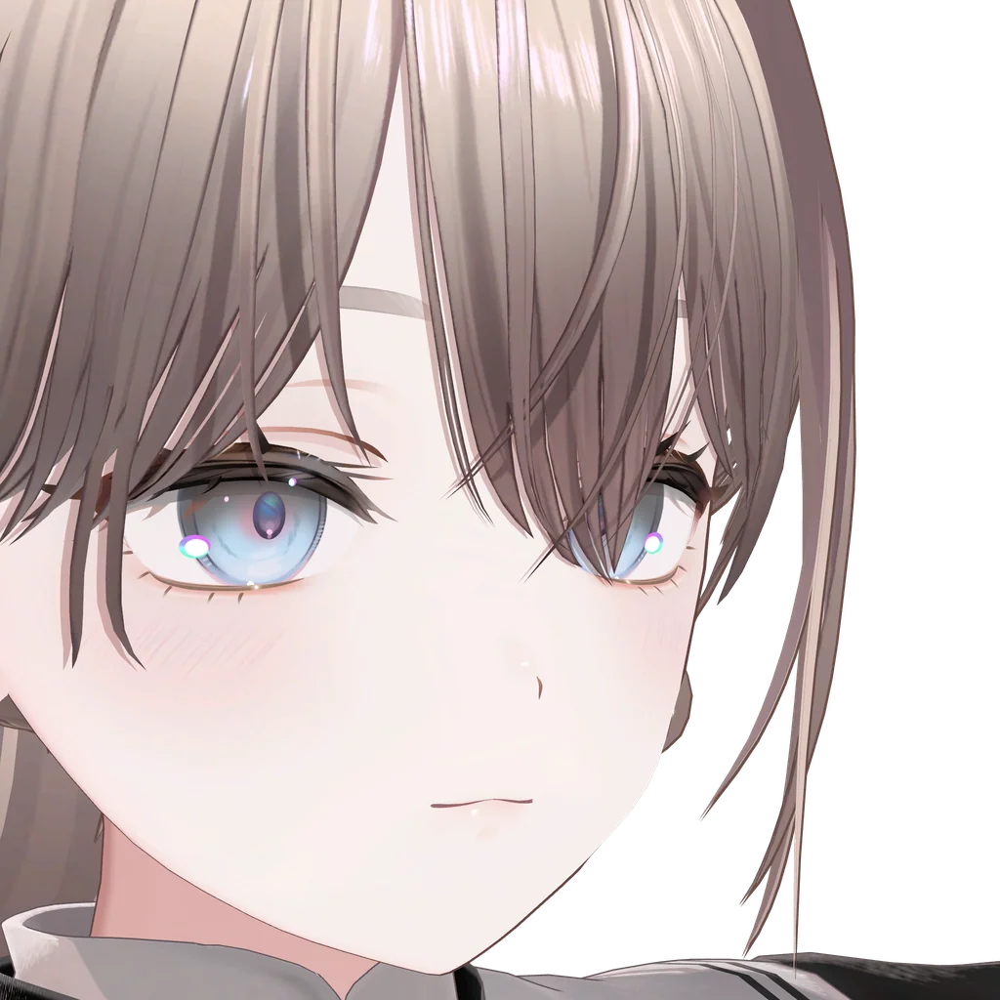
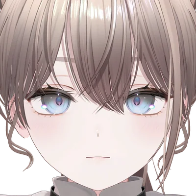
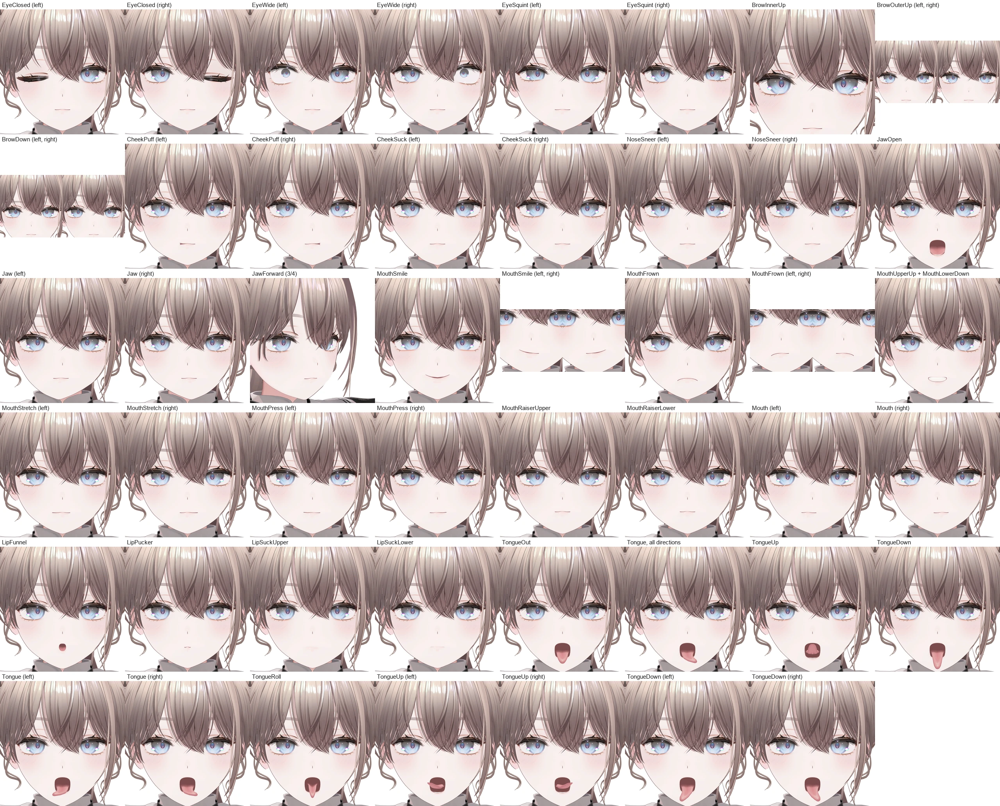

# Michella Face Tracking v2.0.0-native

**▶▶▶ FT シェイプを動くプレビューでチェック! / Preview the FT shapes here: [github.com/mustar22/mFT/tree/main/Michella#expressions](https://github.com/mustar22/mFT/tree/main/Michella#expressions) ◀◀◀**

Free report. Read this before you buy: what you get, what changes on your avatar, and the numbers, explained.
Face tracking for **Michella** by CEM DOLLS. Built by mustar. Native (VRChat's built-in FT) and classic install in one package.

Michella: [Michella by CEM DOLLS](https://booth.pm/en/items/8916626)

Demo video: [https://youtu.be/fPGB_iy_bqk](https://youtu.be/fPGB_iy_bqk)

制作を快諾してくださった CEM DOLLS さまに感謝します。/ Thanks to CEM DOLLS for the green light.

> **Mustard Awards**
> **Michella: 7.5 / 10 mustard cans.**
> How well the model behaved on the way to face tracking. Higher is better.
> Plus: 536 shapes, more than enough to work with, with clean left/right splits for the eyes, lids and brows, and 11 face decals ready to become emotes.
> Minus: her mouth is small, which is nobody's fault, it is her design. The one real oddity: her eyeballs are flat discs, so the eyes needed a re-rig.

---

[日本語](#日本語) · [English](#english)

## 日本語

### 概要

- ミシェラの口、目、舌、頬、眉があなたの顔に合わせて動きます。彼女の顔のために造形したシェイプ 30 個と、彼女のシェイプを組み合わせたミックス 23 個。
- 本物のアイボーンで視線が動きます。瞳は左右に約 12 mm、上下に約 10 mm 動き、白目が目からはみ出しません。
- アニメモード: 顔がポーズを保って 1 秒に 8 回切り替わり、口は声に合わせてパキッと動きます。
- 導入はボタンひとつ。元のファイルには一切触れません。
- ミシェラ本体とフェイストラッキング機器は含まれません。

mFT はゼロから作った独自テンプレートで、より幅広いツールと豊かな表現力を求める人のための選択肢です。

### 数字とその意味

| 数字 | 意味 |
|---|---|
| 自分 +0.34 ms、他の人 +0.35 ms (ネイティブ) | 1 フレームあたりの追加負荷。2026-11-20 にきれいなシーンで計測、上限と考えてください。従来版 (2026-10-05 計測): フルで自分 +0.80 ms / 他の人 +0.75 ms、ライトで +0.33 ms / +0.30 ms。彼女自身の FX は約 0.2 ms。 |
| 74 / 256 (ネイティブ)、219 / 256 (従来版フル)、187 / 256 (従来版ライト) | 同期パラメーター。ネイティブは別々に数えます: 彼女自身 47 + FT 27 (フル) または 8 (ライト)。顔の動き自体は 0 bit。エモートは 1 個 1 bit。 |
| シェイプ 78 個 + 彼女の 536 個 | 造形 30、彼女のシェイプのミックス 23、左右に分けた半分 10、ビゼーム 20% が 15。彼女のシェイプはひとつも消しません。 |
| 舌 10 ポーズ | 上、下、左右、斜め、ロール。どれも彼女の小さな口に合わせて細くした完成形。 |
| パッケージ 2.3 MB | 差分データのみ。アバター本体のデータは入っていません。 |

### 中身

- ワールド内キャリブレーションと微調整ダイヤル 7 種。
- デバッグパネル: 顔、目、全表情の値をその場で表示。左手首のボタンで開閉。
- スムージング Off / 5〜30 ms、または Stop Motion。見ている人にも設定どおりに映ります。
- 声で動く口: 声に合わせて口がパキッと切り替わり、トラッキングの口に重なります。
- フリーズ、瞳 (エミュレートまたはトラッカー)、表情に反応する目 (笑顔、にらみ、下を見るとまぶたが下がる)。
- エモート 11 種 (猫目、うるうる、キラキラ、涙、青ざめ、白目、ショック、ほっぺ、照れ、ぐるぐる、ハート)。メニューで 1 つずつ ON、初期 OFF。入れるものはパッチャーで選べます。
- 見ている人には目に小さな自然な揺れが見えます。0 bit。

### アバターで変わること

- 顔はフェイストラッキングが担当するので、コピー側では彼女の Face 表情メニューが外れます。
- 視線トラッキング中は彼女の自動まばたきが止まり、切ると戻ります。
- ハンドジェスチャーの表情は初期オフ (メニューで ON)。
- コピー側のリップシンクは私のレイヤーが動かします。アンインストールで元に戻ります。
- Backlit や彼女の他のトグルはそのまま使えます。

### 弱点

- ミシェラ専用。PC で確認、Quest は未検証。
- キャリブレーションと Tune は保存されますが、アバターのリセットでは初期値に戻ります。
- ヒンディー語とアラビア語はキャリブレーションパネルのみ。エモート名、Stop Motion、FT anime visemes はどの言語でも英語です。
- ミシェラの更新で顔のメッシュが変わると、対応版が必要です。

### 必要なもの

ミシェラ、VRChat SDK (3.10.6 以降)、VRCFT (Steam 版、メインでもベータブランチでも可)、VRCFT (Unified Expressions) で動くフェイストラッカー。ミシェラ本体 (Modular Avatar、lilToon) の導入は CEM DOLLS さまの説明に従ってください。

### 技術的な詳細

- 負荷の測り方: Unity 上で彼女の FX と完成した FX を比較、10 フレームの実行を繰り返した最速値。ネイティブは 2026-11-20 にきれいなシーンで計測、その日の誤差は約 30%。
- 顔メッシュ 9,649 頂点。
- 目: 彼女の目は平らな円盤なので、コピー側では回転の中心を 100 mm 後ろに置き、瞳のまわりの白い輪を切り取ります。瞳は彼女自身の固定された白目の上を滑ります。コピーは専用のヒューマノイドを持ち、彼女のファイルはそのまま。
- 口を閉じるシェイプは顎の開き具合で上限がかかり、法線は顎の分をぴったり打ち消します。
- スムージングはフレームレートに左右されず、設定は 3 bit で同期。Stop Motion はその設定値のひとつなので追加コストなし。
- ネイティブ: 式の命令 140、フェイストラッキング演算 325。

---

## English

### In short

- Michella's mouth, eyes, tongue, cheeks and brows move with your face. 30 shapes sculpted for her face, plus 23 mixes of her own shapes.
- Gaze on her real eye bones: the iris travels about 12 mm sideways and 10 mm up and down, and the eye white never leaves the eye.
- An anime mode: the face holds a pose and jumps 8 times a second, and the mouth snaps with your voice.
- One button to install. Your original files are never touched.
- Michella and a face tracking device are not included.

mFT runs on my own template, written from scratch, for people who want a wider toolkit and more expressiveness.

### The numbers, and what they mean

| number | what it means |
|---|---|
| You +0.34 ms, viewers +0.35 ms (native) | Added per frame. Measured 2026-11-20 in a clean scene, treat it as an upper bound. Classic (measured 2026-10-05): Full you +0.80 ms / viewers +0.75 ms, Light +0.33 ms / +0.30 ms. Her own FX is about 0.2 ms. |
| 74 / 256 (native), 219 / 256 (classic Full), 187 / 256 (classic Light) | Synced parameters. Native counts them apart: her own 47 + FT 27 (Full) or 8 (Light). The face itself is 0 bits. Emotes are 1 bit each. |
| 78 shapes + her 536 | 30 sculpted, 23 mixes of her own shapes, 10 left/right halves, 15 visemes at 20%. None of hers removed. |
| 10 tongue poses | Up, down, sideways, diagonals, roll. Each a complete pose, slimmed to fit her small mouth. |
| Package 2.3 MB | Shape differences only, no avatar data. |

### What you get

- In-world calibration and 7 fine-tune dials.
- Debug panel: face, eyes and every expression value, live. A button on your left wrist opens it.
- Smoothing Off / 5 to 30 ms, or Stop Motion. Viewers see you as you set it.
- Voice-driven mouth: the mouth snaps with your voice, on top of tracking.
- Freeze, pupils (emulated or tracker), and eyes that react to your face (smile, glare, looking down lowers the lids).
- 11 emotes (cat eyes, teary eyes, sparkle, tears, blue face, white eyes, shock, hoppe, blush, dizzy, hearts). Each its own menu toggle, off by default; tick the ones you want in the patcher.
- Living eyes: viewers see tiny natural eye flicks. 0 bits.

### What changes on your avatar

- Face tracking takes over the face, so her Face expression menu is removed on the copy.
- Her auto-blink pauses while Eye Tracking is on, and comes back when it's off.
- Hand gesture expressions start off (menu toggle).
- Lip sync on the copy runs through my layer. Uninstall puts it back.
- Backlit and her other toggles keep working.

### Cons

- Michella only. Tested on PC, Quest is untested.
- Calibration and Tune are saved, but Reset Avatar puts them back to default.
- Hindi and Arabic: calibration panel only. Emote names, Stop Motion and FT anime visemes are English in every language.
- If a Michella update changes her face mesh, an updated version is needed.

### You need

Michella, the VRChat SDK (3.10.6 or newer), VRCFT (Steam, main or beta branch), and a face tracker that works with VRCFT (Unified Expressions). For Michella herself (Modular Avatar, lilToon), follow CEM DOLLS's instructions.

### Technical details

- How cost was measured: her FX against the built one in Unity, fastest of repeated 10-frame runs. Native measured 2026-11-20 in a clean scene; editor noise that day was about 30%.
- Face mesh 9,649 verts.
- Eyes: her eye is a flat disc, so on the copy the pivot sits 100 mm behind it and the white ring around the iris is cut away. The iris slides over her own fixed eye white. The copy gets its own humanoid, her files stay as they are.
- The mouth-closed shape is capped by how far the jaw is open. Its normals cancel the jaw's exactly.
- Smoothing is frame-rate exact and your preset syncs in 3 bits. Stop Motion is one of the preset's values, so it costs nothing extra.
- Native: 140 expression instructions, 325 face-tracking operations.

---

## Debug panel

## Expressions

FT シェイプ (0 → 1 → 0)。左右は見ている人から見た向き。 FT shapes, each looping 0 → 1 → 0. Left and right are as you look at the avatar (its own left shows on your right).

<table>
<tr><td align="center"> EyeClosed (left)</td><td align="center"> EyeWide (left)</td><td align="center"> EyeSquint (left)</td><td align="center"> BrowOuterUp (left, right)</td></tr>
<tr><td align="center"> BrowDown (left, right)</td><td align="center"> CheekPuff (left)</td><td align="center"> JawOpen</td><td align="center"> JawForward (3/4)</td></tr>
<tr><td align="center"> MouthSmile</td><td align="center"> MouthFrown</td><td align="center"> MouthUpperUp + MouthLowerDown</td><td align="center"> Mouth (right)</td></tr>
<tr><td align="center"> LipPucker</td><td align="center"> LipFunnel</td><td align="center"> TongueOut</td><td align="center"> Tongue, all directions</td></tr>
</table>

### All shapes / 全シェイプ

Eyes (6)

<table>
<tr><td align="center"> EyeClosed (left)</td><td align="center"> EyeClosed (right)</td><td align="center"> EyeWide (left)</td><td align="center"> EyeWide (right)</td></tr>
<tr><td align="center"> EyeSquint (left)</td><td align="center"> EyeSquint (right)</td></tr>
</table>

Brows (3)

<table>
<tr><td align="center"> BrowInnerUp</td><td align="center"> BrowOuterUp (left, right)</td><td align="center"> BrowDown (left, right)</td></tr>
</table>

Cheeks and nose (6)

<table>
<tr><td align="center"> CheekPuff (left)</td><td align="center"> CheekPuff (right)</td><td align="center"> CheekSuck (left)</td><td align="center"> CheekSuck (right)</td></tr>
<tr><td align="center"> NoseSneer (left)</td><td align="center"> NoseSneer (right)</td></tr>
</table>

Jaw (4)

<table>
<tr><td align="center"> JawOpen</td><td align="center"> Jaw (left)</td><td align="center"> Jaw (right)</td><td align="center"> JawForward (3/4)</td></tr>
</table>

Mouth (13)

<table>
<tr><td align="center"> MouthSmile</td><td align="center"> MouthSmile (left, right)</td><td align="center"> MouthFrown</td><td align="center"> MouthFrown (left, right)</td></tr>
<tr><td align="center"> MouthUpperUp + MouthLowerDown</td><td align="center"> MouthStretch (left)</td><td align="center"> MouthStretch (right)</td><td align="center"> MouthPress (left)</td></tr>
<tr><td align="center"> MouthPress (right)</td><td align="center"> MouthRaiserUpper</td><td align="center"> MouthRaiserLower</td><td align="center"> Mouth (left)</td></tr>
<tr><td align="center"> Mouth (right)</td></tr>
</table>

Lips (4)

<table>
<tr><td align="center"> LipFunnel</td><td align="center"> LipPucker</td><td align="center"> LipSuckUpper</td><td align="center"> LipSuckLower</td></tr>
</table>

Tongue (11)

<table>
<tr><td align="center"> TongueOut</td><td align="center"> Tongue, all directions</td><td align="center"> TongueUp</td><td align="center"> TongueDown</td></tr>
<tr><td align="center"> Tongue (left)</td><td align="center"> Tongue (right)</td><td align="center"> TongueRoll</td><td align="center"> TongueUp (left)</td></tr>
<tr><td align="center"> TongueUp (right)</td><td align="center"> TongueDown (left)</td><td align="center"> TongueDown (right)</td></tr>
</table>

