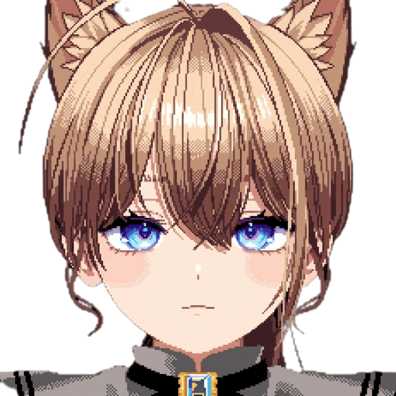
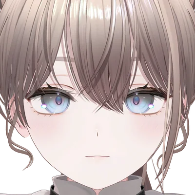
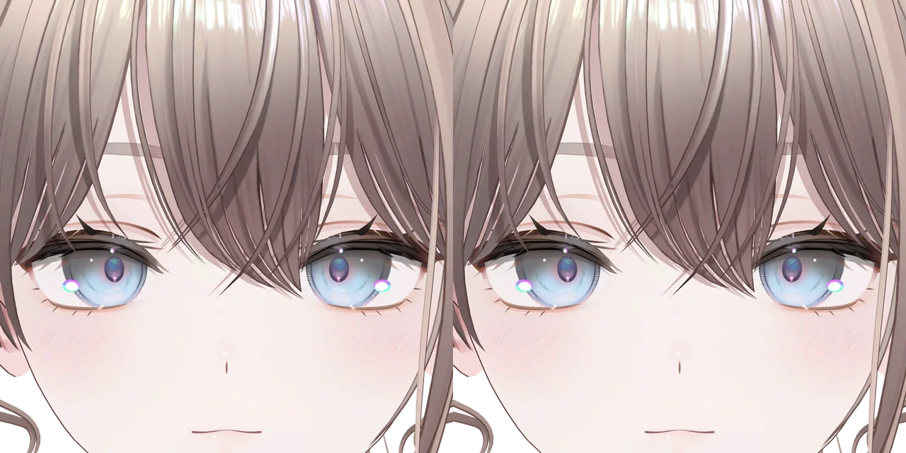
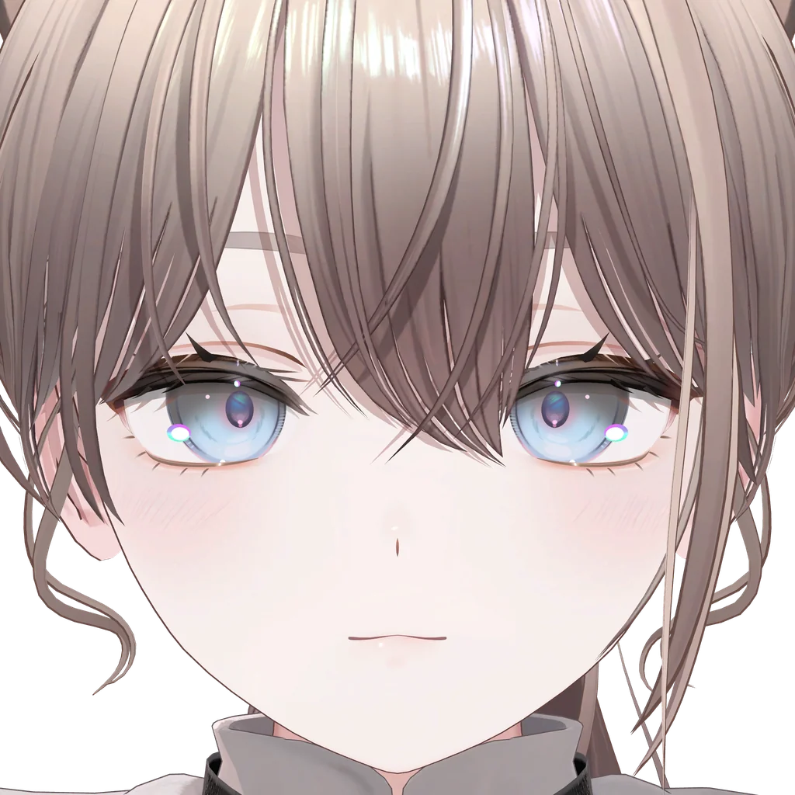
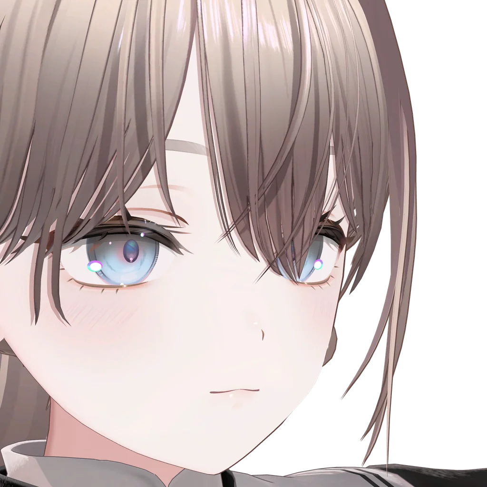
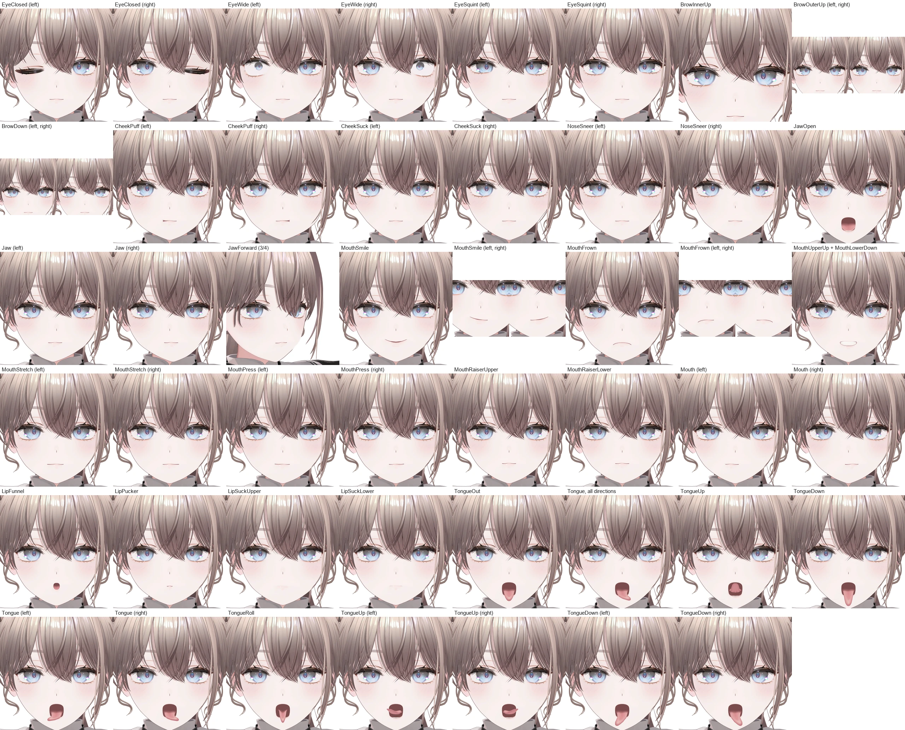
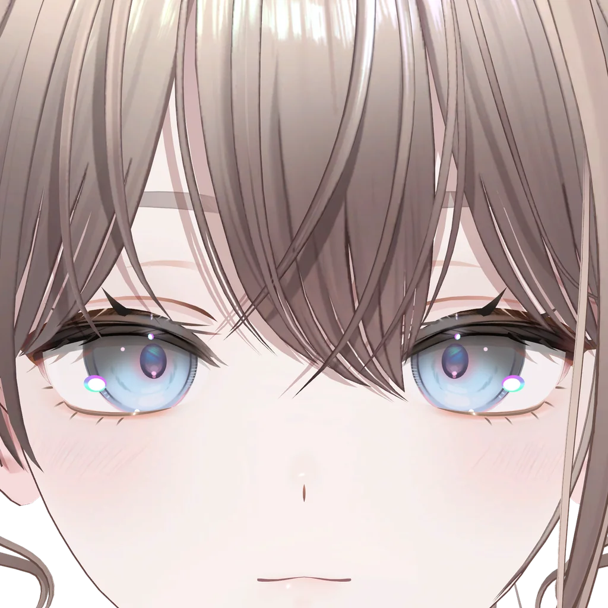
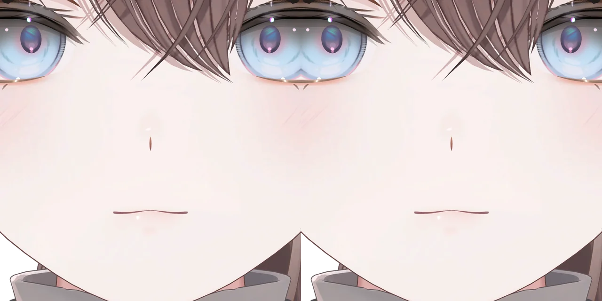
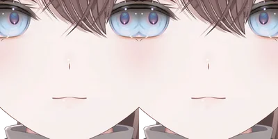
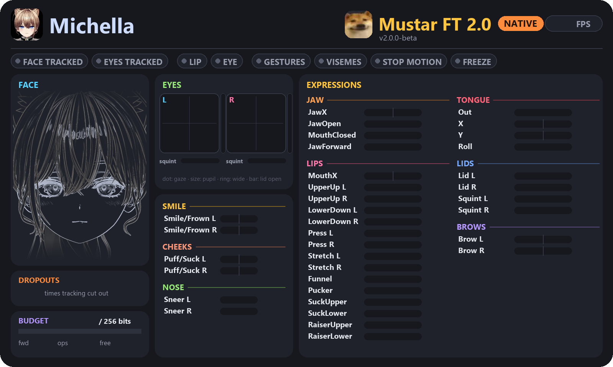

<a href="README.md">English</a> · <a href="README.ja.md">日本語</a> · <b>中文</b>

<h1 align="center">Michella Face Tracking</h1>

mFT v2.0.0-native for <b>Michella by CEM DOLLS</b>

<a href="https://mustarlabs.booth.pm/items/8944145">mFT on BOOTH</a> · <a href="https://booth.pm/en/items/8916626">Michella by CEM DOLLS</a> · <a href="https://youtu.be/fPGB_iy_bqk">Demo video</a>

制作を快諾してくださった CEM DOLLS さまに感謝します。/ Thanks to CEM DOLLS for the green light.

## Expressions

FT shapes, each looping 0 → 1 → 0. Left and right are as you look at the avatar (its own left shows on your right).  
FT シェイプ (0 → 1 → 0)。左右は見ている人から見た向き。

<table>
<tr><td align="center"> EyeClosed (left)</td><td align="center"> EyeWide (left)</td><td align="center"> EyeSquint (left)</td><td align="center"> BrowOuterUp (left, right)</td></tr>
<tr><td align="center"> BrowDown (left, right)</td><td align="center"> CheekPuff (left)</td><td align="center"> JawOpen</td><td align="center"> JawForward (3/4)</td></tr>
<tr><td align="center"> MouthSmile</td><td align="center"> MouthFrown</td><td align="center"> MouthUpperUp + MouthLowerDown</td><td align="center"> Mouth (right)</td></tr>
<tr><td align="center"> LipPucker</td><td align="center"> LipFunnel</td><td align="center"> TongueOut</td><td align="center"> Tongue, all directions</td></tr>
</table>

### All shapes / 全シェイプ

Eyes (6)

<table>
<tr><td align="center"> EyeClosed (left)</td><td align="center"> EyeClosed (right)</td><td align="center"> EyeWide (left)</td><td align="center"> EyeWide (right)</td></tr>
<tr><td align="center"> EyeSquint (left)</td><td align="center"> EyeSquint (right)</td></tr>
</table>

Brows (3)

<table>
<tr><td align="center"> BrowInnerUp</td><td align="center"> BrowOuterUp (left, right)</td><td align="center"> BrowDown (left, right)</td></tr>
</table>

Cheeks and nose (6)

<table>
<tr><td align="center"> CheekPuff (left)</td><td align="center"> CheekPuff (right)</td><td align="center"> CheekSuck (left)</td><td align="center"> CheekSuck (right)</td></tr>
<tr><td align="center"> NoseSneer (left)</td><td align="center"> NoseSneer (right)</td></tr>
</table>

Jaw (4)

<table>
<tr><td align="center"> JawOpen</td><td align="center"> Jaw (left)</td><td align="center"> Jaw (right)</td><td align="center"> JawForward (3/4)</td></tr>
</table>

Mouth (13)

<table>
<tr><td align="center"> MouthSmile</td><td align="center"> MouthSmile (left, right)</td><td align="center"> MouthFrown</td><td align="center"> MouthFrown (left, right)</td></tr>
<tr><td align="center"> MouthUpperUp + MouthLowerDown</td><td align="center"> MouthStretch (left)</td><td align="center"> MouthStretch (right)</td><td align="center"> MouthPress (left)</td></tr>
<tr><td align="center"> MouthPress (right)</td><td align="center"> MouthRaiserUpper</td><td align="center"> MouthRaiserLower</td><td align="center"> Mouth (left)</td></tr>
<tr><td align="center"> Mouth (right)</td></tr>
</table>

Lips (4)

<table>
<tr><td align="center"> LipFunnel</td><td align="center"> LipPucker</td><td align="center"> LipSuckUpper</td><td align="center"> LipSuckLower</td></tr>
</table>

Tongue (11)

<table>
<tr><td align="center"> TongueOut</td><td align="center"> Tongue, all directions</td><td align="center"> TongueUp</td><td align="center"> TongueDown</td></tr>
<tr><td align="center"> Tongue (left)</td><td align="center"> Tongue (right)</td><td align="center"> TongueRoll</td><td align="center"> TongueUp (left)</td></tr>
<tr><td align="center"> TongueUp (right)</td><td align="center"> TongueDown (left)</td><td align="center"> TongueDown (right)</td></tr>
</table>

## 中文

### 简介

- Michella 的嘴、眼、舌、脸颊和眉毛随你的脸而动。为她的脸雕刻了 30 个形态键，另有 23 个由她自己的形态键组合而成。
- 视线使用她真正的眼骨：虹膜左右约 12 mm、上下约 10 mm，眼白不会跑出眼睛。
- 动画模式：脸保持姿势，每秒切换 8 次，嘴随你的声音利落地变化。
- 一键安装。绝不改动你的原始文件。
- 不包含 Michella 本体和面捕设备。

mFT 使用我从零编写的模板，是给想要更丰富工具和更强表现力的人的选择。

### 数字及其含义

| 数字 | 含义 |
|---|---|
| 自己 +0.34 ms，他人 +0.35 ms (原生) | 每帧增加的开销。2026-11-20 在干净的场景中测得，请视为上限。经典版 (2026-10-05 测得)：Full 自己 +0.80 ms / 他人 +0.75 ms，Light +0.33 ms / +0.30 ms。她自身的 FX 约 0.2 ms。 |
| 74 / 256 (原生)、219 / 256 (经典 Full)、187 / 256 (经典 Light) | 同步参数。原生分开计算：她自身 47 + FT 27 (Full) 或 8 (Light)。面部本身 0 bit。表情每个 1 bit。 |
| 78 个形态键 + 她的 536 个 | 雕刻 30、她的形态键组合 23、左右分开的一半 10、20% 的口型 15。她的形态键一个都不删。 |
| 舌头 10 个姿势 | 上、下、左右、斜向、卷舌。每个都是为她小嘴收窄的完整姿势。 |
| 包 2.3 MB | 只有形态差异，不含模型数据。 |

### 内容

- 场景内校准和 7 个微调旋钮。
- 调试面板：实时显示脸、眼睛和所有表情的数值。左手腕的按钮可开关。
- 平滑 关闭 / 5 到 30 ms，或 Stop Motion。别人看到的和你设置的一样。
- 声音驱动的嘴：嘴随你的声音利落切换，叠加在追踪之上。
- 定格、瞳孔 (模拟或追踪器)，以及会对表情做出反应的眼睛 (笑、瞪眼、往下看时眼睑下垂)。
- 11 个表情 (猫眼、泪眼、闪亮、眼泪、脸色发青、白眼、震惊、鼓脸、脸红、晕眩、爱心)。每个都有自己的菜单开关，默认关闭；在补丁工具中勾选需要的。
- 灵动的眼睛：别人能看到细微自然的眼球跳动。0 bit。

### 模型上的变化

- 面部交给面捕，所以副本上她的 Face 表情菜单会被移除。
- 视线追踪开启时她的自动眨眼暂停，关闭后恢复。
- 手势表情默认关闭 (菜单开关)。
- 副本上的口型由我的层驱动。卸载即可恢复。
- Backlit 和她的其他开关照常使用。

### 缺点

- 仅限 Michella。已在 PC 上测试，Quest 未测试。
- 校准和 Tune 会保存，但重置模型会恢复默认值。
- 印地语和阿拉伯语仅有校准面板。表情名称、Stop Motion 和 FT anime visemes 在所有语言中都是英文。
- 如果 Michella 更新改变了脸部网格，需要对应的新版本。

### 需要

Michella、VRChat SDK (3.10.6 或更新)、VRCFT (Steam 版，main 或 beta 分支均可)，以及支持 VRCFT (Unified Expressions) 的面捕设备。Michella 本体 (Modular Avatar、lilToon) 请按 CEM DOLLS 的说明操作。

### 技术细节

- 开销的测量方法：在 Unity 中比较她的 FX 和完成后的 FX，取重复 10 帧运行的最快值。原生于 2026-11-20 在干净的场景中测得，当天编辑器误差约 30%。
- 脸部网格 9,649 顶点。
- 眼睛：她的眼睛是扁平的圆盘，所以副本上把旋转中心放在后方 100 mm，并切掉虹膜周围的白圈。虹膜在她自己固定的眼白上滑动。副本有自己的 humanoid，她的文件保持原样。
- 闭嘴形态键的上限取决于下巴张开的程度，法线正好抵消下巴的部分。
- 平滑不受帧率影响，你的预设用 3 bit 同步。Stop Motion 是预设的一个值，不额外占用。
- 原生：140 条表达式指令，325 次面捕运算。

---

> **Mustard Awards**  
> **Michella: 7.5 / 10 mustard cans.**  
> How well the model behaved on the way to face tracking. Higher is better.  
> Plus: 536 shapes, more than enough to work with, with clean left/right splits for the eyes, lids and brows, and 11 face decals ready to become emotes.  
> Minus: her mouth is small, which is nobody's fault, it is her design. The one real oddity: her eyeballs are flat discs, so the eyes needed a re-rig.

## 调试面板

