
<a href="README.md">English</a> · <b>日本語</b> · <a href="README.zh.md">中文</a>

<h1 align="center">NULU Face Tracking</h1>

mFT v2.0.0-native for <b>NULU by uryu (Uryu Lab)</b>

<a href="https://mustarlabs.booth.pm/items/9238479">mFT on BOOTH</a> · <a href="https://uryushop.booth.pm/items/9106531">NULU by uryu</a>

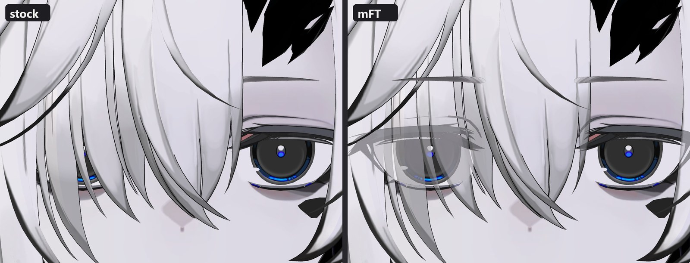 Brows, eyes and lashes through bangs, front (options, off by default. Left: stock, right: mFT) · 前髪越しの眉・目・まつげ (正面)

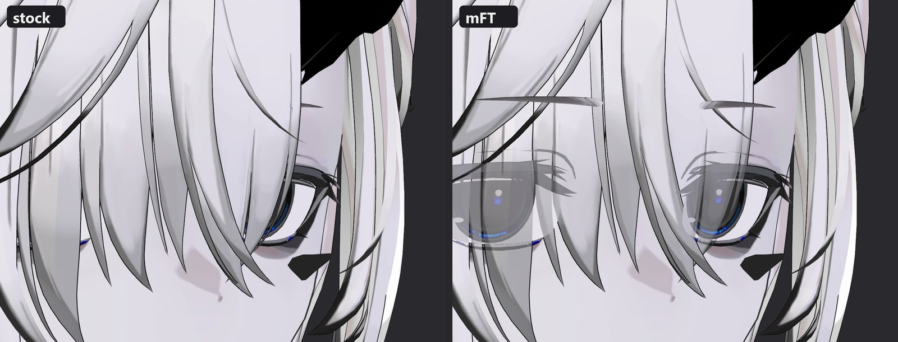 Through bangs, 3/4 view · 斜め

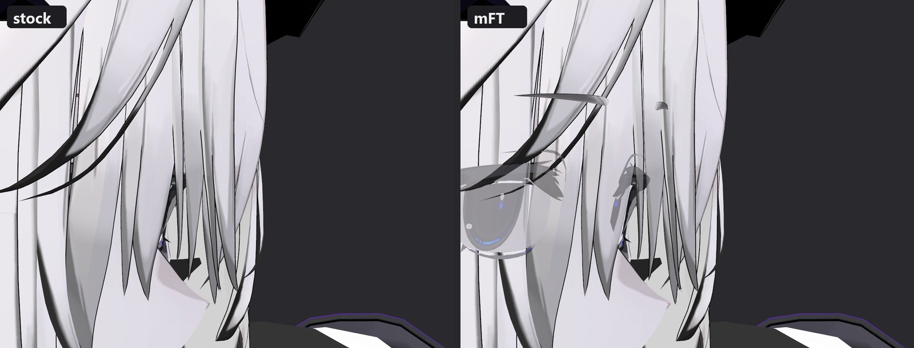 Through bangs, side view · 横

## Expressions

FT shapes, each looping 0 → 1 → 0. Left and right are as you look at the avatar (its own left shows on your right).  
FT シェイプ (0 → 1 → 0)。左右は見ている人から見た向き。

<table>
<tr><td align="center">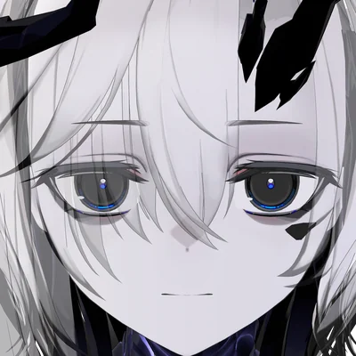 Eyes, all directions (lids follow)</td><td align="center"> EyeClosed (left)</td><td align="center"> EyeWide (left)</td><td align="center"> EyeSquint (left)</td></tr>
<tr><td align="center">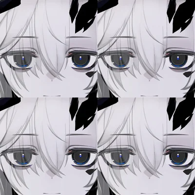 BrowInnerUp · BrowOuterUp (left, right)</td><td align="center"> BrowDown · BrowPinch (left, right)</td><td align="center">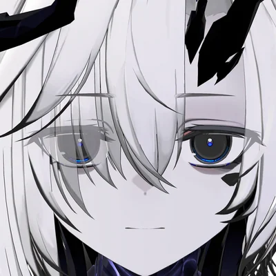 CheekPuff (left)</td><td align="center"> JawOpen</td></tr>
<tr><td align="center">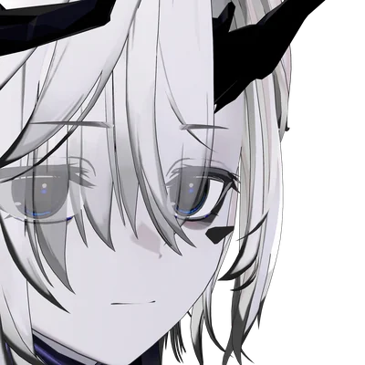 JawForward (3/4)</td><td align="center"> MouthSmile</td><td align="center"> Toothy smile</td><td align="center"> MouthFrown</td></tr>
<tr><td align="center"> MouthUpperUp + MouthLowerDown</td><td align="center"> Mouth (right)</td><td align="center"> LipPucker</td><td align="center"> LipFunnel</td></tr>
<tr><td align="center"> TongueOut</td><td align="center"> Tongue, all directions</td></tr>
</table>

### All shapes / 全シェイプ

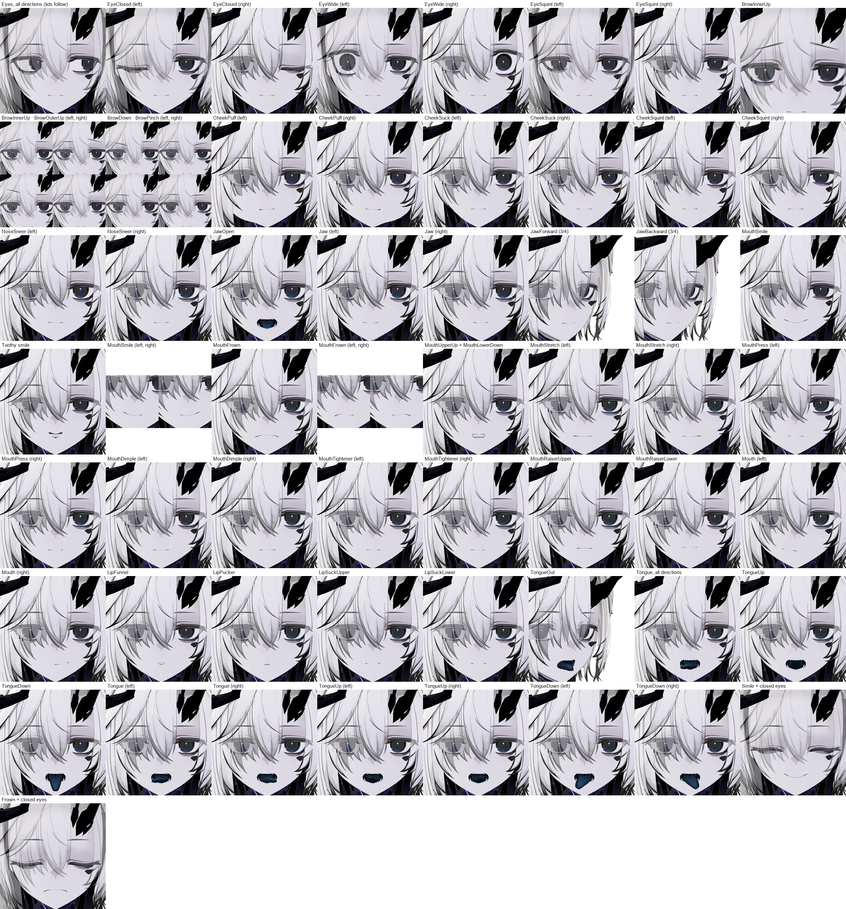

Eyes (7)

<table>
<tr><td align="center"> Eyes, all directions (lids follow)</td><td align="center"> EyeClosed (left)</td><td align="center"> EyeClosed (right)</td><td align="center"> EyeWide (left)</td></tr>
<tr><td align="center"> EyeWide (right)</td><td align="center"> EyeSquint (left)</td><td align="center"> EyeSquint (right)</td></tr>
</table>

Brows (3)

<table>
<tr><td align="center">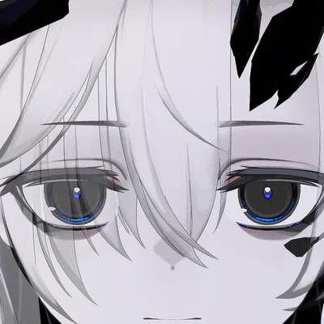 BrowInnerUp</td><td align="center"> BrowInnerUp · BrowOuterUp (left, right)</td><td align="center"> BrowDown · BrowPinch (left, right)</td></tr>
</table>

Cheeks and nose (8)

<table>
<tr><td align="center"> CheekPuff (left)</td><td align="center"> CheekPuff (right)</td><td align="center"> CheekSuck (left)</td><td align="center"> CheekSuck (right)</td></tr>
<tr><td align="center"> CheekSquint (left)</td><td align="center"> CheekSquint (right)</td><td align="center"> NoseSneer (left)</td><td align="center"> NoseSneer (right)</td></tr>
</table>

Jaw (5)

<table>
<tr><td align="center"> JawOpen</td><td align="center"> Jaw (left)</td><td align="center"> Jaw (right)</td><td align="center"> JawForward (3/4)</td></tr>
<tr><td align="center"> JawBackward (3/4)</td></tr>
</table>

Mouth (18)

<table>
<tr><td align="center"> MouthSmile</td><td align="center"> Toothy smile</td><td align="center">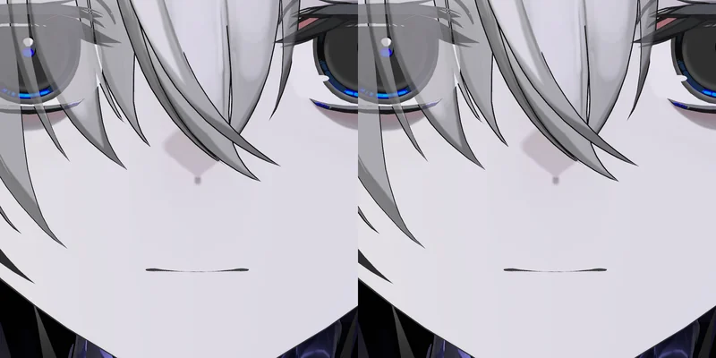 MouthSmile (left, right)</td><td align="center"> MouthFrown</td></tr>
<tr><td align="center">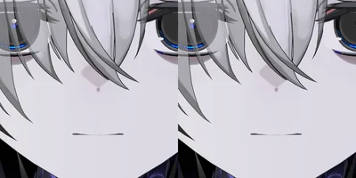 MouthFrown (left, right)</td><td align="center"> MouthUpperUp + MouthLowerDown</td><td align="center"> MouthStretch (left)</td><td align="center"> MouthStretch (right)</td></tr>
<tr><td align="center"> MouthPress (left)</td><td align="center"> MouthPress (right)</td><td align="center"> MouthDimple (left)</td><td align="center"> MouthDimple (right)</td></tr>
<tr><td align="center"> MouthTightener (left)</td><td align="center"> MouthTightener (right)</td><td align="center"> MouthRaiserUpper</td><td align="center"> MouthRaiserLower</td></tr>
<tr><td align="center"> Mouth (left)</td><td align="center"> Mouth (right)</td></tr>
</table>

Lips (4)

<table>
<tr><td align="center"> LipFunnel</td><td align="center"> LipPucker</td><td align="center"> LipSuckUpper</td><td align="center"> LipSuckLower</td></tr>
</table>

Tongue (11)

<table>
<tr><td align="center"> TongueOut</td><td align="center"> Tongue, all directions</td><td align="center"> TongueUp</td><td align="center"> TongueDown</td></tr>
<tr><td align="center"> Tongue (left)</td><td align="center"> Tongue (right)</td><td align="center"> TongueRoll</td><td align="center"> TongueUp (left)</td></tr>
<tr><td align="center"> TongueUp (right)</td><td align="center"> TongueDown (left)</td><td align="center"> TongueDown (right)</td></tr>
</table>

Her extras (2)

<table>
<tr><td align="center"> Smile + closed eyes</td><td align="center"> Frown + closed eyes</td></tr>
</table>

## 日本語

### 概要

- NULU の口、目、舌、頬、眉があなたの顔に合わせて動きます。彼女のために作ったシェイプ 79 個。
- 彼女の涙、よだれ、頬染め、黒い涙、頬のマークなどのパーツも顔の動きについていきます。
- 手で作り込んだ部分がたくさん: 舌、歯、目、閉じた目の補正、前髪越しの眉と目。下の一覧をどうぞ。
- ボタンひとつで導入。元のファイルには触りません。
- NULU本体とフェイストラッキング機器は含まれません。

mFT はゼロから作った独自テンプレートで、より幅広いツールと豊かな表現力を求める人のための選択肢です。

### 数字とその意味

| 数字 | 意味 |
|---|---|
| 自分 TBD ms、他の人 TBD ms | 1 フレームあたりの追加負荷。彼女自身の FX は約 TBD ms。 |
| 彼女自身 41 / 256、FT 28 | 同期パラメーターは別々に数えます (パッチャーの初期設定)。顔の動き自体は 0 bit。 |
| シェイプ 100 個 + 彼女の 512 個 | 79 個は FT 用、21 個はビゼーム (35%、歯は動かさない)。彼女のシェイプは 1 つも消しません。 |
| 舌 4 段階 + 8 方向 + タコ巻き | 手で付けたポーズ。口の左右についていき、口も舌の方向についていきます。 |
| パッケージ TBD | 差分データのみ。アバター本体のデータは入っていません。 |

### 中身

- ワールド内キャリブレーションと微調整ダイヤル 7 種。
- デバッグパネル: 顔、目、全表情の値をその場で表示。メニューで開閉、左手首のボタンは導入時に選べます。
- スムージング Off / 5〜30 ms、または Stop Motion。設定は見ている人にも同じに映ります。
- FT anime visemes: 声で口がパキッと切り替わり、トラッキングの口に重なります。
- フリーズ、瞳 (エミュレートまたはトラッカー)、PaperTrackerMode。
- 目: 視線は彼女の目のボーンで動きます。上下左右の範囲は彼女の目に合わせて手で決めました。上を見ると上まぶたが上がり、下を見ると下まぶたが下がります。
- 閉じた目: 元の閉じ目では瞳が少し見えていたので、しっかり閉じるようにしました。笑顔+閉じ目と、への字口+閉じ目には専用の補正 (やわらかいアーチ、悲しげな傾き)。
- 歯: 彼女の歯は普段開いているので、閉じた歯並びを基本にしました。口を開けると上下の歯がそろって開きます。ビゼームは歯を動かしません (食いしばった歯が突き抜けません)。
- 口を左右に寄せても、肌が歯に重なりません (手で作った補正)。すぼめ口と、をの口を彼女向けに作り直しました。
- 舌: 自作の Tongue Poser で 4 本のボーンに手でポーズを付けて焼き込み。出す途中の 4 段階は下の歯の上を越えていきます。方向は 8 つ。舌のためにあごが少し開きます (100% を超えません)。
- 頬ふくらませは 70% までに抑えています。
- 前髪越しの眉 (オプション、最初はオフ): 正面から見ると眉が前髪の上に見えます。0 bit。
- 前髪越しの目 (オプション、最初はオフ): 目、まつげ、白目が前髪越しにうっすら見えます。0 bit。
- 彼女の顔の形スライダーはそのまま残ります。

### アバターで変わること

- ハンドジェスチャーの表情は最初オフです (Face Tracking > Hand Gestures で戻せます)。
- パッチ済みコピーのリップシンクは Viseme Parameter Only になります。FT アニメビゼーム (Extras) がトラッキングの上で彼女のビゼームを動かします。
- 彼女の衣装、髪、トグルのメニューはそのまま使えます。

### 弱点

- NULU専用。PC で確認、Quest は未検証。
- ネイティブ専用 (VRChat 本体の FT)。
- キャリブレーションと Tune は保存されますが、アバターのリセットでは初期値に戻ります。
- NULUの更新で顔のメッシュが変わると、対応版が必要です。

### 必要なもの

NULU 1.0 / 1.01、VRChat SDK (3.10.6 以降)、VRCFT (Steam 版、メインでもベータブランチでも可)、VRCFT (Unified Expressions) で動くフェイストラッカー。NULU 本体の導入は uryu さんの説明書に従ってください。

### 技術的な詳細

- 負荷の測り方: Unity 上で彼女の FX と完成した FX を比較、10 フレームの実行を繰り返した最速値 (2026-11-27)。誤差は約 15%。
- 顔のメッシュ 10,914 頂点。NULU 1.0 / 1.01 で確認。
- デルタ法線はゼロ: 彼女の顔の陰影がきれいに保たれます。
- 舌: 4 本のボーンのポーズを焼き込み。横への動きは「出した舌」+方向の差分なので、途中で舌が引っ込みません。
- すべての FT シェイプで、彼女の上に乗るパーツ (涙、頬染めなど) が肌について動きます。

---

> **Mustard Awards**  
> **NULU: 8.0 / 10 mustard cans.**  
> How well the model behaved on the way to face tracking. Higher is better.  
> Plus: the essential shapes are all there, a decent-size mouth with a full inner mouth box, and a good tongue.  
> Minus: a bit short on shapes, and from a face tracking point of view her bangs are a bit long and rigid (you want people to see your face), so I added brows, eyes and lashes through the bangs as options.

## デバッグパネル

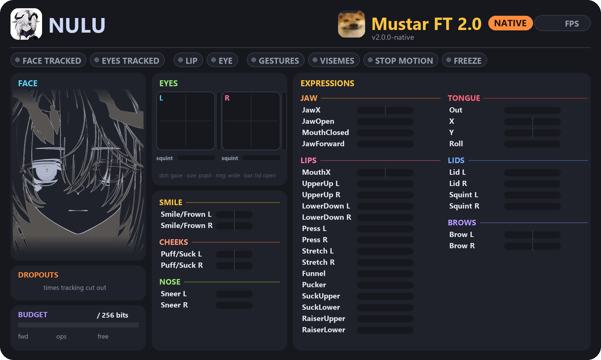
