
<a href="README.md">English</a> · <a href="README.ja.md">日本語</a> · <b>中文</b>

<h1 align="center">NULU Face Tracking</h1>

mFT v2.0.0-native for <b>NULU by uryu (Uryu Lab)</b>

<a href="https://mustarlabs.booth.pm/items/9238479">mFT on BOOTH</a> · <a href="https://uryushop.booth.pm/items/9106531">NULU by uryu</a>

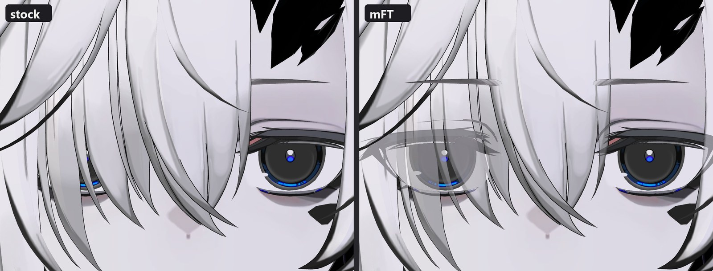 Brows, eyes and lashes through bangs, front (options, off by default. Left: stock, right: mFT) · 前髪越しの眉・目・まつげ (正面)

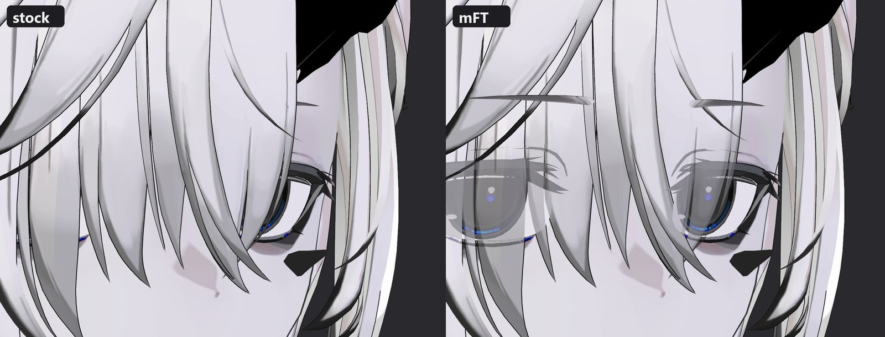 Through bangs, 3/4 view · 斜め

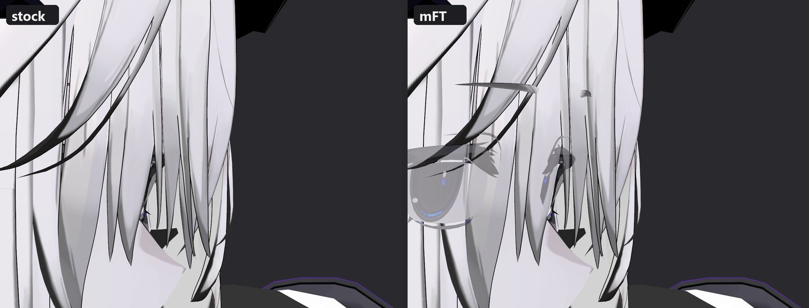 Through bangs, side view · 横

## Expressions

FT shapes, each looping 0 → 1 → 0. Left and right are as you look at the avatar (its own left shows on your right).  
FT シェイプ (0 → 1 → 0)。左右は見ている人から見た向き。

<table>
<tr><td align="center">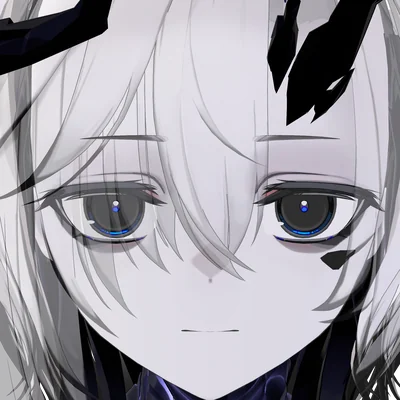 Eyes, all directions (lids follow)</td><td align="center"> EyeClosed (left)</td><td align="center"> EyeWide (left)</td><td align="center"> EyeSquint (left)</td></tr>
<tr><td align="center">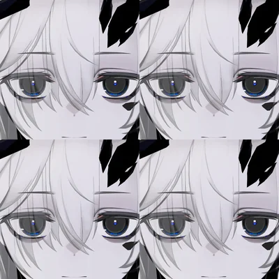 BrowInnerUp · BrowOuterUp (left, right)</td><td align="center"> BrowDown · BrowPinch (left, right)</td><td align="center">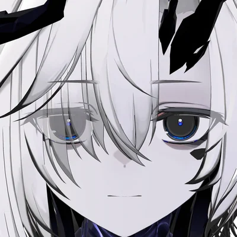 CheekPuff (left)</td><td align="center"> JawOpen</td></tr>
<tr><td align="center">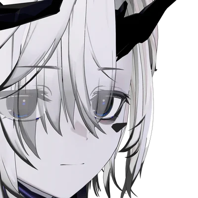 JawForward (3/4)</td><td align="center"> MouthSmile</td><td align="center"> Toothy smile</td><td align="center"> MouthFrown</td></tr>
<tr><td align="center"> MouthUpperUp + MouthLowerDown</td><td align="center"> Mouth (right)</td><td align="center"> LipPucker</td><td align="center"> LipFunnel</td></tr>
<tr><td align="center"> TongueOut</td><td align="center"> Tongue, all directions</td></tr>
</table>

### All shapes / 全シェイプ

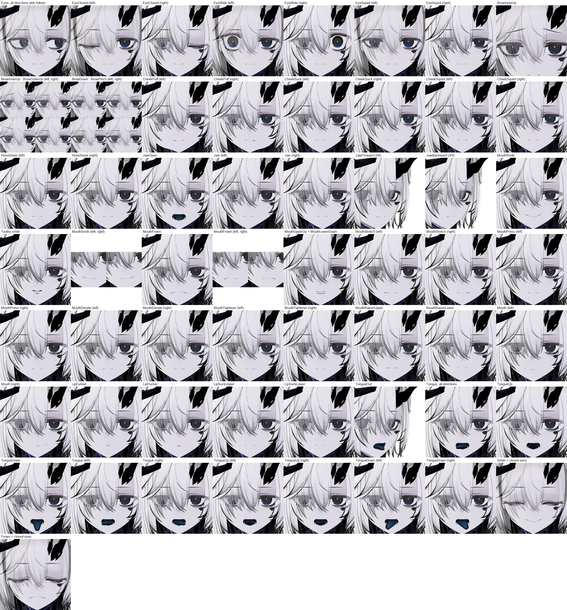

Eyes (7)

<table>
<tr><td align="center"> Eyes, all directions (lids follow)</td><td align="center"> EyeClosed (left)</td><td align="center"> EyeClosed (right)</td><td align="center"> EyeWide (left)</td></tr>
<tr><td align="center"> EyeWide (right)</td><td align="center"> EyeSquint (left)</td><td align="center"> EyeSquint (right)</td></tr>
</table>

Brows (3)

<table>
<tr><td align="center">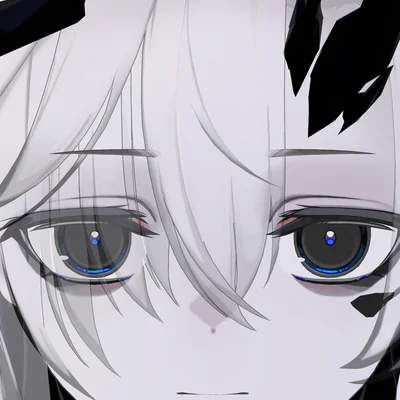 BrowInnerUp</td><td align="center"> BrowInnerUp · BrowOuterUp (left, right)</td><td align="center"> BrowDown · BrowPinch (left, right)</td></tr>
</table>

Cheeks and nose (8)

<table>
<tr><td align="center"> CheekPuff (left)</td><td align="center"> CheekPuff (right)</td><td align="center"> CheekSuck (left)</td><td align="center"> CheekSuck (right)</td></tr>
<tr><td align="center"> CheekSquint (left)</td><td align="center"> CheekSquint (right)</td><td align="center"> NoseSneer (left)</td><td align="center"> NoseSneer (right)</td></tr>
</table>

Jaw (5)

<table>
<tr><td align="center"> JawOpen</td><td align="center"> Jaw (left)</td><td align="center"> Jaw (right)</td><td align="center"> JawForward (3/4)</td></tr>
<tr><td align="center"> JawBackward (3/4)</td></tr>
</table>

Mouth (18)

<table>
<tr><td align="center"> MouthSmile</td><td align="center"> Toothy smile</td><td align="center">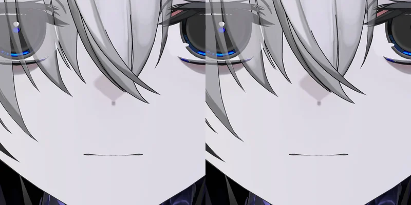 MouthSmile (left, right)</td><td align="center"> MouthFrown</td></tr>
<tr><td align="center">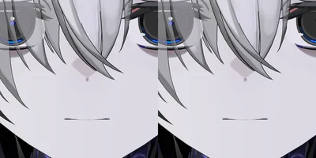 MouthFrown (left, right)</td><td align="center"> MouthUpperUp + MouthLowerDown</td><td align="center"> MouthStretch (left)</td><td align="center"> MouthStretch (right)</td></tr>
<tr><td align="center"> MouthPress (left)</td><td align="center"> MouthPress (right)</td><td align="center"> MouthDimple (left)</td><td align="center"> MouthDimple (right)</td></tr>
<tr><td align="center"> MouthTightener (left)</td><td align="center"> MouthTightener (right)</td><td align="center"> MouthRaiserUpper</td><td align="center"> MouthRaiserLower</td></tr>
<tr><td align="center"> Mouth (left)</td><td align="center"> Mouth (right)</td></tr>
</table>

Lips (4)

<table>
<tr><td align="center"> LipFunnel</td><td align="center"> LipPucker</td><td align="center"> LipSuckUpper</td><td align="center"> LipSuckLower</td></tr>
</table>

Tongue (10)

<table>
<tr><td align="center"> TongueOut</td><td align="center"> Tongue, all directions</td><td align="center"> TongueUp</td><td align="center"> TongueDown</td></tr>
<tr><td align="center"> Tongue (left)</td><td align="center"> Tongue (right)</td><td align="center"> TongueUp (left)</td><td align="center"> TongueUp (right)</td></tr>
<tr><td align="center"> TongueDown (left)</td><td align="center"> TongueDown (right)</td></tr>
</table>

Her extras (2)

<table>
<tr><td align="center"> Smile + closed eyes</td><td align="center"> Frown + closed eyes</td></tr>
</table>

## 中文

### 简介

- NULU 的嘴、眼睛、舌头、脸颊和眉毛会跟随你的脸。为她制作了 79 个形态键。
- 她的眼泪、口水、脸红、黑色眼泪和脸颊标记也会跟着脸动。
- 很多部分都是手工打磨：舌头、牙齿、眼睛、闭眼修正、透过刘海的眉毛和眼睛。见下方列表。
- 一键安装。绝不改动原始文件。
- 不含 NULU 本体和面捕设备。

mFT 使用我从零编写的模板，是给想要更丰富工具和更强表现力的人的选择。

### 数字及其含义

| 数字 | 含义 |
|---|---|
| 自己 TBD ms，其他人 TBD ms | 每帧的额外开销。她自己的 FX 约 TBD ms。 |
| 她自己 41 / 256，FT 28 | 同步参数分开计算 (安装器默认)。脸部动作本身 0 bit。 |
| 100 个形态键 + 她的 512 个 | 79 个用于 FT，21 个口型副本 (35%，牙齿不动)。不删除她的任何形态键。 |
| 舌头 4 段 + 8 个方向 | 手工摆姿势。舌头跟随嘴左右移动，嘴也跟随舌头。 |
| 安装包 TBD | 仅差分数据，不含模型数据。 |

### 内容

- 游戏内校准和 7 个微调旋钮。
- 调试面板：实时显示脸、眼睛和所有表情数值。从菜单打开，也可在安装器中添加左手腕按钮。
- 平滑 关闭 / 5 到 30 ms，或 Stop Motion。他人看到的与你的设置相同。
- FT anime visemes：嘴随声音利落切换，叠加在追踪之上。
- 冻结、瞳孔 (模拟或追踪器)、PaperTrackerMode。
- 眼睛：视线转动她的眼睛骨骼。上下左右都按她的眼睛手工设定。往上看时上眼睑抬起，往下看时下眼睑下降。
- 闭眼：她原本的闭眼会露出一点瞳孔，现在完全闭合。微笑+闭眼、撇嘴+闭眼各有专用修正 (柔和的弧线、难过的倾斜)。
- 牙齿：她的牙齿平时是张开的，所以以闭合咬合为基础。张嘴时上下牙齿均匀分开。口型不会移动牙齿 (咬紧时不会穿模)。
- 嘴偏向一侧时，皮肤不会压到牙齿 (手工雕刻的修正)。为她重做了嘟嘴和圆嘴。
- 舌头：在我的 Tongue Poser 中用 4 根骨骼手工摆姿势后烘焙。伸出的 4 段会越过下排牙齿，8 个方向。舌头伸出时下巴会稍微张开 (不超过 100%)。
- 鼓腮限制在 70%。
- 透过刘海的眉毛 (选项，默认关闭)：从正面看，眉毛显示在刘海上方。0 bit。
- 透过刘海的眼睛 (选项，默认关闭)：眼睛、睫毛和眼白会隐约透过刘海显示。0 bit。
- 她的脸型滑块保持你的设定。

### 模型上的变化

- 手势表情默认关闭 (Face Tracking > Hand Gestures 可重新开启)。
- 已打补丁副本的口型同步改为 Viseme Parameter Only。FT 动漫口型 (Extras) 在追踪之上播放她的口型。
- 她的服装、头发和开关菜单照常可用。

### 缺点

- 仅限 NULU。已在 PC 测试，Quest 未测试。
- 仅原生 (VRChat 内置 FT)。
- 校准和 Tune 会保存，但重置模型会恢复默认。
- 如果 NULU 更新改变了脸部网格，需要更新版本。

### 需要

NULU 1.0 / 1.01、VRChat SDK (3.10.6 或更新)、VRCFT (Steam 版，主线或测试分支均可)，以及支持 VRCFT (Unified Expressions) 的面部追踪设备。请先按 uryu 的说明设置好 NULU。

### 技术细节

- 开销测量：在 Unity 中比较她的 FX 与构建后的 FX，取重复 10 帧运行的最快值 (2026-11-27)。误差约 15%。
- 脸部网格 10,914 顶点。已在 NULU 1.0 和 1.01 上确认。
- 增量法线为零，她的脸部阴影保持干净。
- 舌头：烘焙 4 根骨骼的姿势。横向移动是伸出姿势加方向差分，所以途中舌头不会缩回。
- 在每个 FT 形态键中，她的覆盖部件 (眼泪、脸红等) 都贴着皮肤移动。

---

> **Mustard Awards**  
> **NULU: 8.0 / 10 mustard cans.**  
> How well the model behaved on the way to face tracking. Higher is better.  
> Plus: the essential shapes are all there, a decent-size mouth with a full inner mouth box, and a good tongue.  
> Minus: a bit short on shapes, and from a face tracking point of view her bangs are a bit long and rigid (you want people to see your face), so I added brows, eyes and lashes through the bangs as options.

## 调试面板

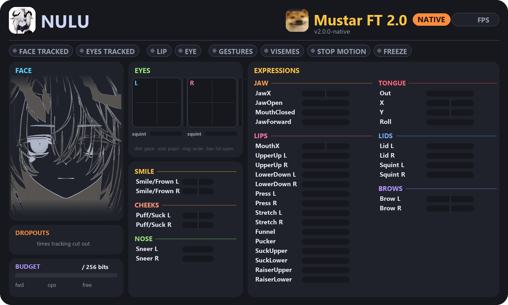
