
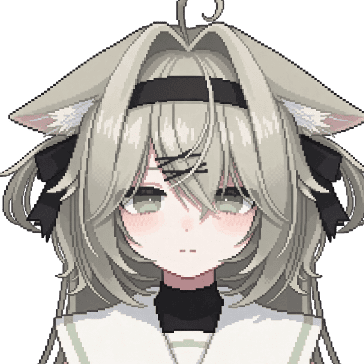

<h1 align="center">Nokua Face Tracking</h1>

mFT v2.0.0-native for <b>Nokua by rio (regular and petit)</b>

<a href="https://mustarlabs.booth.pm/items/9210314">mFT on BOOTH</a> · <a href="https://rio3d.booth.pm/items/9121634">Nokua by rio</a> · <a href="https://youtu.be/oqRwskHSS_Y">Demo video</a>

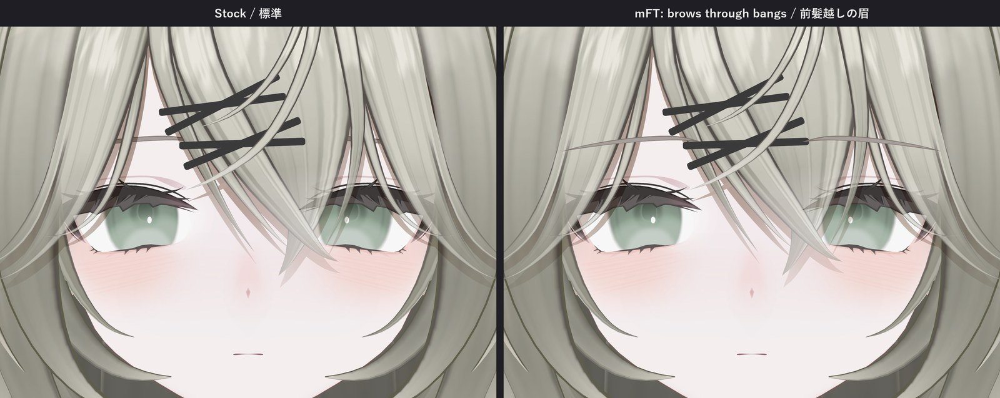 Brows through bangs, on by default (left: stock, right: mFT) · 前髪越しの眉

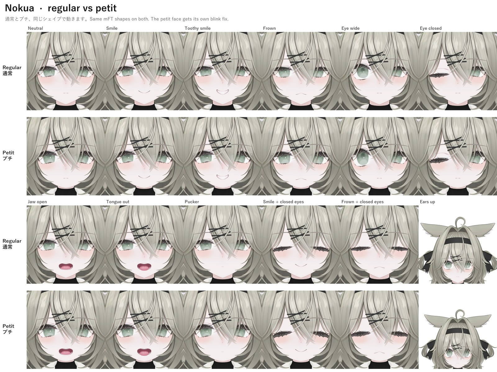 Regular and petit, same shapes · 通常とプチ

## Expressions

FT shapes, each looping 0 → 1 → 0. Left and right are as you look at the avatar (its own left shows on your right).  
FT シェイプ (0 → 1 → 0)。左右は見ている人から見た向き。

<table>
<tr><td align="center"> Eyes, all directions (lids follow)</td><td align="center"> EyeClosed (left)</td><td align="center"> EyeWide (left)</td><td align="center"> EyeSquint (left)</td></tr>
<tr><td align="center">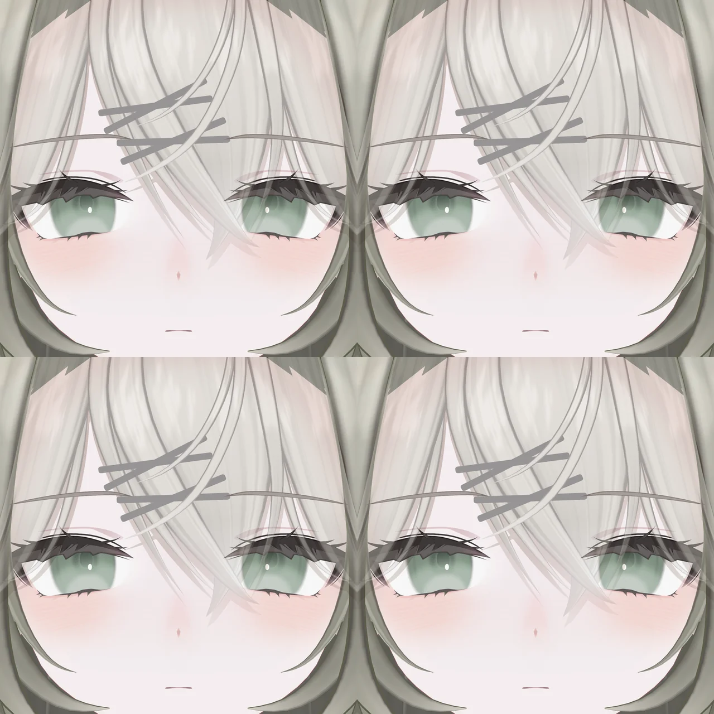 BrowInnerUp · BrowOuterUp (left, right)</td><td align="center"> BrowDown · BrowPinch (left, right)</td><td align="center"> CheekPuff (left)</td><td align="center"> JawOpen</td></tr>
<tr><td align="center">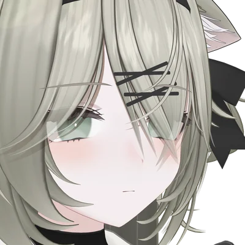 JawForward (3/4)</td><td align="center"> MouthSmile</td><td align="center"> Toothy smile</td><td align="center"> MouthFrown</td></tr>
<tr><td align="center"> MouthUpperUp + MouthLowerDown</td><td align="center"> Mouth (right)</td><td align="center"> LipPucker</td><td align="center"> LipFunnel</td></tr>
<tr><td align="center"> TongueOut</td><td align="center"> Tongue, all directions</td><td align="center">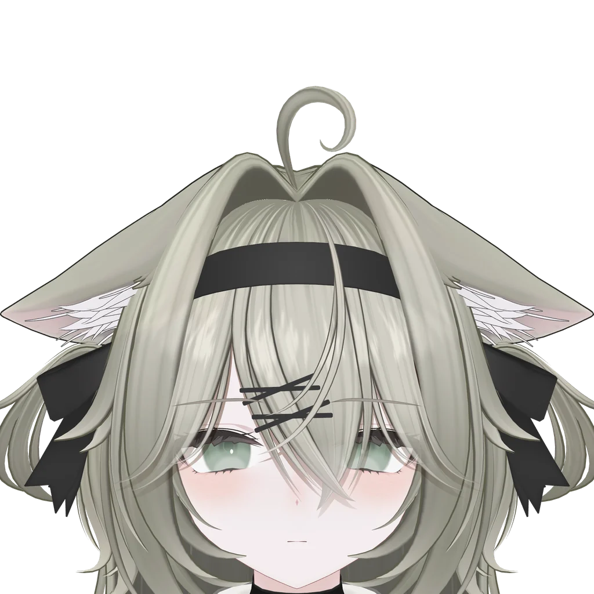 Ears: wide eyes lift them</td><td align="center"> Ears: a smile turns them forward</td></tr>
</table>

### All shapes / 全シェイプ

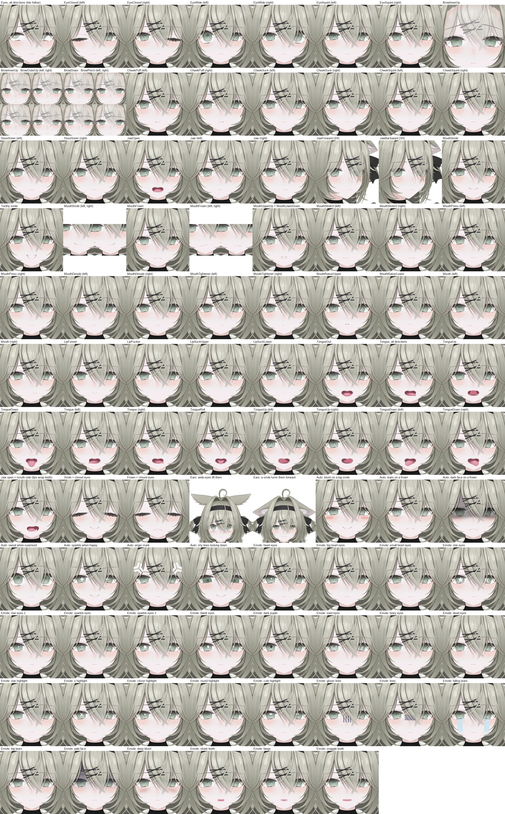

Eyes (7)

<table>
<tr><td align="center"> Eyes, all directions (lids follow)</td><td align="center"> EyeClosed (left)</td><td align="center"> EyeClosed (right)</td><td align="center"> EyeWide (left)</td></tr>
<tr><td align="center"> EyeWide (right)</td><td align="center"> EyeSquint (left)</td><td align="center"> EyeSquint (right)</td></tr>
</table>

Brows (3)

<table>
<tr><td align="center">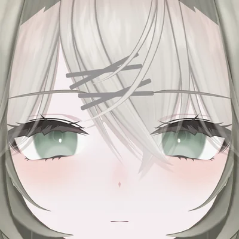 BrowInnerUp</td><td align="center"> BrowInnerUp · BrowOuterUp (left, right)</td><td align="center"> BrowDown · BrowPinch (left, right)</td></tr>
</table>

Cheeks and nose (8)

<table>
<tr><td align="center"> CheekPuff (left)</td><td align="center"> CheekPuff (right)</td><td align="center"> CheekSuck (left)</td><td align="center"> CheekSuck (right)</td></tr>
<tr><td align="center"> CheekSquint (left)</td><td align="center"> CheekSquint (right)</td><td align="center"> NoseSneer (left)</td><td align="center"> NoseSneer (right)</td></tr>
</table>

Jaw (5)

<table>
<tr><td align="center"> JawOpen</td><td align="center"> Jaw (left)</td><td align="center"> Jaw (right)</td><td align="center"> JawForward (3/4)</td></tr>
<tr><td align="center"> JawBackward (3/4)</td></tr>
</table>

Mouth (18)

<table>
<tr><td align="center"> MouthSmile</td><td align="center"> Toothy smile</td><td align="center">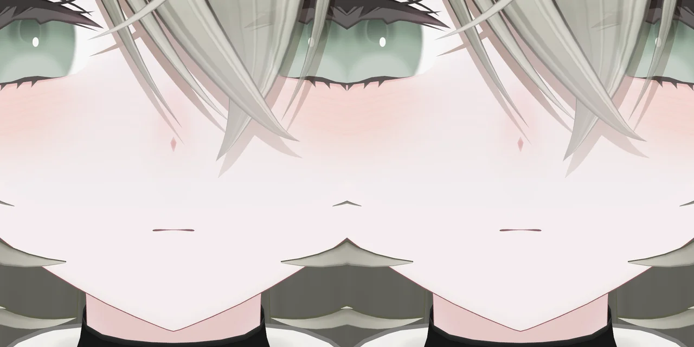 MouthSmile (left, right)</td><td align="center"> MouthFrown</td></tr>
<tr><td align="center"> MouthFrown (left, right)</td><td align="center"> MouthUpperUp + MouthLowerDown</td><td align="center"> MouthStretch (left)</td><td align="center"> MouthStretch (right)</td></tr>
<tr><td align="center"> MouthPress (left)</td><td align="center"> MouthPress (right)</td><td align="center">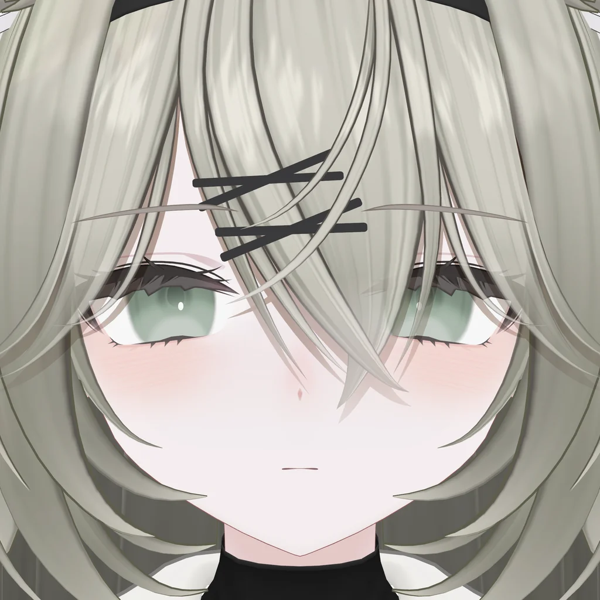 MouthDimple (left)</td><td align="center"> MouthDimple (right)</td></tr>
<tr><td align="center"> MouthTightener (left)</td><td align="center"> MouthTightener (right)</td><td align="center"> MouthRaiserUpper</td><td align="center"> MouthRaiserLower</td></tr>
<tr><td align="center"> Mouth (left)</td><td align="center"> Mouth (right)</td></tr>
</table>

Lips (4)

<table>
<tr><td align="center"> LipFunnel</td><td align="center"> LipPucker</td><td align="center"> LipSuckUpper</td><td align="center"> LipSuckLower</td></tr>
</table>

Tongue (11)

<table>
<tr><td align="center"> TongueOut</td><td align="center"> Tongue, all directions</td><td align="center"> TongueUp</td><td align="center"> TongueDown</td></tr>
<tr><td align="center"> Tongue (left)</td><td align="center"> Tongue (right)</td><td align="center"> TongueRoll</td><td align="center"> TongueUp (left)</td></tr>
<tr><td align="center"> TongueUp (right)</td><td align="center"> TongueDown (left)</td><td align="center"> TongueDown (right)</td></tr>
</table>

Her extras (5)

<table>
<tr><td align="center"> Jaw open + mouth side (lips wrap teeth)</td><td align="center"> Smile + closed eyes</td><td align="center"> Frown + closed eyes</td><td align="center"> Ears: wide eyes lift them</td></tr>
<tr><td align="center"> Ears: a smile turns them forward</td></tr>
</table>

Emotes and auto effects (33)

<table>
<tr><td align="center"> Auto: blush on a big smile</td><td align="center"> Auto: tears on a frown</td><td align="center"> Auto: dark face on a frown</td><td align="center"> Auto: sweat when surprised</td></tr>
<tr><td align="center"> Auto: sparkle when happy</td><td align="center"> Auto: anger mark</td><td align="center"> Auto: shy lines looking down</td><td align="center"> Emote: heart eyes</td></tr>
<tr><td align="center"> Emote: big heart eyes</td><td align="center"> Emote: small heart eyes</td><td align="center"> Emote: star eyes</td><td align="center"> Emote: star eyes 2</td></tr>
<tr><td align="center"> Emote: sparkle eyes</td><td align="center"> Emote: sparkle eyes 2</td><td align="center"> Emote: blank eyes</td><td align="center"> Emote: dark pupils</td></tr>
<tr><td align="center"> Emote: swirl eyes</td><td align="center"> Emote: teary eyes</td><td align="center"> Emote: dead eyes</td><td align="center"> Emote: star highlight</td></tr>
<tr><td align="center"> Emote: x highlight</td><td align="center"> Emote: clover highlight</td><td align="center"> Emote: round highlight</td><td align="center"> Emote: cute highlight</td></tr>
<tr><td align="center"> Emote: gloom lines</td><td align="center"> Emote: lines</td><td align="center"> Emote: falling tears</td><td align="center"> Emote: big tears</td></tr>
<tr><td align="center"> Emote: pale face</td><td align="center"> Emote: deep blush</td><td align="center"> Emote: shark teeth</td><td align="center"> Emote: fangs</td></tr>
<tr><td align="center"> Emote: snaggle tooth</td></tr>
</table>

## English

### In short

- Nokua's mouth, eyes, tongue, cheeks, brows and ears follow your face. 92 shapes made for her.
- Works on both her regular and petit bodies. The petit face is detected on its own and gets its own blink fix.
- A lot of hand work went in: tongue, teeth, eyes, ears, closed-eye fixes, brows through bangs. See the list below.
- One button to install. Your original files are never touched.
- Nokua and a face tracking device are not included.

mFT runs on my own template, written from scratch, for people who want a wider toolkit and more expressiveness.

Full report

### The numbers, and what they mean

| number | what it means |
|---|---|
| You TBD ms, viewers TBD ms | Extra cost per frame. Her own FX is about TBD ms. |
| Her own 59 / 256, FT 36 | Synced parameters, counted apart (patcher defaults). Each manual emote adds 1 bit. The face itself is 0 bits. |
| 145 shapes + her 853 | 92 for FT, 38 copies of her own parts (for emotes), 15 visemes at 35%. None of her shapes are removed. |
| Tongue: 10 poses | Out (4 stages), up, down, left, right, 4 diagonals, taco roll. It also follows the mouth left and right. |
| Package TBD | Difference data only. No avatar data inside. |

### What you get

- In-world calibration and 7 fine-tune dials.
- Debug panel: face, eyes and every expression value, live. Open it from the menu, or add a button on your left wrist in the installer.
- Smoothing Off / 5 to 30 ms, or Stop Motion. Viewers see you as you set it.
- FT anime visemes: the mouth snaps with your voice, on top of tracking.
- Freeze, pupils (emulated or tracker), PaperTrackerMode.
- Eyes: gaze moves as a flat slide, so her anime eyes never tilt or break. Up, down, in and out were each set by hand on her eyes.
- Clean closed eyes: the lash shadow hides as the eye closes. Smile + closed, frown + closed and squint + closed are corrected so lids and lashes never crumple.
- Raised brows lift the lash shadow with them.
- Teeth: a tidy closed bite, upper teeth 1.6 times taller, and the lower teeth follow the jaw cleanly when the mouth opens.
- Mouth to the side with the jaw open: the lips still wrap over the teeth (a hand-sculpted fix).
- Tongue: posed by hand in my Tongue Poser. Its resting spot is fixed too, so it never pokes through a pursed mouth. It follows the mouth when the mouth moves left or right.
- Ears (option, on by default): wide eyes lift the ears, a smile turns them forward. They move slowly and keep their physics swing.
- Brows through bangs (option, on by default): from the front, her brows show over her front hair. 0 bits.
- 7 auto effects (ticked in the patcher, OFF in game at first): blush on a smile, tears on a frown with a raised chin, a dark face on a frown with lowered brows, sweat when surprised, sparkle when happy, an anger mark on hard-lowered brows, shy lines on a smile while looking down.
- 26 manual emotes (add the ones you want, 1 bit each): 3 heart eyes, 2 star eyes, 2 sparkle eyes, blank eyes, dark pupils, swirl eyes, teary eyes, dead eyes, 5 highlight styles, gloom lines, lines, falling tears, big tears, pale face, deep blush, shark teeth, cat fangs, snaggle tooth.
- Her face sliders (face type, eye shape, petit face and more) stay as you set them.

### What changes on your avatar

- Hand gesture expressions start off (Face Tracking > Hand Gestures turns them back on).
- Her own face toggles (Face) keep working on top of tracking.
- Her Face menu moves to Face Tracking > Extras (her faces override tracking while on).
- Her outfit, hair, kemomimi, particle and locomotion menus keep working.
- With the ears option on, the KemoRoot PhysBone on the patched copy gets Is Animated, so the ears keep swinging.

### Cons

- Nokua only. Tested on PC, Quest is untested.
- Native only (VRChat's built-in FT).
- Calibration and Tune are saved, but Reset Avatar puts them back to default.
- If a Nokua update changes her face mesh, an updated version is needed.

### You need

Nokua (regular or petit prefab), VRChat SDK (3.10.6 or newer), VRCFT (Steam version, main or beta branch), and a face tracker that works with VRCFT (Unified Expressions). Set Nokua up first with rio's own instructions.

### Technical details

- How cost was measured: her FX against the built one in Unity, fastest of repeated 10-frame runs (2026-11-24). Noise is about 15%.
- Face mesh 9,458 verts. Checked on Nokua 1.0 (regular and petit).
- Zero delta normals, so her face shading stays clean.
- Gaze runs on shapes, so the eye bones never turn (her anime eye plates never tilt).
- Tongue: posed by hand on 3 bones in my Tongue Poser, then baked.

---

> **Mustard Awards**  
> **Nokua: 6.7 / 10 mustard cans.**  
> How well the model behaved on the way to face tracking. Higher is better.  
> Plus: a LOT of shapes of her own, and well made (853), a huge mouth box inside (respect to the author for that), very well made side profiles and great eye shells.  
> Minus: a lot of fixing on the way. The teeth did not close by default, closed eyes crumpled with a smile or frown, and the eyes sat too shallow for gaze. All fixed in this package.

## 日本語

日本語で読む

### 概要

- ノクアの口、目、舌、頬、眉、耳があなたの顔に合わせて動きます。彼女のために作ったシェイプ 92 個。
- 通常体とプチ体の両方に対応。プチの顔は自動で見分けて、専用のまばたき補正を入れます。
- 手で作り込んだ部分がたくさん: 舌、歯、目、耳、閉じた目の補正、前髪越しの眉。下の一覧をどうぞ。
- ボタンひとつで導入。元のファイルには触りません。
- ノクア本体とフェイストラッキング機器は含まれません。

mFT はゼロから作った独自テンプレートで、より幅広いツールと豊かな表現力を求める人のための選択肢です。

### 数字とその意味

| 数字 | 意味 |
|---|---|
| 自分 TBD ms、他の人 TBD ms | 1 フレームあたりの追加負荷。彼女自身の FX は約 TBD ms。 |
| 彼女自身 59 / 256、FT 36 | 同期パラメーターは別々に数えます (パッチャーの初期設定)。手動エモートは 1 個 1 bit。顔の動き自体は 0 bit。 |
| シェイプ 145 個 + 彼女の 853 個 | 92 個は FT 用、38 個は彼女のパーツの複製 (エモート用)、15 個はビゼーム 35%。彼女のシェイプは 1 つも消しません。 |
| 舌 10 ポーズ | 出す (4 段階)、上下左右、斜め 4 つ、タコスのように丸める。口の左右にもついていきます。 |
| パッケージ TBD | 差分データのみ。アバター本体のデータは入っていません。 |

### 中身

- ワールド内キャリブレーションと微調整ダイヤル 7 種。
- デバッグパネル: 顔、目、全表情の値をその場で表示。メニューで開閉、左手首のボタンは導入時に選べます。
- スムージング Off / 5〜30 ms、または Stop Motion。設定は見ている人にも同じに映ります。
- FT anime visemes: 声で口がパキッと切り替わり、トラッキングの口に重なります。
- フリーズ、瞳 (エミュレートまたはトラッカー)、PaperTrackerMode。
- 目: 視線は平面スライドで動きます。アニメの目が傾いて割れて見えることがありません。上下左右とも彼女の目に合わせて手で決めた位置です。
- 閉じた目をきれいに: 目を閉じると、まつげの影が消えます。笑顔+閉じ目、への字口+閉じ目、頬や目の細め+閉じ目で、まぶたとまつげが崩れないよう補正します。
- 眉を上げると、まつげの影も一緒に上がります。
- 歯: 閉じた歯並びを整え、上の歯を 1.6 倍の長さに。口を開けると下の歯がきれいについていきます。
- 口を左右に寄せたまま大きく開けても、唇がちゃんと歯を覆います (手で作った補正)。
- 舌: Tongue Poser で手で付けたポーズ。普段の舌の位置も直してあり、口をすぼめても突き抜けません。口が左右に動くと舌もついていきます。
- 耳 (オプション、最初からオン): 目を見開くと耳が立ち、笑うと耳が前に向きます。ゆっくり動き、揺れもそのまま。
- 前髪越しの眉 (オプション、最初からオン): 正面から見ると眉が前髪の上に見えます。0 bit。
- 自動エフェクト 7 個 (パッチャーで最初からチェック、ゲーム内では最初オフ): 笑顔で頬染め、への字口+あごで涙、への字口+眉下げで顔の影、驚くと汗、嬉しい顔でキラキラ、強く眉を下げると怒りマーク、笑顔+下を見ると照れ線。
- 手動エモート 26 個 (お好みで追加、1 個 1 bit): ハートの目 3 種、星の目 2 種、キラキラの目 2 種、白目、暗い瞳、ぐるぐる目、うるうる目、ハイライトなし、ハイライト 5 種、どんより線、線、流れる涙、大粒の涙、青ざめ、真っ赤な照れ、ギザ歯、猫の八重歯、八重歯。
- 彼女の顔の形スライダー (顔型、目の形、プチの顔など) はそのまま残ります。

### アバターで変わること

- ハンドジェスチャーの表情は最初オフです (Face Tracking > Hand Gestures で戻せます)。
- 彼女の表情トグル (Face) はトラッキングの上でそのまま使えます。
- 彼女の Face メニューは Face Tracking > Extras に移ります (表情はトラッキングより優先されます)。
- 彼女の衣装、髪、ケモ耳、パーティクル、ロコモーションのメニューはそのまま使えます。
- 耳オプションがオンのとき、パッチ済みコピーの KemoRoot の PhysBone の Is Animated がオンになります (耳が揺れ続けるため)。

### 弱点

- ノクア専用。PC で確認、Quest は未検証。
- ネイティブ専用 (VRChat 本体の FT)。
- キャリブレーションと Tune は保存されますが、アバターのリセットでは初期値に戻ります。
- ノクアの更新で顔のメッシュが変わると、対応版が必要です。

### 必要なもの

ノクア (通常またはプチのプレハブ)、VRChat SDK (3.10.6 以降)、VRCFT (Steam 版、メインでもベータブランチでも可)、VRCFT (Unified Expressions) で動くフェイストラッカー。ノクア本体の導入は rio さんの説明書に従ってください。

### 技術的な詳細

- 負荷の測り方: Unity 上で彼女の FX と完成した FX を比較、10 フレームの実行を繰り返した最速値 (2026-11-24)。誤差は約 15%。
- 顔のメッシュ 9,458 頂点。ノクア 1.0 で確認 (通常とプチ)。
- デルタ法線はゼロ: 彼女の顔の陰影がきれいに保たれます。
- 視線はシェイプで動かすので、目のボーンは回りません (アニメの目の板が傾きません)。
- 舌: 自作の Tongue Poser で 3 本のボーンに手でポーズを付けて焼き込み。

---

## Debug panel

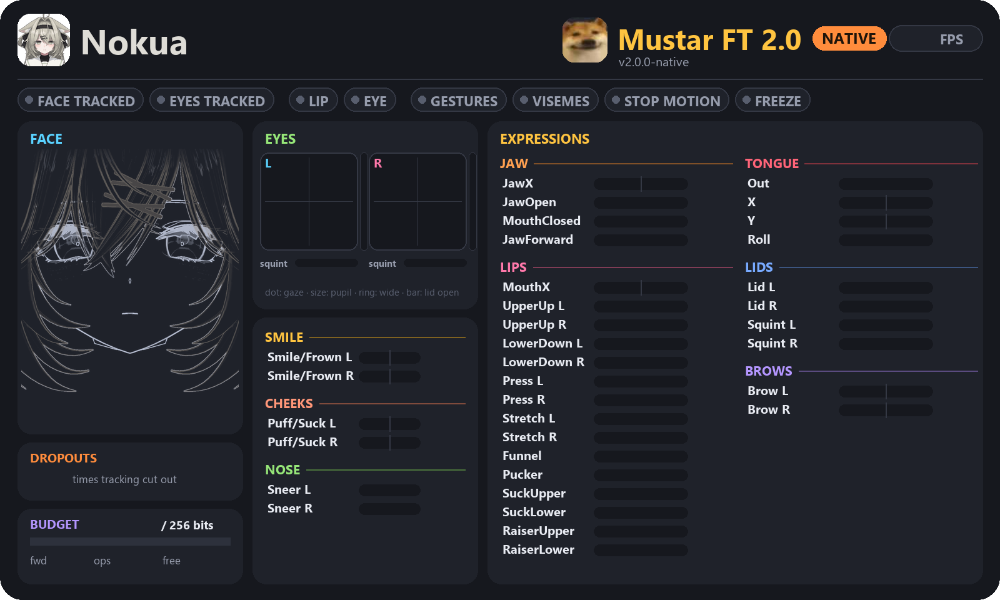
