
<a href="README.md">English</a> · <a href="README.ja.md">日本語</a> · <b>中文</b>

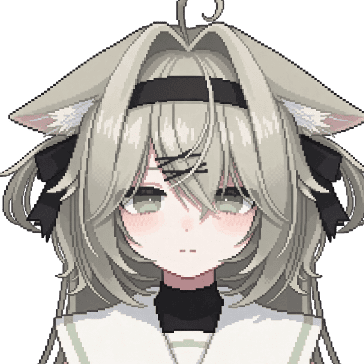

<h1 align="center">Nokua Face Tracking</h1>

mFT v2.0.0-native for <b>Nokua by rio (regular and petit)</b>

<a href="https://mustarlabs.booth.pm/items/9210314">mFT on BOOTH</a> · <a href="https://rio3d.booth.pm/items/9121634">Nokua by rio</a> · <a href="https://youtu.be/oqRwskHSS_Y">Demo video</a>

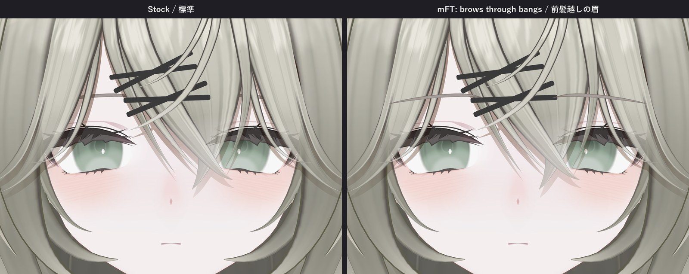 Brows through bangs, on by default (left: stock, right: mFT) · 前髪越しの眉

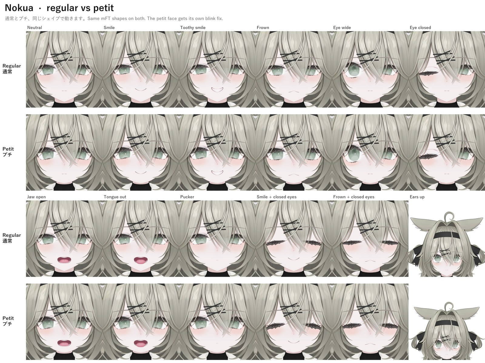 Regular and petit, same shapes · 通常とプチ

## Expressions

FT shapes, each looping 0 → 1 → 0. Left and right are as you look at the avatar (its own left shows on your right).  
FT シェイプ (0 → 1 → 0)。左右は見ている人から見た向き。

<table>
<tr><td align="center"> Eyes, all directions (lids follow)</td><td align="center"> EyeClosed (left)</td><td align="center"> EyeWide (left)</td><td align="center"> EyeSquint (left)</td></tr>
<tr><td align="center">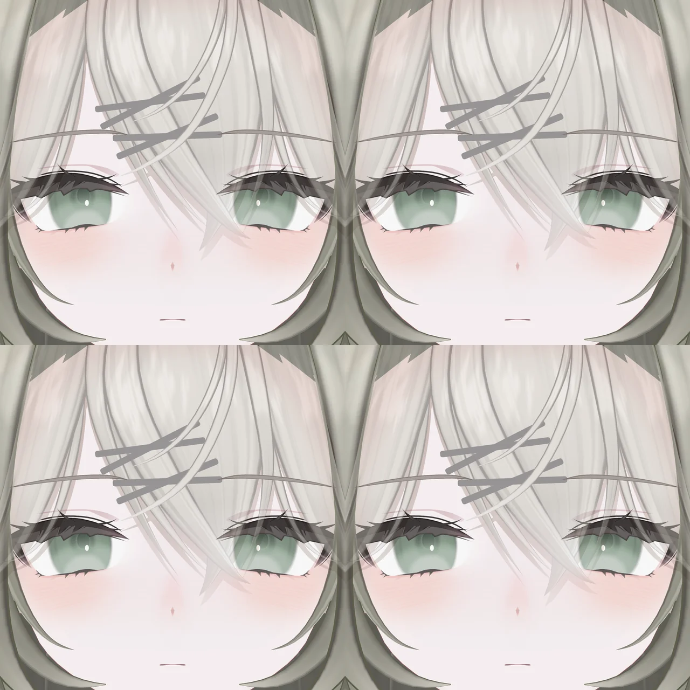 BrowInnerUp · BrowOuterUp (left, right)</td><td align="center"> BrowDown · BrowPinch (left, right)</td><td align="center"> CheekPuff (left)</td><td align="center"> JawOpen</td></tr>
<tr><td align="center">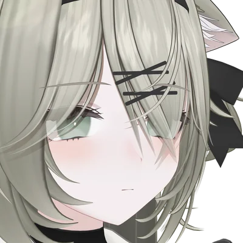 JawForward (3/4)</td><td align="center"> MouthSmile</td><td align="center"> Toothy smile</td><td align="center"> MouthFrown</td></tr>
<tr><td align="center"> MouthUpperUp + MouthLowerDown</td><td align="center"> Mouth (right)</td><td align="center"> LipPucker</td><td align="center"> LipFunnel</td></tr>
<tr><td align="center"> TongueOut</td><td align="center"> Tongue, all directions</td><td align="center">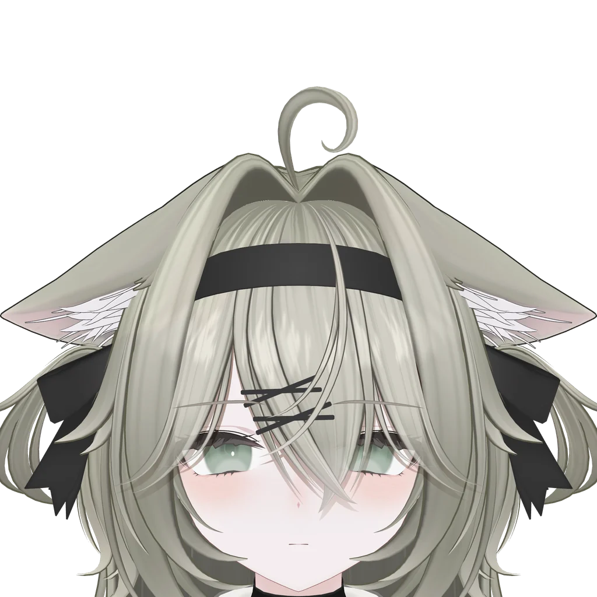 Ears: wide eyes lift them</td><td align="center"> Ears: a smile turns them forward</td></tr>
</table>

### All shapes / 全シェイプ

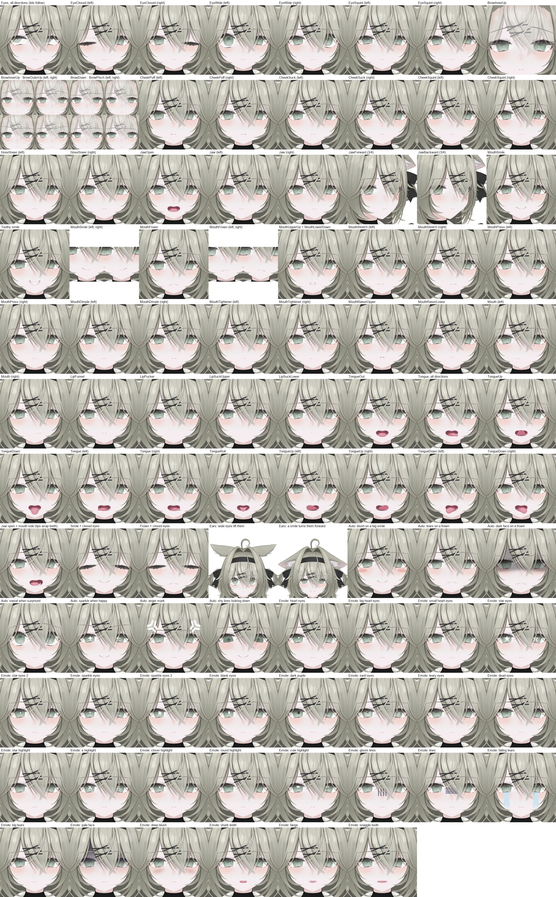

Eyes (7)

<table>
<tr><td align="center"> Eyes, all directions (lids follow)</td><td align="center"> EyeClosed (left)</td><td align="center"> EyeClosed (right)</td><td align="center"> EyeWide (left)</td></tr>
<tr><td align="center"> EyeWide (right)</td><td align="center"> EyeSquint (left)</td><td align="center"> EyeSquint (right)</td></tr>
</table>

Brows (3)

<table>
<tr><td align="center">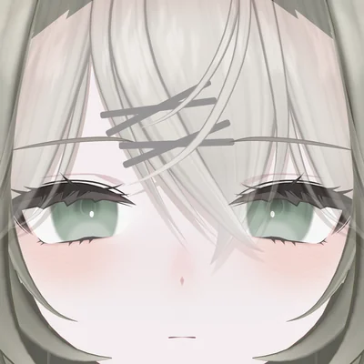 BrowInnerUp</td><td align="center"> BrowInnerUp · BrowOuterUp (left, right)</td><td align="center"> BrowDown · BrowPinch (left, right)</td></tr>
</table>

Cheeks and nose (8)

<table>
<tr><td align="center"> CheekPuff (left)</td><td align="center"> CheekPuff (right)</td><td align="center"> CheekSuck (left)</td><td align="center"> CheekSuck (right)</td></tr>
<tr><td align="center"> CheekSquint (left)</td><td align="center"> CheekSquint (right)</td><td align="center"> NoseSneer (left)</td><td align="center"> NoseSneer (right)</td></tr>
</table>

Jaw (5)

<table>
<tr><td align="center"> JawOpen</td><td align="center"> Jaw (left)</td><td align="center"> Jaw (right)</td><td align="center"> JawForward (3/4)</td></tr>
<tr><td align="center"> JawBackward (3/4)</td></tr>
</table>

Mouth (18)

<table>
<tr><td align="center"> MouthSmile</td><td align="center"> Toothy smile</td><td align="center">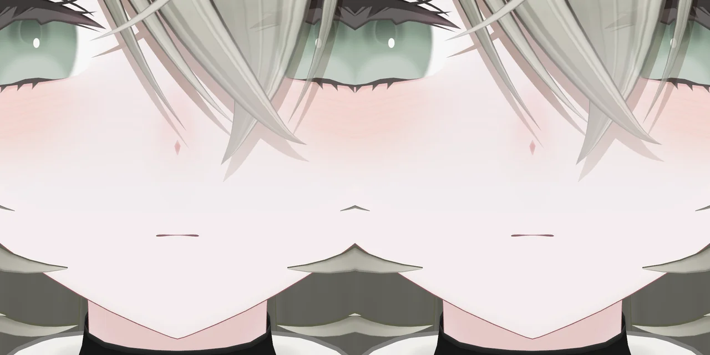 MouthSmile (left, right)</td><td align="center"> MouthFrown</td></tr>
<tr><td align="center"> MouthFrown (left, right)</td><td align="center"> MouthUpperUp + MouthLowerDown</td><td align="center"> MouthStretch (left)</td><td align="center"> MouthStretch (right)</td></tr>
<tr><td align="center"> MouthPress (left)</td><td align="center"> MouthPress (right)</td><td align="center">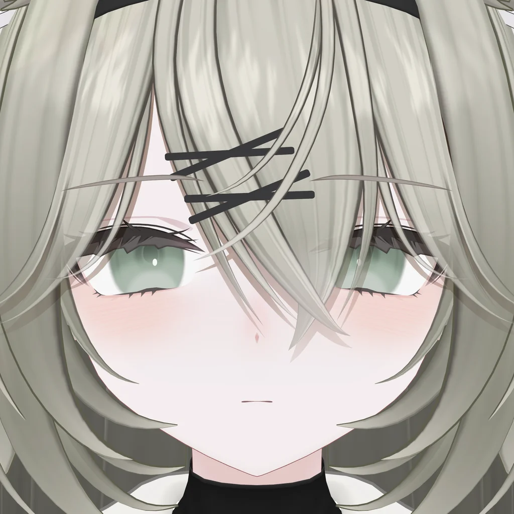 MouthDimple (left)</td><td align="center"> MouthDimple (right)</td></tr>
<tr><td align="center"> MouthTightener (left)</td><td align="center"> MouthTightener (right)</td><td align="center"> MouthRaiserUpper</td><td align="center"> MouthRaiserLower</td></tr>
<tr><td align="center"> Mouth (left)</td><td align="center"> Mouth (right)</td></tr>
</table>

Lips (4)

<table>
<tr><td align="center"> LipFunnel</td><td align="center"> LipPucker</td><td align="center"> LipSuckUpper</td><td align="center"> LipSuckLower</td></tr>
</table>

Tongue (11)

<table>
<tr><td align="center"> TongueOut</td><td align="center"> Tongue, all directions</td><td align="center"> TongueUp</td><td align="center"> TongueDown</td></tr>
<tr><td align="center"> Tongue (left)</td><td align="center"> Tongue (right)</td><td align="center"> TongueRoll</td><td align="center"> TongueUp (left)</td></tr>
<tr><td align="center"> TongueUp (right)</td><td align="center"> TongueDown (left)</td><td align="center"> TongueDown (right)</td></tr>
</table>

Her extras (5)

<table>
<tr><td align="center"> Jaw open + mouth side (lips wrap teeth)</td><td align="center"> Smile + closed eyes</td><td align="center"> Frown + closed eyes</td><td align="center"> Ears: wide eyes lift them</td></tr>
<tr><td align="center"> Ears: a smile turns them forward</td></tr>
</table>

Emotes and auto effects (33)

<table>
<tr><td align="center"> Auto: blush on a big smile</td><td align="center"> Auto: tears on a frown</td><td align="center"> Auto: dark face on a frown</td><td align="center"> Auto: sweat when surprised</td></tr>
<tr><td align="center"> Auto: sparkle when happy</td><td align="center"> Auto: anger mark</td><td align="center"> Auto: shy lines looking down</td><td align="center"> Emote: heart eyes</td></tr>
<tr><td align="center"> Emote: big heart eyes</td><td align="center"> Emote: small heart eyes</td><td align="center"> Emote: star eyes</td><td align="center"> Emote: star eyes 2</td></tr>
<tr><td align="center"> Emote: sparkle eyes</td><td align="center"> Emote: sparkle eyes 2</td><td align="center"> Emote: blank eyes</td><td align="center"> Emote: dark pupils</td></tr>
<tr><td align="center"> Emote: swirl eyes</td><td align="center"> Emote: teary eyes</td><td align="center"> Emote: dead eyes</td><td align="center"> Emote: star highlight</td></tr>
<tr><td align="center"> Emote: x highlight</td><td align="center"> Emote: clover highlight</td><td align="center"> Emote: round highlight</td><td align="center"> Emote: cute highlight</td></tr>
<tr><td align="center"> Emote: gloom lines</td><td align="center"> Emote: lines</td><td align="center"> Emote: falling tears</td><td align="center"> Emote: big tears</td></tr>
<tr><td align="center"> Emote: pale face</td><td align="center"> Emote: deep blush</td><td align="center"> Emote: shark teeth</td><td align="center"> Emote: fangs</td></tr>
<tr><td align="center"> Emote: snaggle tooth</td></tr>
</table>

## 中文

### 简介

- Nokua 的嘴、眼睛、舌头、脸颊、眉毛和耳朵会跟随你的脸。为她制作了 92 个形态键。
- 普通体型和 petit 体型都支持。petit 的脸会自动识别，并加上专用的眨眼修正。
- 很多部分都是手工打磨：舌头、牙齿、眼睛、耳朵、闭眼修正、透过刘海的眉毛。见下方列表。
- 一键安装。绝不改动原始文件。
- 不含 ノクア 本体和面捕设备。

mFT 使用我从零编写的模板，是给想要更丰富工具和更强表现力的人的选择。

### 数字及其含义

| 数字 | 含义 |
|---|---|
| 轻量 / 中等 / 完整 | 安装器的三个预设，按此顺序: 轻量 (只有必要部分)、中等 (默认勾选)、完整 (全部表情)。下面的数字都按这个顺序。FT bit 9 / 36 / 62。计划推出 mFT 2.1: 更加优化，并可管理和混合形态键。 |
| 自己 0.82 / 1.18 / 1.44 ms，其他人 0.81 / 1.14 / 1.49 ms | 每帧的额外开销。她自己的 FX 约 0.12 ms。 |
| 她自己 59 / 256，FT 9 / 36 / 62 | 同步参数分开计算 (安装器默认)。每个手动表情加 1 bit。脸部动作本身 0 bit。 |
| 145 个形态键 + 她的 853 个 | 92 个用于 FT，38 个是她自身部件的副本 (用于表情)，15 个是 35% 的口型。不删除她的任何形态键。 |
| 舌头 10 个姿势 | 伸出 (4 段)、上下左右、4 个斜向、卷成塔可状。嘴左右移动时舌头也会跟随。 |
| 安装包 2.4 MB | 仅差分数据，不含模型数据。 |

### 内容

- 游戏内校准和 7 个微调旋钮。
- 调试面板：实时显示脸、眼睛和所有表情数值。从菜单打开，也可在安装器中添加左手腕按钮。
- 平滑 关闭 / 5 到 30 ms，或 Stop Motion。他人看到的与你的设置相同。
- FT anime visemes：嘴随声音利落切换，叠加在追踪之上。
- 冻结、瞳孔 (模拟或追踪器)、PaperTrackerMode。
- 眼睛：视线以平面滑动方式移动，动漫眼睛不会倾斜或破面。上下左右都按她的眼睛手工设定。
- 干净的闭眼：闭眼时睫毛阴影会隐藏。微笑+闭眼、撇嘴+闭眼、眯眼+闭眼都做了修正，眼睑和睫毛不会变形。
- 抬眉时睫毛阴影也会一起抬起。
- 牙齿：整齐的闭合咬合，上排牙齿加长到 1.6 倍，张嘴时下排牙齿干净地跟随下颌。
- 嘴偏向一侧并张大时，嘴唇依然包住牙齿 (手工雕刻的修正)。
- 舌头：在我的 Tongue Poser 中手工摆姿势。静止位置也修正过，噘嘴时不会穿出。嘴左右移动时舌头也会跟随。
- 耳朵 (选项，默认开启)：睁大眼睛时耳朵竖起，微笑时耳朵朝前。动作缓慢，并保留物理摆动。
- 透过刘海的眉毛 (选项，默认开启)：从正面看，眉毛显示在刘海上方。0 bit。
- 7 个自动特效 (安装器默认勾选，游戏中默认关闭)：微笑时脸红，撇嘴+抬下巴时流泪，撇嘴+压眉时脸部阴影，惊讶时出汗，开心时闪光，用力压眉时愤怒符号，微笑+往下看时害羞线。
- 26 个手动表情 (按需添加，每个 1 bit)：3 种爱心眼、2 种星星眼、2 种闪光眼、空白眼、暗瞳、漩涡眼、泪汪汪、无高光眼、5 种高光、阴沉线、线条、流泪、大泪珠、脸色苍白、满脸通红、鲨鱼齿、猫牙、虎牙。
- 她的脸型滑块 (脸型、眼型、petit 脸等) 保持你的设定。

### 模型上的变化

- 手势表情默认关闭 (Face Tracking > Hand Gestures 可重新开启)。
- 她自己的表情开关 (Face) 在追踪之上仍可使用。
- 她的 Face 菜单移到 Face Tracking > Extras (开启时她的表情优先于追踪)。
- 她的服装、头发、兽耳、粒子和移动菜单照常可用。
- 开启耳朵选项时，已打补丁副本上 KemoRoot 的 PhysBone 会开启 Is Animated，让耳朵继续摆动。

### 缺点

- 仅限 ノクア。已在 PC 测试，Quest 未测试。
- 仅原生 (VRChat 内置 FT)。
- 校准和 Tune 会保存，但重置模型会恢复默认。
- 如果 ノクア 更新改变了脸部网格，需要更新版本。

### 需要

Nokua (普通或 petit 预制体)、VRChat SDK (3.10.6 或更新)、VRCFT (Steam 版，主线或测试分支均可)，以及支持 VRCFT (Unified Expressions) 的面部追踪设备。请先按 rio 的说明设置好 Nokua。

### 技术细节

- 开销测量：在 Unity 中比较她的 FX 与构建后的 FX，取重复 10 帧运行的最快值 (2026-11-24)。误差约 15%。
- 脸部网格 9,458 顶点。已在 Nokua 1.0 / 1.1 / 1.2 上确认 (普通与 petit)。
- 增量法线为零，她的脸部阴影保持干净。
- 视线由形态键驱动，眼睛骨骼不转动 (动漫眼片不会倾斜)。
- 舌头：在我的 Tongue Poser 中用 3 根骨骼手工摆姿势后烘焙。

---

> **Mustard Awards**  
> **Nokua: 6.7 / 10 mustard cans.**  
> How well the model behaved on the way to face tracking. Higher is better.  
> Plus: a LOT of shapes of her own, and well made (853), a huge mouth box inside (respect to the author for that), very well made side profiles and great eye shells.  
> Minus: a lot of fixing on the way. The teeth did not close by default, closed eyes crumpled with a smile or frown, and the eyes sat too shallow for gaze. All fixed in this package.

## 调试面板

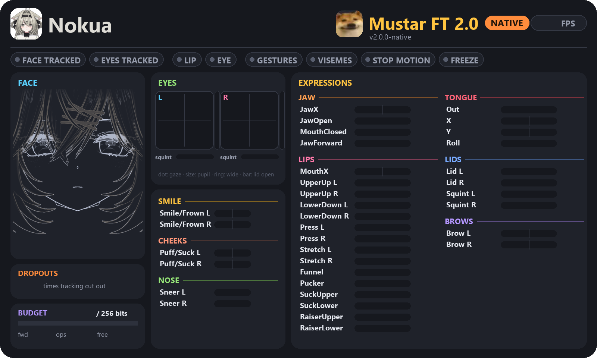
