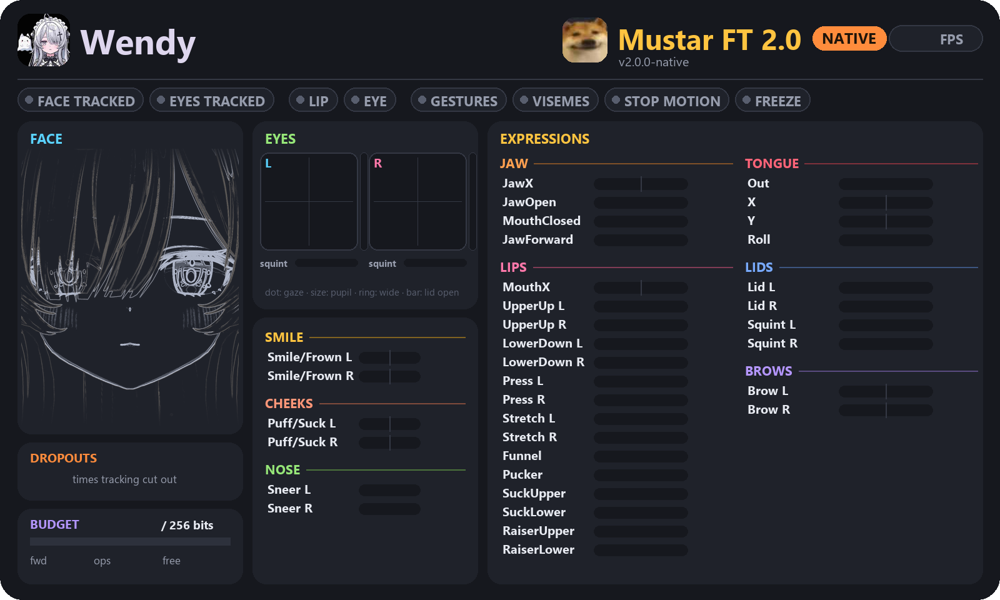

<h1 align="center">mFT</h1>

<b>Face tracking for VRChat avatars, by mustar.</b> Shapes sculpted per avatar, VRChat native face tracking, previews of every shape.

mustar のフェイストラッキング。アバターごとに造形したシェイプと、その全プレビュー。

 mFT debug panel

### The mFT template goes open source soon (MIT)

The full toolkit behind every avatar here: native face tracking, calibration, smoothing and Stop Motion, the debug panel, and the patcher. It comes with my own original avatar as an open FT benchmark: she will be set up and tested on every face tracking template available today, including Adjerry's and Pawlygon's. Her face is free for anyone to download, so anyone can compare templates on the same face, and test their own.

日本語

**mFT テンプレートはまもなく MIT ライセンスでオープンソース公開します。**

ここにあるすべてのアバターを支えるツール一式 (ネイティブ FT、キャリブレーション、スムージングと Stop Motion、デバッグパネル、パッチャー)。オープンな FT ベンチマークとして私のオリジナルアバターも一緒に公開し、Adjerry や Pawlygon など現在あるすべての FT テンプレートで設定・テストします。彼女は誰でも無料でダウンロードできるので、同じ顔でテンプレートを比べたり、自分のテンプレートを試したりできます。

## Avatars

<table>
<tr><td align="center" width="25%"> <b><a href="Wendy/">Wendy</a></b> 薄暮帰路 <a href="Wendy/README.md#expressions">previews</a> · <a href="https://mustarlabs.booth.pm/items/9122969">BOOTH</a> · <a href="https://youtu.be/4iEUEHY-Ous">video</a></td><td align="center" width="25%"> <b><a href="Haruka/">Haruka</a></b> BLUESTELLA <a href="Haruka/README.md#expressions">previews</a> · <a href="https://mustarlabs.booth.pm/items/9103429">BOOTH</a> · <a href="https://youtu.be/BaPW5rd_xLo">video</a></td><td align="center" width="25%"> <b><a href="Chiyu/">Chiyu</a></b> plium <a href="Chiyu/README.md#expressions">previews</a> · <a href="https://mustarlabs.booth.pm/items/9078058">BOOTH</a> · <a href="https://youtu.be/25gfjd5u3mI">video</a></td><td align="center" width="25%"> <b><a href="Salt/">Salt</a></b> komado <a href="Salt/README.md#expressions">previews</a> · <a href="https://mustarlabs.booth.pm/items/9081877">BOOTH</a> · <a href="https://youtu.be/ixlHtQ36ZWg">video</a></td></tr>
<tr><td align="center" width="25%"> <b><a href="Michella/">Michella</a></b> CEM DOLLS <a href="Michella/README.md#expressions">previews</a> · <a href="https://mustarlabs.booth.pm/items/8944145">BOOTH</a> · <a href="https://youtu.be/fPGB_iy_bqk">video</a></td><td align="center" width="25%"> <b><a href="Yuri/">Yuri</a></b> VISIONTOKYO <a href="Yuri/README.md#expressions">previews</a> · <a href="https://mustarlabs.booth.pm/items/8926576">BOOTH</a> · <a href="https://youtu.be/OH4fnlD3O7s">video</a></td><td align="center" width="25%"> <b><a href="Lunary/">Lunary</a></b> あまのえむ (mellowpink) <a href="Lunary/README.md#expressions">previews</a> · <a href="https://mustarlabs.booth.pm/items/8886565">BOOTH</a> · <a href="https://youtu.be/cTbftDgtHQg">video</a></td><td align="center" width="25%"> <b><a href="Twale/">Twale</a></b> 図鑑 <a href="Twale/README.md#expressions">previews</a> · <a href="https://mustarlabs.booth.pm/items/9093402">BOOTH</a> · <a href="https://youtu.be/CSxgPL3owQA">video</a></td></tr>
<tr><td align="center" width="25%"> <b><a href="Diana/">Diana</a></b> 雑司 <a href="Diana/README.md#expressions">previews</a> · <a href="https://mustarlabs.booth.pm/items/9194443">BOOTH</a> · <a href="https://youtu.be/eJ7l7llmK-4">video</a></td><td align="center" width="25%"> <b><a href="Nokua/">Nokua</a></b> rio (regular and petit) <a href="Nokua/README.md#expressions">previews</a> · <a href="https://mustarlabs.booth.pm/items/9210314">BOOTH</a> · <a href="https://youtu.be/oqRwskHSS_Y">video</a></td><td align="center" width="25%"> <b><a href="NULU/">NULU</a></b> uryu (Uryu Lab) <a href="NULU/README.md#expressions">previews</a> · <a href="https://mustarlabs.booth.pm/items/9238479">BOOTH</a></td></tr>
</table>

The avatars belong to their creators and are shown with credit. mFT itself is not in this repo.
