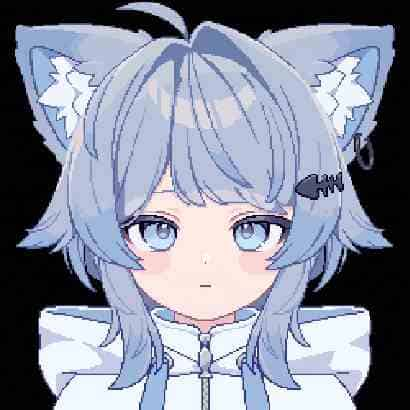
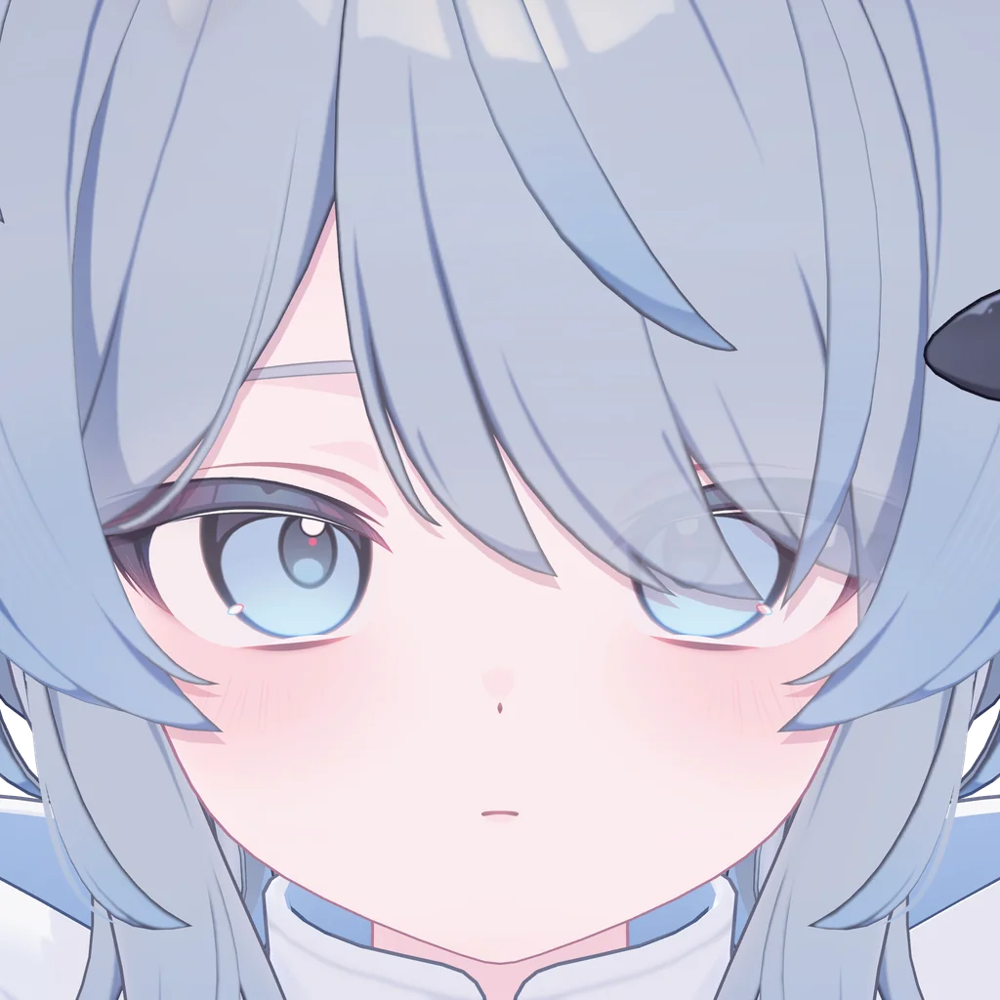
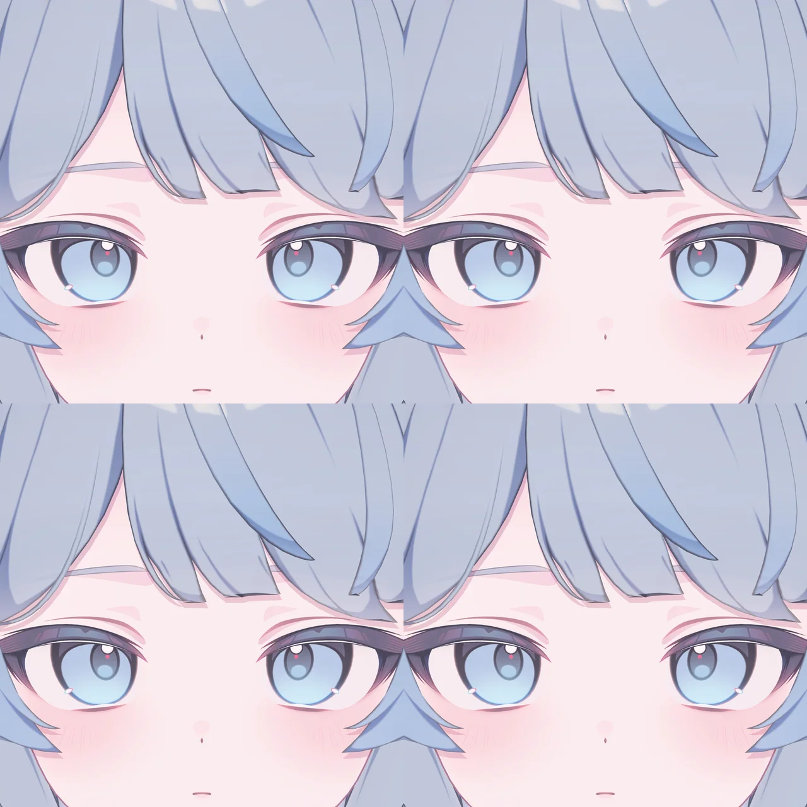
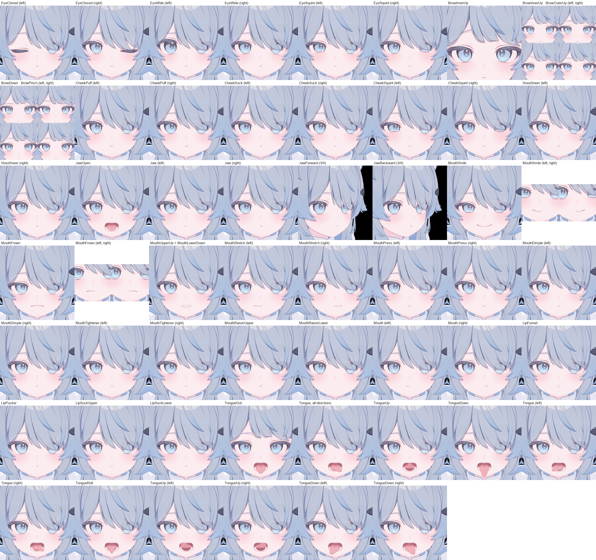
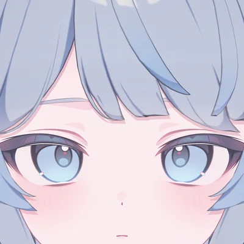
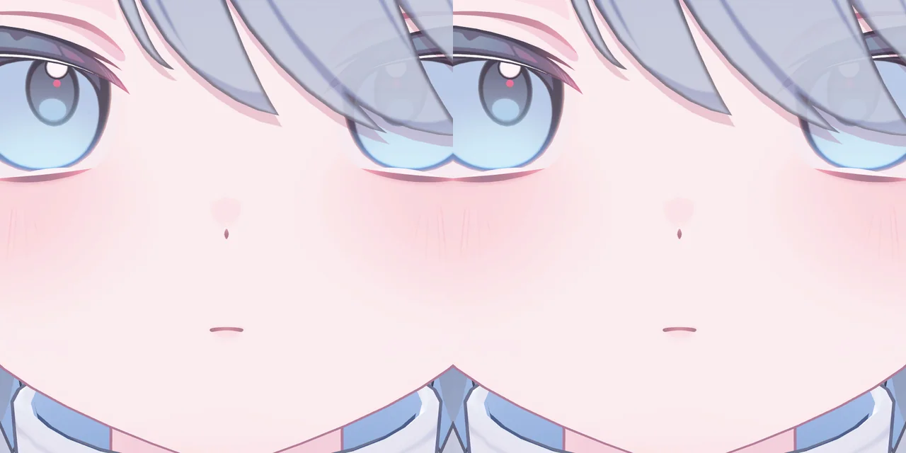
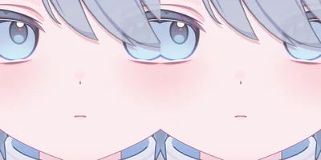
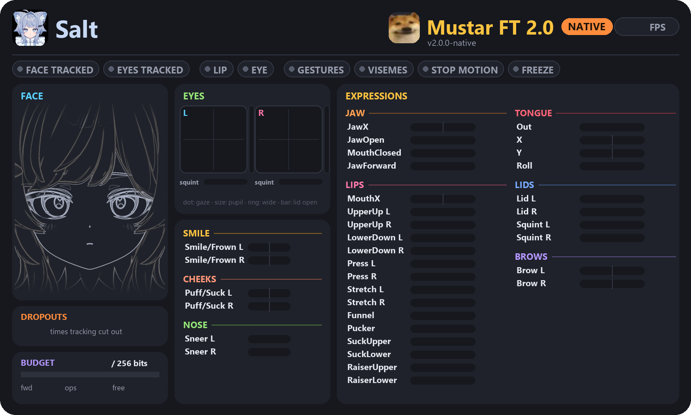

<b>English</b> · <a href="README.ja.md">日本語</a> · <a href="README.zh.md">中文</a>

<h1 align="center">Salt Face Tracking</h1>

mFT v2.0.0-native for <b>ソルト -Salt- by komado</b>

<a href="https://mustarlabs.booth.pm/items/9081877">mFT on BOOTH</a> · <a href="https://booth.pm/ja/items/8962830">ソルト -Salt- by komado</a> · <a href="https://youtu.be/ixlHtQ36ZWg">Demo video</a>

## Expressions

FT shapes, each looping 0 → 1 → 0. Left and right are as you look at the avatar (its own left shows on your right).  
FT シェイプ (0 → 1 → 0)。左右は見ている人から見た向き。

<table>
<tr><td align="center"> EyeClosed (left)</td><td align="center"> EyeWide (left)</td><td align="center"> EyeSquint (left)</td><td align="center"> BrowInnerUp · BrowOuterUp (left, right)</td></tr>
<tr><td align="center"> BrowDown · BrowPinch (left, right)</td><td align="center"> CheekPuff (left)</td><td align="center"> JawOpen</td><td align="center"> JawForward (3/4)</td></tr>
<tr><td align="center"> MouthSmile</td><td align="center"> MouthFrown</td><td align="center"> MouthUpperUp + MouthLowerDown</td><td align="center"> Mouth (right)</td></tr>
<tr><td align="center"> LipPucker</td><td align="center"> LipFunnel</td><td align="center"> TongueOut</td><td align="center"> Tongue, all directions</td></tr>
</table>

### All shapes / 全シェイプ

Eyes (6)

<table>
<tr><td align="center"> EyeClosed (left)</td><td align="center"> EyeClosed (right)</td><td align="center"> EyeWide (left)</td><td align="center"> EyeWide (right)</td></tr>
<tr><td align="center"> EyeSquint (left)</td><td align="center"> EyeSquint (right)</td></tr>
</table>

Brows (3)

<table>
<tr><td align="center"> BrowInnerUp</td><td align="center"> BrowInnerUp · BrowOuterUp (left, right)</td><td align="center"> BrowDown · BrowPinch (left, right)</td></tr>
</table>

Cheeks and nose (8)

<table>
<tr><td align="center"> CheekPuff (left)</td><td align="center"> CheekPuff (right)</td><td align="center"> CheekSuck (left)</td><td align="center"> CheekSuck (right)</td></tr>
<tr><td align="center"> CheekSquint (left)</td><td align="center"> CheekSquint (right)</td><td align="center"> NoseSneer (left)</td><td align="center"> NoseSneer (right)</td></tr>
</table>

Jaw (5)

<table>
<tr><td align="center"> JawOpen</td><td align="center"> Jaw (left)</td><td align="center"> Jaw (right)</td><td align="center"> JawForward (3/4)</td></tr>
<tr><td align="center"> JawBackward (3/4)</td></tr>
</table>

Mouth (17)

<table>
<tr><td align="center"> MouthSmile</td><td align="center"> MouthSmile (left, right)</td><td align="center"> MouthFrown</td><td align="center"> MouthFrown (left, right)</td></tr>
<tr><td align="center"> MouthUpperUp + MouthLowerDown</td><td align="center"> MouthStretch (left)</td><td align="center"> MouthStretch (right)</td><td align="center"> MouthPress (left)</td></tr>
<tr><td align="center"> MouthPress (right)</td><td align="center"> MouthDimple (left)</td><td align="center"> MouthDimple (right)</td><td align="center"> MouthTightener (left)</td></tr>
<tr><td align="center"> MouthTightener (right)</td><td align="center"> MouthRaiserUpper</td><td align="center"> MouthRaiserLower</td><td align="center"> Mouth (left)</td></tr>
<tr><td align="center"> Mouth (right)</td></tr>
</table>

Lips (4)

<table>
<tr><td align="center"> LipFunnel</td><td align="center"> LipPucker</td><td align="center"> LipSuckUpper</td><td align="center"> LipSuckLower</td></tr>
</table>

Tongue (11)

<table>
<tr><td align="center"> TongueOut</td><td align="center"> Tongue, all directions</td><td align="center"> TongueUp</td><td align="center"> TongueDown</td></tr>
<tr><td align="center"> Tongue (left)</td><td align="center"> Tongue (right)</td><td align="center"> TongueRoll</td><td align="center"> TongueUp (left)</td></tr>
<tr><td align="center"> TongueUp (right)</td><td align="center"> TongueDown (left)</td><td align="center"> TongueDown (right)</td></tr>
</table>

## English

### In short

- Salt's mouth, eyes, tongue, cheeks and brows move with your face. 77 face tracking shapes.
- Gaze on her real eye bones: 50° outward, 34° inward, 30° up and down.
- Stop Motion mode (anime mode): the face holds a pose and jumps 8 times a second, and the mouth snaps with your voice.
- One button to install. Your original files are never touched.
- Salt and a face tracking device are not included.

mFT runs on my own template, written from scratch, for people who want a wider toolkit and more expressiveness.

Full report

### The numbers, and what they mean

| number | what it means |
|---|---|
| You +0.29 ms, viewers +0.28 ms (native) | Added per frame. Classic: you +0.35 ms, viewers +0.35 ms. Her own FX is about 0.2 ms. |
| 106 / 256 (native), 224 / 256 (classic) | Synced parameters. Native: her own 67 + extras 39 (Full) or 10 (Light, total 77). The face itself is 0 bits. |
| 95 shapes + her 881 | 80 for face tracking, 15 visemes at 35%. None of hers removed. |
| 10 tongue poses | Up, down, sideways, diagonals, roll. Tongue out extends in 4 stages. |
| Package 2.4 MB | Shape differences only, no avatar data. |

### What you get

- In-world calibration and 7 fine-tune dials.
- Debug panel: face, eyes and every expression value, live. Open it from the menu, or add a button on your left wrist in the installer.
- Smoothing Off / 5 to 30 ms, or Stop Motion. Viewers see you as you set it.
- FT anime visemes: the mouth snaps with your voice, on top of tracking.
- Freeze, pupils (emulated or tracker), and eyes that react to your face (smile, glare, looking down).
- 11 emotes (native): cat eyes, teary eyes, sparkle, tears, blue face, white eyes, sweat, cheek lines, blush, dizzy, hearts.
- One clean bite: her teeth sit in a single set position across every expression.
- Teeth menu (native, pick it in the installer): Long Fangs, No Fangs, Shark Teeth.
- Anti-break: wide smiles and frowns on an open mouth, and smiling or cheek-raising with closed eyes, correct themselves (0 bits).
- Her own Facial Option and hand-gesture face parts keep working while face tracking is on.
- PaperTrackerMode: when Paper Tracker fires funnel and pucker together, the stronger one wins.

### What changes on your avatar

- Facial Option moves to Extras > Emotes_Vendors.
- Her auto-blink layer pauses while Eye Tracking is on, and comes back when it's off. Her AFK eye animation pauses with it.
- Her teeth stay in the one bite on the copy. Uninstall puts them back.
- Hand gesture expressions start off (menu toggle).
- Lip sync on the copy runs through my layer. Uninstall puts it back.
- Her outfit, hair, ear and tail menus keep working.

### Cons

- Salt only. Tested on PC, Quest is untested.
- To fit, classic leaves out Eye Control (her manual gaze menu), the emotes and the teeth menu. Native has everything.
- Calibration and Tune are saved, but Reset Avatar puts them back to default.
- If a Salt update changes her face mesh, an updated version is needed.

### You need

Salt, the VRChat SDK (3.10.6 or newer), VRCFT, and a face tracker that works with VRCFT (Unified Expressions). For Salt herself, follow komado's manual. If Modular Avatar says it is too old when you import Salt, press Ignore. Checked on Modular Avatar 1.18.7.

### Technical details

- How cost was measured: her FX against the built one in Unity, fastest of repeated 10-frame runs (2026-11-03). Noise is about 15%.
- Face mesh 9,772 verts. Checked on the Salt prefab of Salt 1.0.0.
- Zero delta normals, so her flat face shading stays clean.
- Tongue shapes move only the tongue; a small correction fires only when jaw and tongue are both up (0 bits).
- Native: 331 / 2048 expression instructions.
- A fresh import matched the development build exactly.

---

> **Mustard Awards**  
> **Salt: 7 / 10 mustard cans.**  
> How well the model behaved on the way to face tracking. Higher is better.  
> Plus: 881 shapes with clean left/right splits, real eye bones, and clean tongue-only keys. Very generous.  
> Minus: a light skin mesh around a tiny mouth, so wide expressions needed extra care.

## 日本語

日本語で読む

### 概要

- Salt の口、目、舌、頬、眉があなたの顔に合わせて動きます。FT 用シェイプ 77 個。
- 本物のアイボーンで視線が動き、外側 50°、内側 34°、上下 30°。
- Stop Motion モード (アニメモード): 顔がポーズを保ち 1 秒に 8 回切り替わり、口は声に合わせてパキッと動きます。
- ボタンひとつで導入。元のファイルには触りません。
- Salt本体とフェイストラッキング機器は含まれません。

mFT はゼロから作った独自テンプレートで、より幅広いツールと豊かな表現力を求める人のための選択肢です。

### 数字とその意味

| 数字 | 意味 |
|---|---|
| 自分 +0.29 ms、他の人 +0.28 ms (ネイティブ) | 1 フレームあたりの追加負荷。従来版は自分 +0.35 ms、他の人 +0.35 ms。彼女自身の FX は約 0.2 ms。 |
| 106 / 256 (ネイティブ)、224 / 256 (従来版) | 同期パラメーター。ネイティブ: 彼女自身の 67 + 追加機能 39 (Full) または 10 (Light、合計 77)。顔の動き自体は 0 bit。 |
| シェイプ 95 個 + 彼女の 881 個 | 80 個は FT 用、15 個はビゼーム 35%。彼女のシェイプは 1 つも消しません。 |
| 舌 10 ポーズ | 上下左右、斜め、丸め。舌出しは 4 段階で伸びます。 |
| パッケージ 2.4 MB | 差分データのみ。アバター本体のデータは入っていません。 |

### 中身

- ワールド内キャリブレーションと微調整ダイヤル 7 種。
- デバッグパネル: 顔、目、全表情の値をその場で表示。メニューで開閉、左手首のボタンは導入時に選べます。
- スムージング Off / 5〜30 ms、または Stop Motion。設定は見ている人にも同じに映ります。
- FT anime visemes: 声で口がパキッと切り替わり、トラッキングの口に重なります。
- 表情キープ (Freeze)、瞳 (エミュレート / トラッカー)、目が表情に反応 (笑顔、にらみ、下を見る)。
- エモート 11 種 (ネイティブ): 猫目、うるうる、キラキラ、涙、青ざめ、白目、汗、ほっぺの線、照れ、ぐるぐる、ハート。
- 歯の統一: 口を開けたときの歯の位置を 1 つのきれいな噛み合わせに揃えました。全表情で共通です。
- 歯メニュー (ネイティブ、導入時に選択): Long Fangs、No Fangs、Shark Teeth。
- 破綻防止: 大きく口を開けたままの笑顔としかめ面、笑顔や頬上げのまま目を閉じた形を、自動で補正します (0 bit)。
- 彼女自身の Facial Option とハンドジェスチャーの表情パーツは、フェイストラッキング中もそのまま使えます。
- PaperTrackerMode: Paper Tracker でファンネルとパッカーが同時に出るとき、強い方だけを使います。

### アバターで変わること

- Facial Option は Extras > Emotes_Vendors に移ります。
- 彼女の自動まばたきレイヤーは視線トラッキング中は止まり、切ると戻ります。AFK の目の動きも一緒に止まります。
- 歯は常に統一した噛み合わせになります (コピーのみ)。アンインストールで元に戻ります。
- ハンドジェスチャーの表情は初期 OFF (メニューで ON)。
- リップシンクはコピー側で私のレイヤーが動かします。アンインストールで元に戻ります。
- 衣装、髪、ケモ耳、尻尾のメニューはそのまま使えます。

### 弱点

- Salt 専用。PC で確認、Quest は未検証。
- 従来版は枠に収めるため、Eye Control (手動の視線操作)、エモート、歯メニューが入りません。ネイティブは全部入ります。
- キャリブレーションと Tune は保存されますが、アバターのリセットでは初期値に戻ります。
- Salt の更新で顔のメッシュが変わると、対応版が必要です。

### 必要なもの

Salt、VRChat SDK (3.10.6 以降)、VRCFT、VRCFT (Unified Expressions) で動くフェイストラッカー。Salt 本体の導入は komado さんの説明書に従ってください。Salt を入れたときに Modular Avatar の「バージョンが古い」という警告が出たら Ignore を押してください。Modular Avatar 1.18.7 で確認済みです。

### 技術的な詳細

- 負荷の測り方: Unity 上で彼女の FX と完成した FX を比較、10 フレームの実行を繰り返した最速値 (2026-11-03)。誤差は約 15%。
- 顔メッシュ 9,772 頂点。Salt 1.0.0 の Salt プレハブで確認。
- デルタ法線はゼロ: 彼女のフラットな顔の陰影がきれいに保たれます。
- 舌のシェイプは舌だけを動かし、顎と舌が同時に動くときだけ小さな補正が入ります (0 bit)。
- ネイティブ: 331 / 2048 エクスプレッション命令。
- 新規インポートで導入した結果と開発環境の結果が一致することを確認済み。

---

## Debug panel

