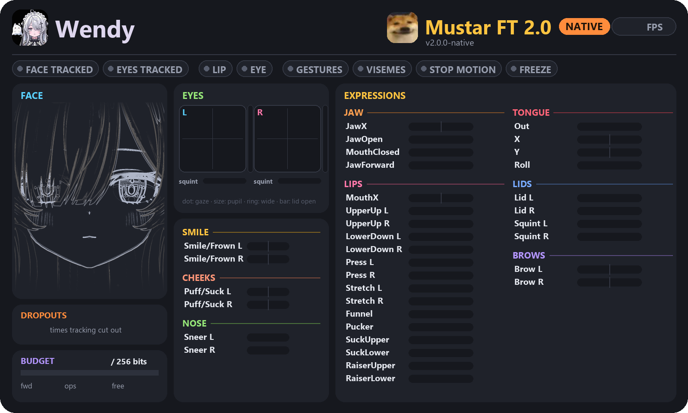
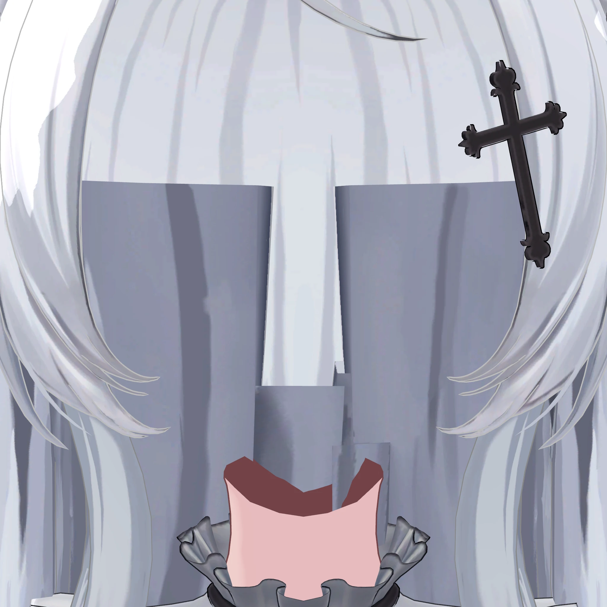
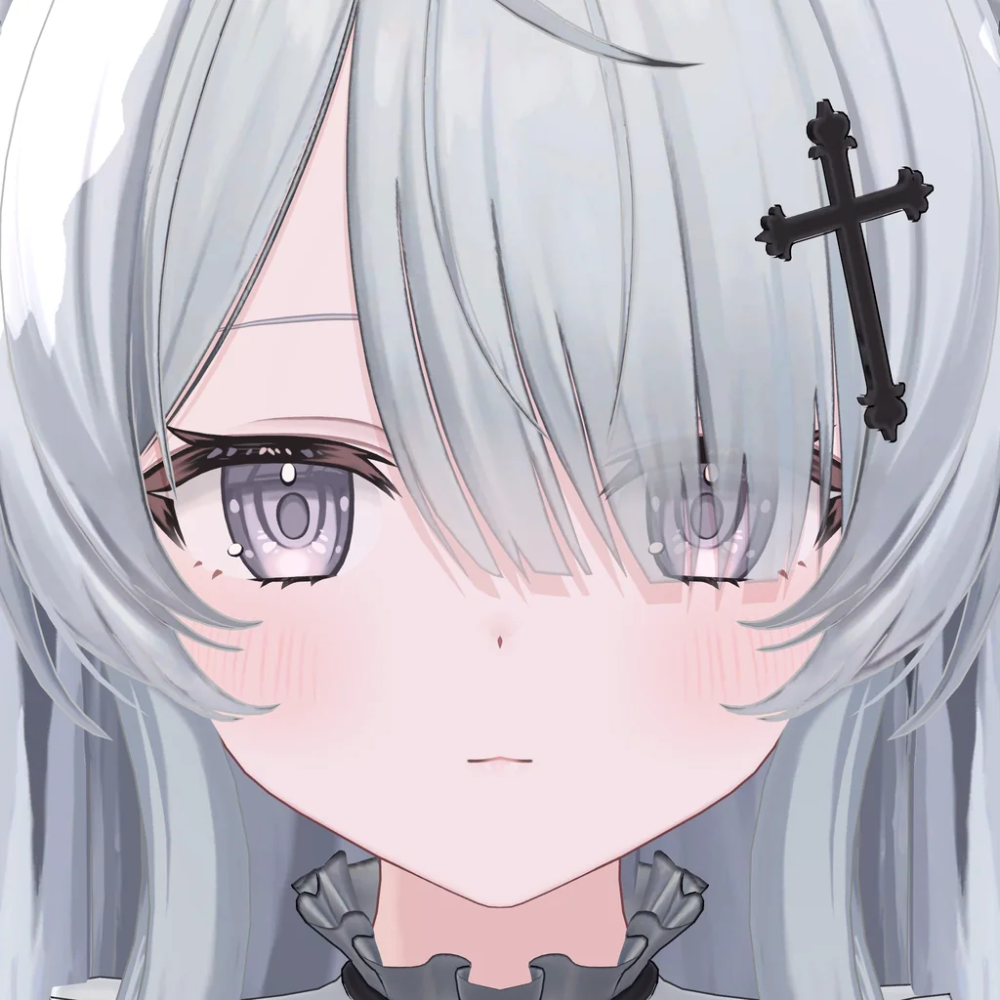
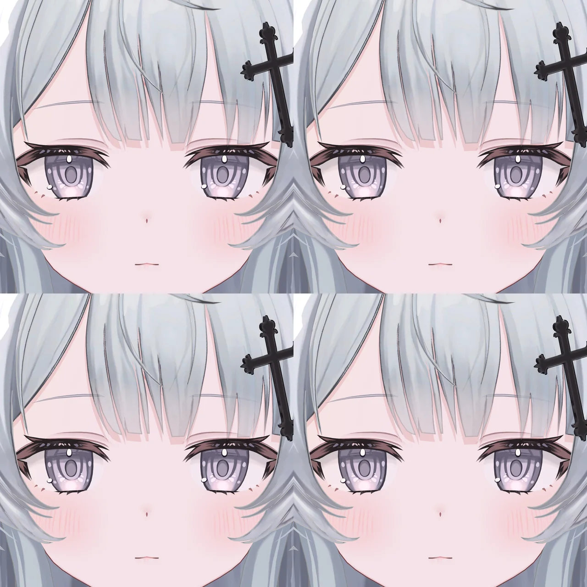
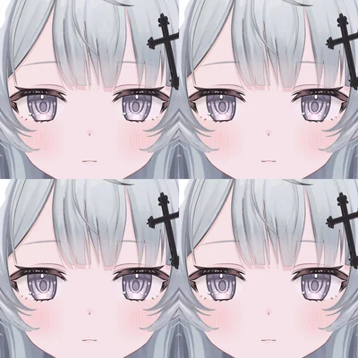
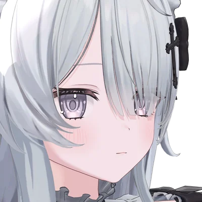
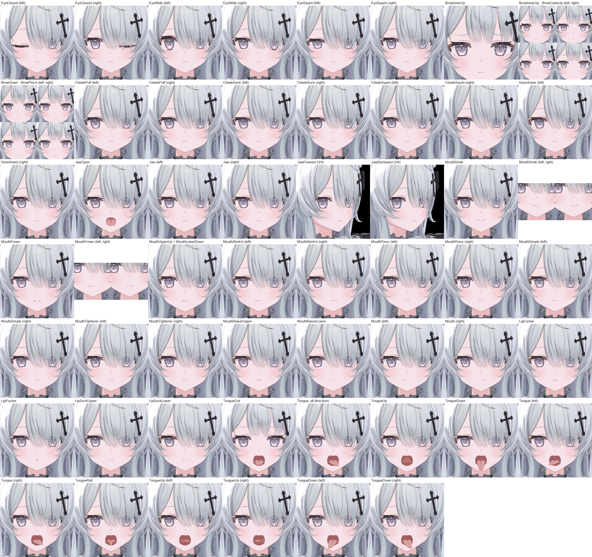
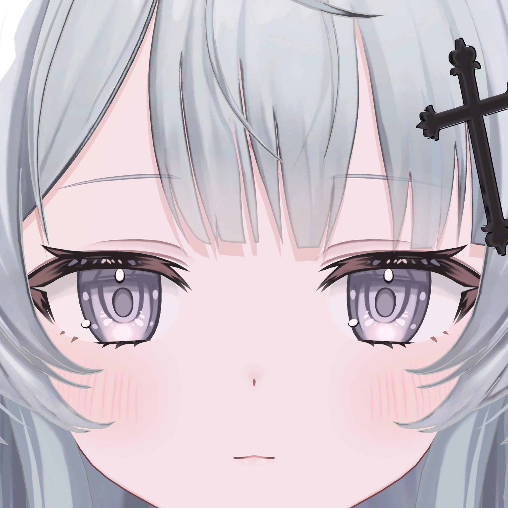
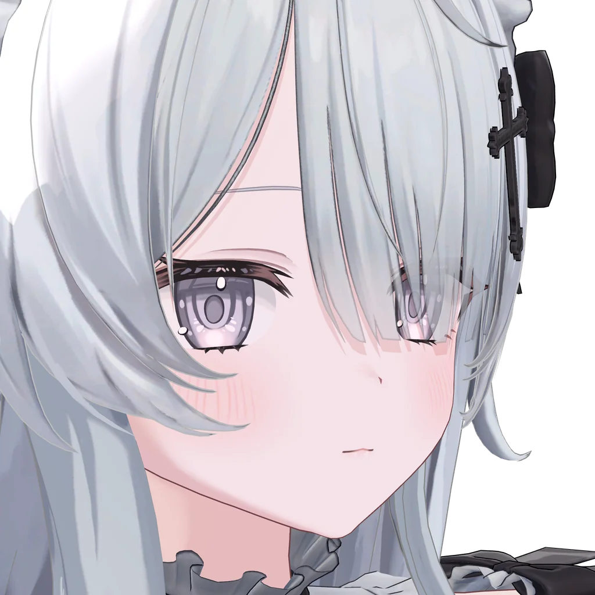
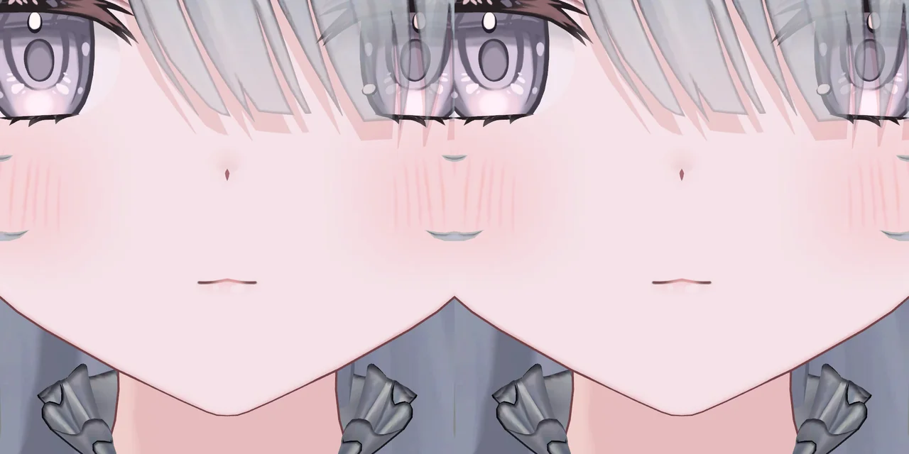

# Wendy Face Tracking v2.0.0-native

Free report. Read this before you buy: what you get, what changes on your avatar, and the numbers, explained.
Face tracking for **Wendy** by 薄暮帰路. Built by mustar.

Wendy: [Wendy by 薄暮帰路](https://booth.pm/en/items/7841391)

Demo video: [https://youtu.be/4iEUEHY-Ous](https://youtu.be/4iEUEHY-Ous)

> **Mustard Awards**
> **Wendy: 7 / 10 mustard cans.**
> How well the model behaved on the way to face tracking. Higher is better.
> Plus: good expressions of her own, and a mouth that works well.
> Minus: the animator: her pet's look-back gimmick clashed with face tracking, so it stayed out. The mouth is on the small side.

---

[日本語](#日本語) · [English](#english)

## 日本語

### 概要

- ウェンディの口、目、舌、頬、眉があなたの顔に合わせて動きます。彼女のために作ったシェイプ 73 個。
- 平面の目: 目玉は回らずに滑るので、瞳の後ろのパーツが肌から飛び出しません。外 11.7 mm、内 5.7 mm、上 15.8 mm、下 17.4 mm。
- キャンディのペットが彼女と一緒にまばたきし、同じ方向を見ます。
- ボタンひとつで導入。元のファイルには触りません。
- ウェンディ本体とフェイストラッキング機器は含まれません。

mFT はゼロから作った独自テンプレートで、より幅広いツールと豊かな表現力を求める人のための選択肢です。

### 数字とその意味

| 数字 | 意味 |
|---|---|
| 自分 +0.33 ms、他の人 +0.33 ms | 1 フレームあたりの追加負荷。重い開発環境で測った値なので上限と考えてください。彼女自身の FX は約 0.04 ms。 |
| 彼女自身 123 / 256、FT 29 (Full) または 11 (Light) | 同期パラメーターは別々に数えます。顔の動き自体は 0 bit (VRChat 本体の FT が運びます)。 |
| シェイプ 107 個 + 彼女の 491 個 | 73 個は FT 用、19 個は彼女の表情パーツの複製、15 個はビゼーム 35%。彼女のシェイプは 1 つも消しません。 |
| 舌 10 ポーズ | 出す、上下左右、斜め、丸め。舌出しは 4 段階で伸び、70% を超えると口が少し大きく開きます。 |
| パッケージ 2.1 MB | 差分データのみ。アバター本体のデータは入っていません。 |

### 中身

- ワールド内キャリブレーションと微調整ダイヤル 7 種。
- デバッグパネル: 顔、目、全表情の値をその場で表示。メニューで開閉、左手首のボタンは導入時に選べます。
- スムージング Off / 5〜30 ms、または Stop Motion。設定は見ている人にも同じに映ります。
- FT anime visemes: 声で口がパキッと切り替わり、トラッキングの口に重なります。
- フリーズ、瞳 (エミュレートまたはトラッカー)、PaperTrackerMode。
- 顔に反応する目: 目の笑顔、ジト目、視線に合わせて上下に動くまぶた。
- 彼女のために作ったニュートラルな眉の休みポーズと、眉上げ・下げ・寄せ。
- ペットのアップグレード: キャンディのゴーストが一緒にまばたきして視線を追います。Extras > Pet でオフ、インストーラーにもチェックがあります。
- 彼女の Face Emote メニューは Face Tracking > Extras に移ります。

### アバターで変わること

- 彼女のまばたきレイヤーは視線トラッキング中は止まり、切ると戻ります。
- ハンドジェスチャーの表情は最初オフです (Face Tracking > Hand Gestures で戻せます)。
- なでなで中はまばたきと目の笑顔が止まり、彼女自身の表情と重なりません。
- リップシンクはコピー側で私のレイヤーが動かします。アンインストールで元に戻ります。
- 彼女の衣装、髪、ポーズ、キャンディ、Config のメニューはそのまま使えます。

### 弱点

- ウェンディ専用。PC で確認、Quest は未検証。
- ネイティブ専用: 彼女自身のパラメーターが 123 bit あるため、従来版は入りません (合計 298 / 256)。
- キャリブレーションと Tune は保存されますが、アバターのリセットでは初期値に戻ります。
- ウェンディの更新で顔のメッシュが変わると、対応版が必要です。

### 必要なもの

ウェンディ、VRChat SDK (3.10.6 以降)、VRCFT (Steam 版、メインでもベータブランチでも可)、VRCFT (Unified Expressions) で動くフェイストラッカー。ウェンディ本体の導入は薄暮帰路さんの説明書に従ってください。

### 技術的な詳細

- 負荷の測り方: Unity 上で彼女の FX と完成した FX を比較、10 フレームの実行を繰り返した最速値 (2026-11-09)。誤差は約 15%。
- 顔のメッシュ 8,445 頂点。ウェンディのプレハブで確認。
- デルタ法線はゼロ: 彼女の顔の陰影がきれいに保たれます。
- 目: 目のボーンは各目の 500 mm 後ろの点を中心に回るので、ほぼ平面に滑ります。
- 舌のシェイプは舌だけを動かします。舌出し 70% を超えると口が開いて場所を作ります (0 bit)。

---

## English

### In short

- Wendy's mouth, eyes, tongue, cheeks and brows move with your face. 73 shapes built for her.
- Planar eyes: they slide instead of swinging, so the parts behind her irises never poke through. 11.7 mm out, 5.7 mm in, 15.8 mm up, 17.4 mm down.
- Her candy pet blinks with her and looks where she looks.
- One button to install. Your original files are never touched.
- Wendy and a face tracking device are not included.

mFT runs on my own template, written from scratch, for people who want a wider toolkit and more expressiveness.

### The numbers, and what they mean

| number | what it means |
|---|---|
| You +0.33 ms, viewers +0.33 ms | Added per frame. Measured in a heavy development project, so treat it as an upper bound. Her own FX is about 0.04 ms. |
| Her own 123 / 256, FT 29 (Full) or 11 (Light) | Synced parameters, counted apart. The face itself is 0 bits (VRChat's built-in FT carries it). |
| 107 shapes + her 491 | 73 for face tracking, 19 copies of her face parts, 15 visemes at 35%. None of hers removed. |
| 10 tongue poses | Out, up, down, sideways, diagonals, roll. Tongue out extends in 4 stages; past 70% the mouth opens a little wider. |
| Package 2.1 MB | Shape differences only, no avatar data. |

### What you get

- In-world calibration and 7 fine-tune dials.
- Debug panel: face, eyes and every expression value, live. Open it from the menu, or add a button on your left wrist in the installer.
- Smoothing Off / 5 to 30 ms, or Stop Motion. Viewers see you as you set it.
- FT anime visemes: the mouth snaps with your voice, on top of tracking.
- Freeze, pupils (emulated or tracker), PaperTrackerMode.
- Eyes that react to your face: eye smile, glare, and lids that follow your gaze up and down.
- A neutral brow rest made for her, plus brows up, down and pinch.
- Pet upgrade: the candy ghost blinks with her and follows her gaze. Extras > Pet turns it off, and the installer has a tick for it.
- Her Face Emote menu moves into Face Tracking > Extras.

### What changes on your avatar

- Her blink layer pauses while Eye Tracking is on, and comes back when it's off.
- Hand-gesture faces start off (Face Tracking > Hand Gestures brings them back).
- During headpat, blink and eye smile pause, so they never stack on her own face.
- Lip sync on the copy runs through my layer. Uninstall puts it back.
- Her outfit, hair, pose, candy and config menus keep working.

### Cons

- Wendy only. Tested on PC, Quest is untested.
- Native only: her own parameters take 123 bits, so the classic install doesn't fit (298 / 256 in total).
- Calibration and Tune are saved, but Reset Avatar puts them back to default.
- If a Wendy update changes her face mesh, an updated version is needed.

### You need

Wendy, the VRChat SDK (3.10.6 or newer), VRCFT (Steam, main or beta branch), and a face tracker that works with VRCFT (Unified Expressions). For Wendy herself, follow 薄暮帰路's manual.

### Technical details

- How cost was measured: her FX against the built one in Unity, fastest of repeated 10-frame runs (2026-11-09). Noise is about 15%.
- Face mesh 8,445 verts. Checked on the Wendy prefab.
- Zero delta normals, so her face shading stays clean.
- Eyes: each eye bone turns around a point 500 mm behind the eye, so the eyes slide almost flat.
- Tongue shapes move only the tongue; past 70% out, the mouth opens to give it room (0 bits).

---

## Debug panel

## Expressions

FT シェイプ (0 → 1 → 0)。左右は見ている人から見た向き。 FT shapes, each looping 0 → 1 → 0. Left and right are as you look at her (her own left shows on your right).

<table>
<tr><td align="center"> EyeClosed (left)</td><td align="center"> EyeWide (left)</td><td align="center"> EyeSquint (left)</td><td align="center"> BrowInnerUp · BrowOuterUp (left, right)</td></tr>
<tr><td align="center"> BrowDown · BrowPinch (left, right)</td><td align="center"> CheekPuff (left)</td><td align="center"> JawOpen</td><td align="center"> JawForward (3/4)</td></tr>
<tr><td align="center"> MouthSmile</td><td align="center"> MouthFrown (left)</td><td align="center"> MouthUpperUp + MouthLowerDown</td><td align="center"> Mouth (right)</td></tr>
<tr><td align="center"> LipPucker</td><td align="center"> LipFunnel</td><td align="center"> TongueOut</td><td align="center"> TongueUp</td></tr>
</table>

### All shapes / 全シェイプ

Eyes (6)

<table>
<tr><td align="center"> EyeClosed (left)</td><td align="center"> EyeClosed (right)</td><td align="center"> EyeWide (left)</td><td align="center"> EyeWide (right)</td></tr>
<tr><td align="center"> EyeSquint (left)</td><td align="center"> EyeSquint (right)</td></tr>
</table>

Brows (3)

<table>
<tr><td align="center"> BrowInnerUp</td><td align="center"> BrowInnerUp · BrowOuterUp (left, right)</td><td align="center"> BrowDown · BrowPinch (left, right)</td></tr>
</table>

Cheeks and nose (8)

<table>
<tr><td align="center"> CheekPuff (left)</td><td align="center"> CheekPuff (right)</td><td align="center"> CheekSuck (left)</td><td align="center"> CheekSuck (right)</td></tr>
<tr><td align="center"> CheekSquint (left)</td><td align="center"> CheekSquint (right)</td><td align="center"> NoseSneer (left)</td><td align="center"> NoseSneer (right)</td></tr>
</table>

Jaw (5)

<table>
<tr><td align="center"> JawOpen</td><td align="center"> Jaw (left)</td><td align="center"> Jaw (right)</td><td align="center"> JawForward (3/4)</td></tr>
<tr><td align="center"> JawBackward (3/4)</td></tr>
</table>

Mouth (17)

<table>
<tr><td align="center"> MouthSmile</td><td align="center"> MouthSmile (left, right)</td><td align="center"> MouthFrown (left)</td><td align="center"> MouthFrown (right)</td></tr>
<tr><td align="center"> MouthUpperUp + MouthLowerDown</td><td align="center"> MouthStretch (left)</td><td align="center"> MouthStretch (right)</td><td align="center"> MouthPress (left)</td></tr>
<tr><td align="center"> MouthPress (right)</td><td align="center"> MouthDimple (left)</td><td align="center"> MouthDimple (right)</td><td align="center"> MouthTightener (left)</td></tr>
<tr><td align="center"> MouthTightener (right)</td><td align="center"> MouthRaiserUpper</td><td align="center"> MouthRaiserLower</td><td align="center"> Mouth (left)</td></tr>
<tr><td align="center"> Mouth (right)</td></tr>
</table>

Lips (4)

<table>
<tr><td align="center"> LipFunnel</td><td align="center"> LipPucker</td><td align="center"> LipSuckUpper</td><td align="center"> LipSuckLower</td></tr>
</table>

Tongue (10)

<table>
<tr><td align="center"> TongueOut</td><td align="center"> TongueUp</td><td align="center"> TongueDown</td><td align="center"> Tongue (left)</td></tr>
<tr><td align="center"> Tongue (right)</td><td align="center"> TongueRoll</td><td align="center"> TongueUp (left)</td><td align="center"> TongueUp (right)</td></tr>
<tr><td align="center"> TongueDown (left)</td><td align="center"> TongueDown (right)</td></tr>
</table>

