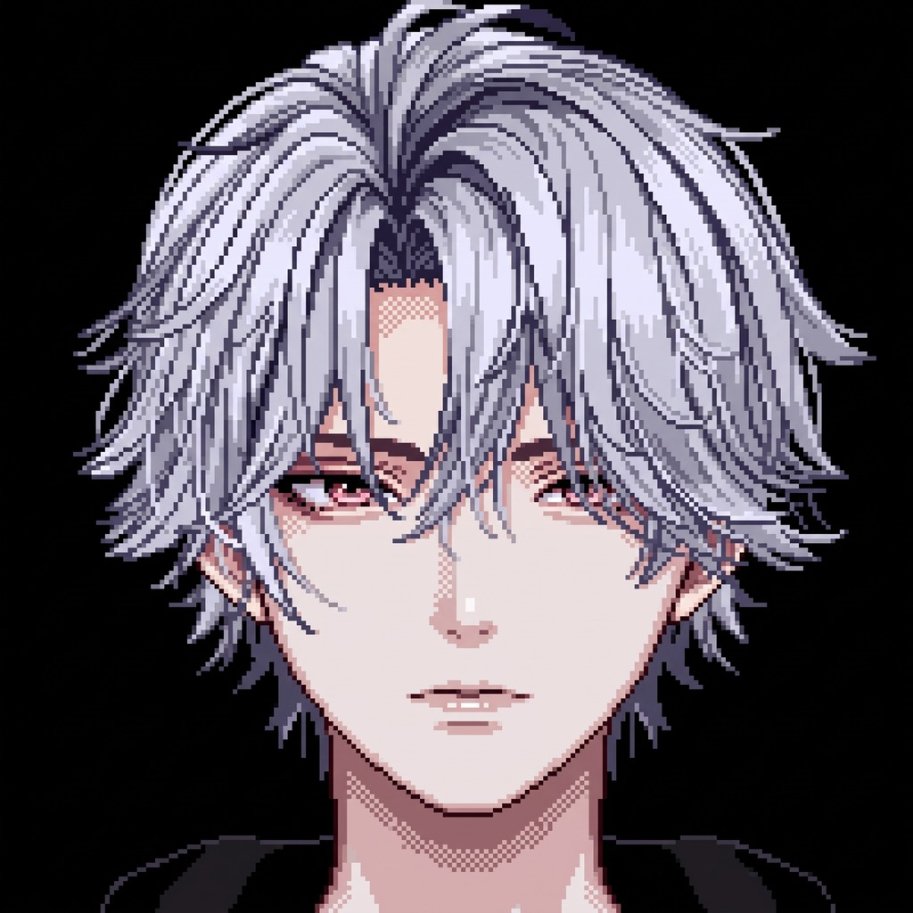
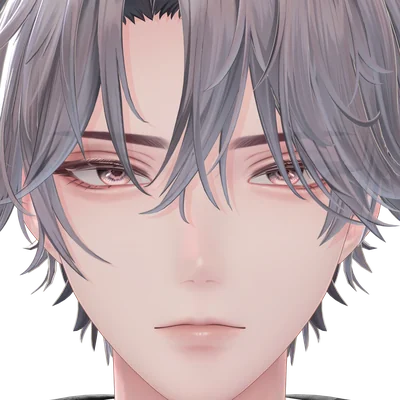
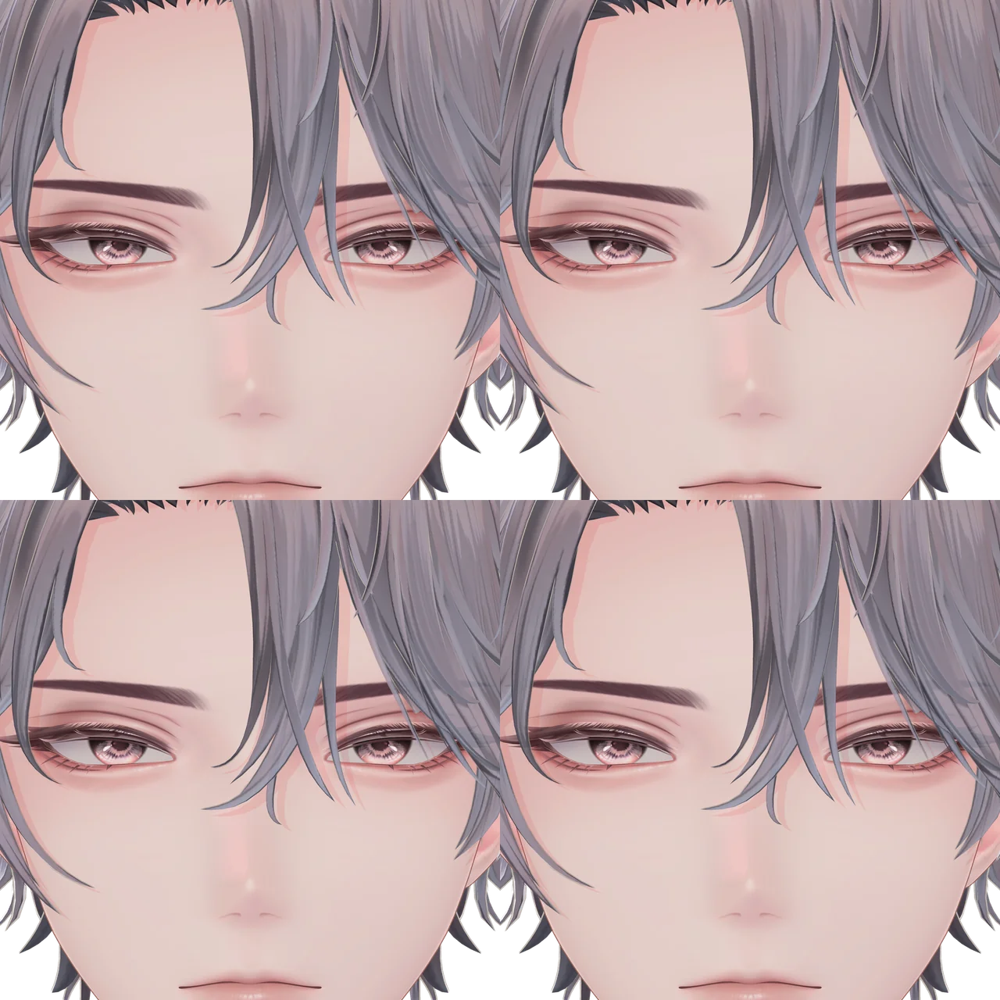
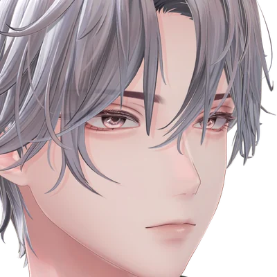
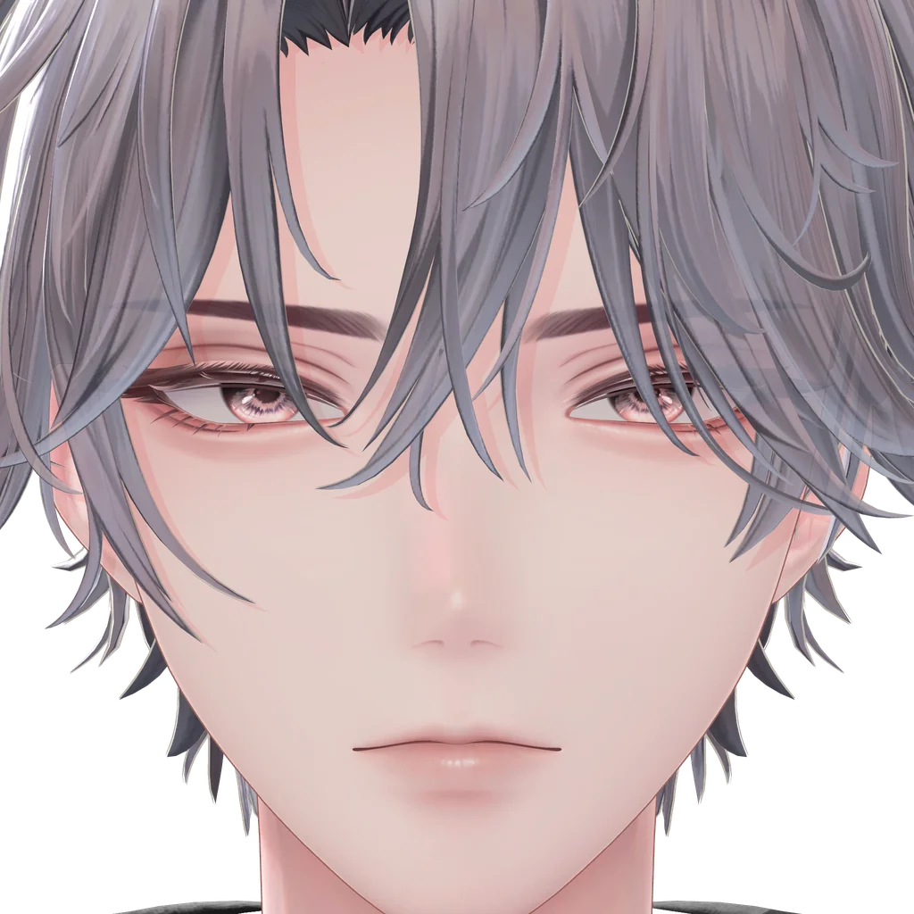
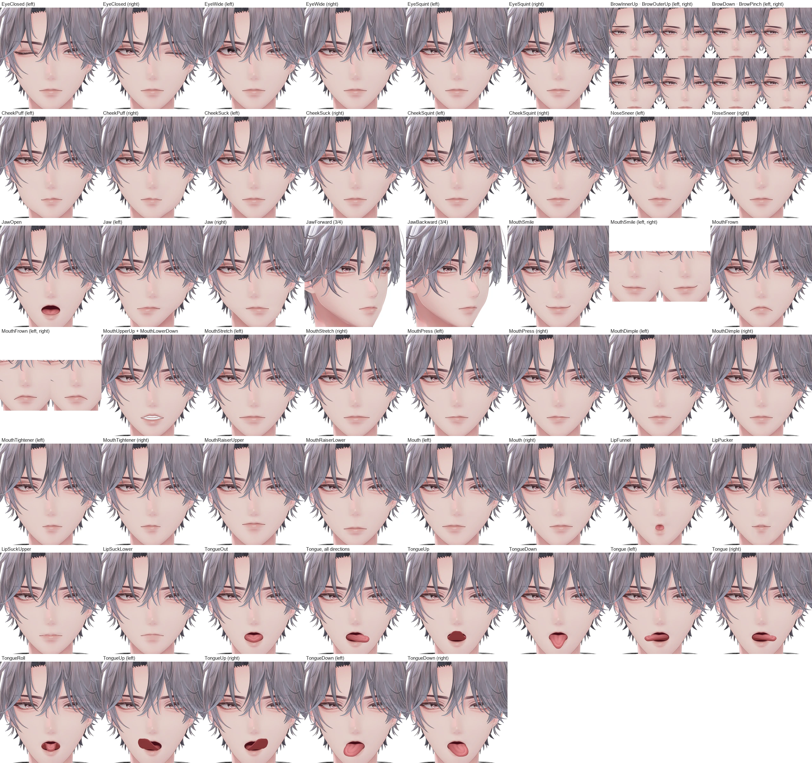
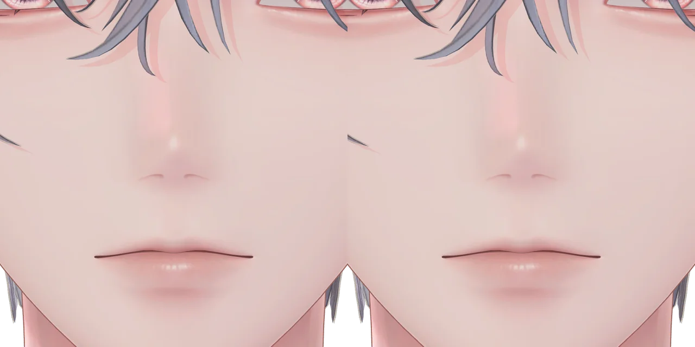
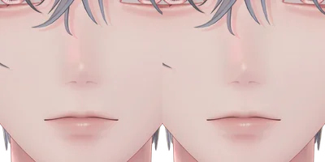
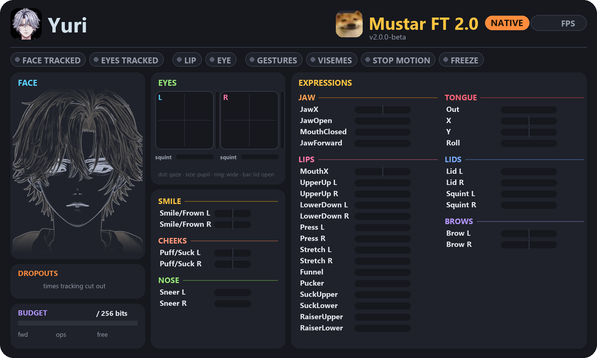

<a href="README.md">English</a> · <b>日本語</b> · <a href="README.zh.md">中文</a>

<h1 align="center">Yuri Face Tracking</h1>

mFT v2.0.0-native for <b>悠莉 - Yuri - by VISIONTOKYO</b>

<a href="https://mustarlabs.booth.pm/items/8926576">mFT on BOOTH</a> · <a href="https://visiontokyo.booth.pm/items/8670449">【オリジナル3Dモデル】悠莉-Yuri-</a> · <a href="https://youtu.be/OH4fnlD3O7s">Demo video</a>

<b>Thanks to VISIONTOKYO for the green light to make face tracking for Yuri.</b>

制作を快諾してくださった VISIONTOKYO さまに感謝します。

## Expressions

FT shapes, each looping 0 → 1 → 0. Left and right are as you look at the avatar (its own left shows on your right).  
FT シェイプ (0 → 1 → 0)。左右は見ている人から見た向き。

<table>
<tr><td align="center"> EyeClosed (left)</td><td align="center"> EyeWide (left)</td><td align="center"> EyeSquint (left)</td><td align="center"> BrowInnerUp · BrowOuterUp (left, right)</td></tr>
<tr><td align="center"> BrowDown · BrowPinch (left, right)</td><td align="center"> CheekPuff (left)</td><td align="center"> JawOpen</td><td align="center"> JawForward (3/4)</td></tr>
<tr><td align="center"> MouthSmile</td><td align="center"> MouthFrown</td><td align="center"> MouthUpperUp + MouthLowerDown</td><td align="center"> Mouth (right)</td></tr>
<tr><td align="center"> LipPucker</td><td align="center"> LipFunnel</td><td align="center"> TongueOut</td><td align="center"> Tongue, all directions</td></tr>
</table>

### All shapes / 全シェイプ

Eyes (6)

<table>
<tr><td align="center"> EyeClosed (left)</td><td align="center"> EyeClosed (right)</td><td align="center"> EyeWide (left)</td><td align="center"> EyeWide (right)</td></tr>
<tr><td align="center"> EyeSquint (left)</td><td align="center"> EyeSquint (right)</td></tr>
</table>

Brows (2)

<table>
<tr><td align="center"> BrowInnerUp · BrowOuterUp (left, right)</td><td align="center"> BrowDown · BrowPinch (left, right)</td></tr>
</table>

Cheeks and nose (8)

<table>
<tr><td align="center"> CheekPuff (left)</td><td align="center"> CheekPuff (right)</td><td align="center"> CheekSuck (left)</td><td align="center"> CheekSuck (right)</td></tr>
<tr><td align="center"> CheekSquint (left)</td><td align="center"> CheekSquint (right)</td><td align="center"> NoseSneer (left)</td><td align="center"> NoseSneer (right)</td></tr>
</table>

Jaw (5)

<table>
<tr><td align="center"> JawOpen</td><td align="center"> Jaw (left)</td><td align="center"> Jaw (right)</td><td align="center"> JawForward (3/4)</td></tr>
<tr><td align="center"> JawBackward (3/4)</td></tr>
</table>

Mouth (17)

<table>
<tr><td align="center"> MouthSmile</td><td align="center"> MouthSmile (left, right)</td><td align="center"> MouthFrown</td><td align="center"> MouthFrown (left, right)</td></tr>
<tr><td align="center"> MouthUpperUp + MouthLowerDown</td><td align="center"> MouthStretch (left)</td><td align="center"> MouthStretch (right)</td><td align="center"> MouthPress (left)</td></tr>
<tr><td align="center"> MouthPress (right)</td><td align="center"> MouthDimple (left)</td><td align="center"> MouthDimple (right)</td><td align="center"> MouthTightener (left)</td></tr>
<tr><td align="center"> MouthTightener (right)</td><td align="center"> MouthRaiserUpper</td><td align="center"> MouthRaiserLower</td><td align="center"> Mouth (left)</td></tr>
<tr><td align="center"> Mouth (right)</td></tr>
</table>

Lips (4)

<table>
<tr><td align="center"> LipFunnel</td><td align="center"> LipPucker</td><td align="center"> LipSuckUpper</td><td align="center"> LipSuckLower</td></tr>
</table>

Tongue (11)

<table>
<tr><td align="center"> TongueOut</td><td align="center"> Tongue, all directions</td><td align="center"> TongueUp</td><td align="center"> TongueDown</td></tr>
<tr><td align="center"> Tongue (left)</td><td align="center"> Tongue (right)</td><td align="center"> TongueRoll</td><td align="center"> TongueUp (left)</td></tr>
<tr><td align="center"> TongueUp (right)</td><td align="center"> TongueDown (left)</td><td align="center"> TongueDown (right)</td></tr>
</table>

## 日本語

### 概要

- 悠莉の口、目、舌、頬、眉があなたの顔に合わせて動きます。彼の顔のために造形したシェイプ 63 個と、彼のシェイプを組み合わせたミックス 12 個。
- Cold、Warm、Kisekae、Makeup の 4 種すべてで動きます。
- 導入はボタンひとつ。元のファイルには一切触れません。
- 悠莉本体とフェイストラッキング機器は含まれません。

mFT はゼロから作った独自テンプレートで、より幅広いツールと豊かな表現力を求める人のための選択肢です。

### 数字とその意味

| 数字 | 意味 |
|---|---|
| 自分 +0.33 ms、他の人 +0.30 ms (ネイティブ) | 1 フレームあたりの追加負荷。2026-11-20 にきれいなシーンで計測、上限と考えてください。従来版 (2026-10-03 計測): フルで自分 +0.61 ms / 他の人 +0.80 ms、ライトで +0.49 ms / +0.59 ms。 |
| 32 / 256 (ネイティブ)、170 / 256 (従来版フル)、145 / 256 (従来版ライト) | 同期パラメーター。ネイティブは別々に数えます: 彼自身 6 + FT 26 (フル) または 7 (ライト)。顔の動き自体は 0 bit。Kisekae の従来版: 165 / 140。エモートは 1 個 1 bit。 |
| シェイプ 94 個 + 彼の 544 個 | 造形 63、彼のシェイプのミックス 12、左右分割 4、ビゼーム 20% が 15。彼のシェイプはひとつも消しません。 |
| 舌 10 ポーズ | 上、下、左右、斜め、ロール。どれも舌を出した完成形なので、混ぜても崩れません。 |
| パッケージ 3.0 MB | 差分データのみ。アバター本体のデータは入っていません。 |

### 中身

- ワールド内キャリブレーションと微調整ダイヤル 7 種。
- デバッグパネル: 顔、目、全表情の値をその場で表示。左手首のボタンで開閉。
- スムージング Off / 5〜30 ms、または Stop Motion。見ている人にも設定どおりに映ります。
- フリーズと瞳 (エミュレートまたはトラッカー)。
- エモート 4 種 (キラキラ目、照れ、汗、どんより): 表情で発動し、それぞれメニューで ON/OFF。
- 口はどの開き具合でもきれいに閉じます: 唇が押し合わず、口角に黒い筋も出ません。
- 見ている人には目に小さな自然な揺れが見えます。0 bit。

### アバターで変わること

- 顔と目はフェイストラッキングが担当するので、彼の手動の目の操作メニューは外れます。
- ハンドジェスチャーの表情は初期オフ (メニューで ON)。
- Makeup: _FT コピーでは顔のスライダーが初期値に戻ります。元のアバターはそのまま。
- それ以外はそのままです。

### 弱点

- 悠莉専用 (Cold、Warm、Kisekae、Makeup)。 PC で確認、Quest は未検証。
- キャリブレーションと Tune は保存されますが、アバターのリセットでは初期値に戻ります。
- ヒンディー語とアラビア語はキャリブレーションパネルのみ。メニューとパッチャーは英語表示です。
- 悠莉の更新で顔のメッシュが変わると、対応版が必要です。

### 必要なもの

悠莉 (どのバージョンでも)、VRChat SDK (3.10.6 以降)、VRCFT (Steam 版、メインでもベータブランチでも可)、VRCFT (Unified Expressions) で動くフェイストラッカー。 悠莉本体 (Modular Avatar、lilToon) の導入は VISIONTOKYO さまの説明に従ってください。

### 技術的な詳細

- 負荷の測り方: Unity 上でアバター自身の FX と完成した FX を比較、10 フレームの実行を繰り返した中央値。ネイティブは 2026-11-20 にきれいなシーンで計測、その日の誤差は約 30%。
- 顔メッシュ 13,384 頂点 / 23,004 三角形。
- 目: VRChat は目のマッスルを 1 までに制限するので、コピーは専用のヒューマノイドを持ち、目の可動域と VRChat の視線角度を広げています。
- 口を閉じるシェイプは顎の開き具合で上限がかかり、法線は顎の分をぴったり打ち消すので、陰影も崩れません。
- スムージングはフレームレートに左右されず、設定は 3 bit で同期。Stop Motion はその設定値のひとつなので追加コストなし。
- ネイティブ: 式の命令 140、フェイストラッキング演算 325。

---

> **Mustard Awards**  
> **Yuri: 7.5 / 10 mustard cans.**  
> How well the model behaved on the way to face tracking. Higher is better.  
> Plus: 544 shapes to build from, and his own sparkle, blush, sweat and shadow decals, ready to become emotes.  
> Minus: his eyes barely turned out of the box, and his jaw shapes didn't close cleanly.

## デバッグパネル

