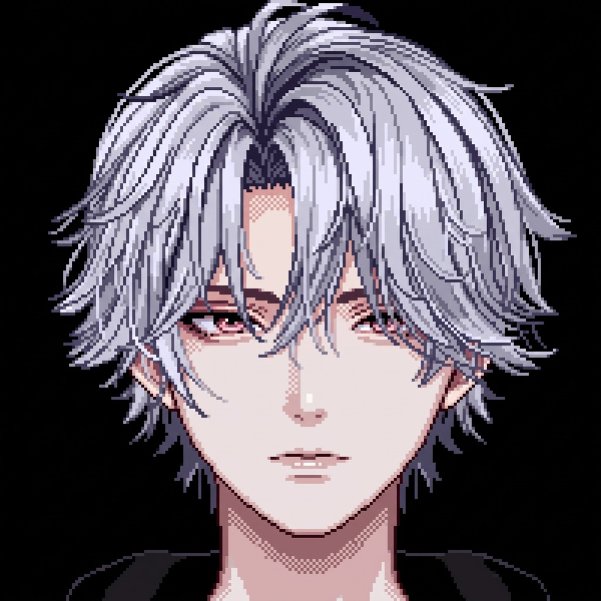
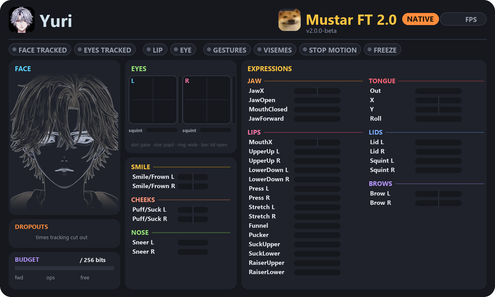

# Yuri Face Tracking v1.1 + mFT 2.0 native v2.0.0-beta

Free report. Read this before you buy: what you get, what changes on your avatar, and the numbers, explained.
Face tracking for **悠莉 - Yuri -** by VISIONTOKYO (Cold, Warm, Kisekae, Makeup). Built by mustar.

**Thanks to VISIONTOKYO for the green light to make face tracking for Yuri.**
制作を快諾してくださった VISIONTOKYO さまに感謝します。

Yuri: [【オリジナル3Dモデル】悠莉-Yuri-](https://visiontokyo.booth.pm/items/8670449) · Video: https://youtu.be/OH4fnlD3O7s

> **Mustard Awards**
> **Yuri: 7.5 / 10 mustard cans.**
> How well the model behaved on the way to face tracking. Higher is better.
> Plus: 544 shapes to build from, and his own sparkle, blush, sweat and shadow decals, ready to become emotes.
> Minus: his eyes barely turned out of the box, and his jaw shapes didn't close cleanly.

---

[日本語](#日本語) · [English](#english)

## 日本語

### mFT 2.0 ネイティブ (ベータ)

- VRChat 本体のフェイストラッキングで動く導入方法を追加。パッチャーで **mFT 2.0: VRChat native face tracking (beta)** にチェック。チェックなしは従来どおりの導入です。
- 顔の同期パラメーターは 0 bit (VRChat が自分で同期)。彼女のメニュー込みで合計 32 / 256。
- キャリブレーション、スムージングとストップモーション、フリーズ、瞳 (エミュレート / トラッカー)、ハンドジェスチャー切替はそのまま使えます。
- 新しいデバッグパネル: 顔、目、全表情の値、途切れ回数、予算をその場で表示。目の前に出て、傾きません。
- キャリブレーションと Tune は保存され、再入室・アバター切替・更新後も残ります。アバターのリセットでは初期値に戻ります。対策を開発中 (試したもの: アップロード時に値を焼き込む、VRChat から値をライブで読む)。
- 必要なもの: VRChat オープンベータ、VRChat SDK 3.10.6-beta.3 以降、VRCFT。PC で確認、Quest は未検証。
- 負荷: 式の命令 140 / 512、フェイストラッキング演算 325。

### ひとことで

- 悠莉の口、目、舌、頬、眉があなたの顔と一緒に動きます。彼の顔のために造形したシェイプ63個。
- Cold / Warm / 着せ替え / メイク の4種すべてに対応。
- 導入はボタン1回。フェイストラッキングに必要なのは VRChat SDK だけ。
- 元のファイルには一切手を加えません。
- 悠莉本体と、フェイストラッキング機器は別途必要です。

### 数値とその意味

| 数値 | 意味 |
|---|---|
| 負荷 フル +0.61 ms / ライト +0.49 ms (1フレーム) | 軽いです。同じテストで定番の Adjerry テンプレートは +0.47 ms (ルナリィで計測)。他の人から見て: フル +0.80 ms、ライト +0.59 ms、Adjerry +0.65 ms。ライトなら見ている人の負荷は Adjerry より軽いです。 |
| パラメータ 170 / 256 (フル) | VRChat のアバターは256まで。フェイストラッキングを全部入れても86空き、他のギミック用に使えます。ライトなら111空き。着せ替え版は 165 / 140 で91 / 116空き。 |
| 彼のメニュー 23 → 6 bit | 服と歩きのメニューはそのまま。手動の目操作だけ外れます (着せ替え版は 18 → 1)。 |
| シェイプ 94個 + 彼の544個 | 造形63個、彼のシェイプのミックス12個、左右分割4個、20%ビセーム15個。元のシェイプは1つも消していません。 |
| スムージング 5 ms (初期) 〜 30 ms | トラッカーの細かい揺れを抑える強さ。数字が小さいほど反応が速く、大きいほどなめらか。見ている人にもあなたの設定のまま映ります。 |
| 舌 10ポーズ | 上下左右、斜め、舌巻き。どれも舌を出した完成形なので、混ぜても崩れません。 |
| 目の揺れ 1.2° / 0 bit | 他の人から見ると、目に小さな自然な揺れ。bit を使いません。 |
| パッケージ 2.5 MB | 軽いです。 |

### できること

- ワールド内キャリブレーション: 点を目で追って表情を作るだけ。控えめな笑顔でもしっかり笑顔に。
- 表情キープ: 今の顔を固定、全員に見えます。
- デバッグパネル: トラッカーが今送っている値をその場で確認。
- エモート4種 (キラキラ目、照れ、汗、どんより): 表情で発動、それぞれメニューでON。
- 感度ダイヤル7種、左手首のボタン。
- あごの開き具合に関係なく口がきれいに閉じます。唇がめり込まず、口角に黒い影も出ません。
- キャリブパネルは10言語、パッチャーとメニューは8言語。

### アバターに加わる変更

- 視線はフェイストラッキングが担当するので、手動の目操作メニューはなくなります。
- ハンドジェスチャーの表情は初期OFF。トラッキング中の顔に重なりません。FT / フェイトラ > ハンドジェスチャー でいつでもON。
- メイク版: _FT コピーでは顔のスライダーが初期値に戻ります。元のアバターはそのまま。
- それ以外はすべてそのまま。

### 弱点

- 悠莉専用 (Cold / Warm / 着せ替え / メイク)。
- メイク版のメイク用スライダーはコピーでは使えません (トラッキングは素の顔が前提)。
- 感度ダイヤルの値はアバターのリセットで戻ります。
- ヒンディー語とアラビア語はキャリブパネルのみ、メニューとパッチャーは英語。

### 必要なもの

悠莉 (どの種類でも)、VRChat SDK、VRCFT (Unified Expressions) で動くフェイストラッキング機器。悠莉本体の必要環境 (Modular Avatar、lilToon) は VISIONTOKYO の説明に従ってください。

### 技術的な詳細

- 規格: VRCFT Unified Expressions v2、同期パラメータ39個。顔メッシュ 13,384頂点 / 23,004三角形。
- 負荷の測り方: Unity で彼のコピーを動かし、彼の FX だけの時と比べた差、表情の入力を動かした状態で。10フレームの計測を繰り返した最速値。Adjerry テンプレートも同じ回に同じ方法で (2026-10-03)。目のレイヤーが別に +0.03 ms。
- 目: VRChat は目の筋肉を1で止めるので、目の可動域と VRChat の目の角度を広げた専用のヒューマノイドをコピーに付けています。
- 口を閉じるシェイプは、あごの開きを上限に効きます。法線もあごのシェイプから正確に打ち消すので、光の当たり方も崩れません。
- スムージングはフレームレートに依存せず、選んだ設定は3 bitで同期。他の人側は届くパケットの間隔を実測して補間します。

---

## English

### mFT 2.0 native (beta)

- New install option on VRChat's own built-in face tracking: tick **mFT 2.0: VRChat native face tracking (beta)** in the patcher. Unticked = the classic install, unchanged.
- The face costs 0 synced bits (VRChat syncs it itself). Total with her menu: 32 / 256.
- Still there: calibration, smoothing + Stop Motion, Freeze, pupils (emulated or from the tracker), hand-gesture toggle.
- New debug panel: face, eyes, every expression value, dropouts and the budget, live. Spawns in front of you and stays level.
- Calibration and Tune are saved: they survive rejoining, avatar switches and updates. Reset Avatar still puts them back to default; I'm working on it (tried so far: baking the values in at upload, reading them live from VRChat).
- Needs VRChat open beta, VRChat SDK 3.10.6-beta.3 or newer, VRCFT. Tested on PC; Quest not tested.
- Cost: 140 / 512 expression instructions, 325 face-tracking ops.

### In short

- Yuri's mouth, eyes, tongue, cheeks and brows move with your face. 63 shapes sculpted for his face.
- Works on all four: Cold, Warm, Kisekae and Makeup.
- One button to install. For the face tracking, the VRChat SDK is all you need.
- Your original files are never touched.
- Yuri and a face tracking device are not included.

### The numbers, and what they mean

| number | what it means |
|---|---|
| +0.61 ms per frame (Full), +0.49 ms (Light) | Light. In the same test the popular Adjerry template adds 0.47 ms (measured on Lunary). Viewers: Full +0.80 ms, Light +0.59 ms, Adjerry +0.65 ms. On Light, viewers pay less than with Adjerry. |
| 170 / 256 parameters (Full) | VRChat caps every avatar at 256. With all of the face tracking in, 86 are left for your other gimmicks. 111 with a Light install. Kisekae: 165 / 140, so 91 / 116 left. |
| His menu: 23 → 6 bits | Clothes and walk toggles stay. Only the manual eye control goes (Kisekae: 18 → 1). |
| 94 shapes + his 544 | 63 sculpted, 12 mixes of his own shapes, 4 left/right splits, 15 visemes at 20%. None of his own shapes removed. |
| Smoothing 5 ms (default) to 30 ms | How much tracker jitter gets calmed. Lower reacts faster, higher looks smoother. Others see you exactly as you set it. |
| Tongue: 10 poses | Up, down, sideways, diagonals, roll. Each is a complete tongue-out pose, so blends never fall apart. |
| Eye flicks 1.2°, 0 bits | Viewers see tiny natural eye flicks. Costs no parameters. |
| Package 2.5 MB | Small. |

### What you get

- In-world calibration: follow the dot, make the faces. A small smile still reads as a full one.
- Freeze: holds your current face, everyone sees it.
- Debug panel: see what your tracker is sending, live.
- 4 emotes (sparkly eyes, blush, sweat drop, gloom): your face triggers them, each has its own menu toggle.
- 7 fine-tune dials, a button on your left wrist.
- The mouth closes cleanly at any jaw opening: no lips pushed into each other, no dark creases at the corners.
- Calibration panel in 10 languages, patcher and menu in 8.

### What changes on your avatar

- Face tracking takes over the eyes, so his manual eye control menu is removed.
- Hand gesture expressions start OFF, so they don't pile on top of your tracked face. Turn them on anytime: Face Tracking > Hand Gestures.
- Makeup: on the _FT copy the face sliders go back to default. The original keeps them.
- Everything else stays as it was.

### Cons

- Yuri only (Cold, Warm, Kisekae, Makeup).
- Makeup's face sliders don't carry over to the copy, tracking needs the plain face.
- Fine-tune dials reset when you reset the avatar.
- Hindi and Arabic: calibration panel only, the menu and patcher show English.

### You need

Yuri (any version), the VRChat SDK, and a face tracker that works with VRCFT (Unified Expressions). For Yuri himself (Modular Avatar, lilToon), follow VISIONTOKYO's instructions.

### Technical details

- Standard: VRCFT Unified Expressions v2, 39 synced parameters. Face mesh 13,384 verts / 23,004 tris.
- How cost was measured: a copy of him running in Unity, his own FX against the built one, with the face inputs moving. The figure is the fastest of repeated 10-frame runs. Adjerry's template measured in the same session, same way (2026-10-03). The eye layer adds +0.03 ms on its own.
- Eyes: VRChat caps eye muscles at 1, so the copy gets its own humanoid with wider eye limits and wider VRChat eye-look angles.
- The mouth-closed shape is capped by how far the jaw is open. Its normals cancel the jaw's exactly, so the lighting holds too.
- Smoothing is frame-rate exact and your preset syncs in 3 bits. Viewers glide on the measured packet interval.

---

## Debug panel

## Expressions

Previews coming soon.
